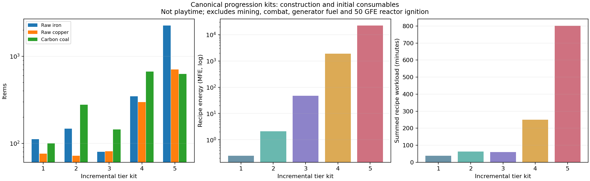

# 0.13.0 バランス調整・再評価・自己レビュー

対象: `feature/0.13.0`。変更前は`9ad0eb78`。[資材・電力・ボス評価](balance-baseline.md)と[素材ライン継続性の追補](material-continuity.md)を受けた実装。目標は探索と工場づくりを両立する中程度の難易度。バージョン番号・公開・マージは変更していない。

## 実装と判定

**最初の討伐による解禁を維持し、解禁後の増設・部品生産を工場で賄えるようにした。** 時間段階の待ちを短縮し、SMESの解禁を時間段階へ揃え、旧セルの投資も引き継げる。探査機の回収品消失・空運転も修正した。

再計算ではTier 1–3の標準セットは変わらず、Tier 4の育成待ちは60分→40分。Tier 5の追加セットは主要原料の増加を小さく抑え、育成待ちも72分→56分へ減った。冷却器・育成槽16台の増設について、既設の入口工場があればボス素材を新たに取得せず製造できる。一方、最初の研究棟・培養施設・最終施設の討伐は迂回できない。

現在のデータでは追加の循環依存や未展開の独自素材は見つからず、全装置の資材依存が到達可能。定形レシピ、保存復元、満杯、最後の触媒使用回数、下位触媒の速度、討伐素材の条件を検査した。探索距離・ボス戦を含む通しプレイは未実施で、数値評価は採掘時間や実クリア時間を保証するものではない。

## レシピと進行条件

### 1. SMESは時間系部品を使う定形クラフトへ

SMESモジュールの機械加工レシピを削除し、作業台の定形レシピへ移した。入力に時間結晶モジュールを追加し、量子素材だけでは作れなくなった。旧セルを強化する経路も**定形**。今回変更・追加した機械本体のレシピはこの2件で、配置を任意に入れ替えると成立しない。

新規製造:

```text
T · T      T = トロイダル磁気コイル
C Q C      C = 冷媒カートリッジ
· M ·      Q = 量子もつれ素子、M = 時間結晶モジュール
```

上部の磁気回路、中央の量子部、左右の冷却、下部の時間制御という配置。

旧セルの強化:

```text
Q T Q
C S C      S = 既設のSMESセル
· M ·
```

旧蓄電部を中央へ置き、磁気・量子部で強化する。単なる同名アイテムの出力ではなく、定形レシピを継承する専用シリアライザで**消費したセル1個の蓄電量を引き継ぐ**。プレビューで入力を変更せず、旧セルは返却しない。コピーするのは正規セルの容量内の電力だけで、旧ブロックの型IDや無関係なNBTを移さない。

| 初回一式・下位工場既設 | 旧モジュール | 新モジュール | 既所有セルから強化する追加材料 |
|---|---:|---:|---:|
| 粗鉄 | 10 | 16 | 12 |
| 粗銅 | 12 | 24 | 16 |
| ダイヤ | 2 | 5 | 5 |
| 加工電力 | 約6.789 MFE | 約348.665 MFE | 約347.688 MFE |

新品の時間触媒・中間部品を整数バッチで作る初回費用。余剰の時間結晶モジュール・残寿命を次の製造へ使えるため、各台の費用をこのまま台数倍しない。強化列では既所有セルの建設費を再加算していない。

容量2 GFE・入出力100 MFE/tは維持した。単純な性能低下より、時間段階の解禁条件と旧セルからの移行を整える方を選んだ。

### 発電機の素材継承の検討

前ティアの発電機を次の発電機の必須素材にする案も比較した。今回は独立した新規建設を維持する。核融合と量子熱機関では発電方式・内部の燃料や触媒が異なり、既設機を必ず撤去させるより、補助電源として残す選択肢を優先した。4 kFE/tの核融合炉も、基礎消費2 kFE/tの探査機などへ使える。

資産の継承は、同じ蓄電用途のSMESと既存配線の転用で確保した。発電機の強化経路を追加する場合も、必須化より任意の定形レシピとし、内部の液体・装填中触媒・予備・電力を失わず引き継げることを条件にする。今回の調整へ不確かな在庫変換は持ち込んでいない。

### 2. 時間結晶の待ちと設備用部品の原価

- 既定の育成時間を**12分→8分**。必要電力30 kFE/tと触媒寿命45分は維持した。
- 時間結晶モジュールは、従来と同じ30分相当の寿命・光格子基板1・鋼板2から、**1個→4個**にした。未使用45分の触媒には15分相当が残る。
- SMES25基に時間系部品を追加しても、モジュールの一括製造でTier 5全体の待ちが悪化しないようにした。
- 育成純度の条件と、寿命の2/3が足りない触媒では部品を作れない制約は維持。低純度品を無条件に新品部品へ変える経路は追加していない。

**既存ワールドの設定は上書きしない。** `timeCrystalGrowthTicks`が以前の`14400`のままなら12分になる。新しい既定値は`9600`。以下の再評価は既定値9600を使っている。

### 3. 増設用のボス部品を再構成できる

素材レシピとして精密組立台に追加した。機械本体のレシピではないため、通常の機械加工で扱う。

| 出力1個 | 主な材料 | 触媒の使用量 | 加工 |
|---|---|---|---|
| 番人の投影核 | 量子演算モジュール1、光格子基板2、隕鉄2 | BE寿命の1/12＝2.5分相当 | 60秒・20 kFE/t |
| 縮退核 | 縮退前駆体1、位相同期板2、量子演算モジュール1 | 時間寿命の1/12＝3.75分相当 | 90秒・50 kFE/t |

最初のBEにはレーザー冷却器、その冷却器には討伐産の投影核が必要。最初の時間触媒には育成槽、その育成槽には討伐産の縮退核が必要。従ってこの再構成だけでは最初の討伐を飛ばせない。解禁後は下位素材と電力を生産する方が、同じボスの再戦に代わる選択になる。

報酬在庫ゼロ・入口加工工場既設で、装置を追加16台作る比較:

| 増設対象 | 従来の戦利品経路 | 再構成経路の新規討伐素材 | 再構成込みの総加工電力 | 再構成込みの粗鉄／粗銅 |
|---|---|---:|---:|---:|
| レーザー冷却器16 | 投影核16＝通常8討伐分 | 0 | 約0.530 GFE | 98／136 |
| 時間結晶育成槽16 | 縮退核16＝通常6討伐分 | 0 | 約2.670 GFE | 126／758 |

いずれも最初の解禁用設備・討伐は別途必要。再構成経路は無料ではなく、前者はダイヤ73等、後者は丸石7,776・高圧結晶等も含む。どちらか一方へ固定せず、探索と工場生産を選べる。

### 4. 最終施設もエンディングの解禁条件に

原初の種へ**復元したアノマリー・サンプル1使用回数**を追加した。試料1個を丸ごと使うのではなく、既定4回のうち1回だけ消費する。最初のコアと種に同じ試料を使えるため、この変更のためだけに最終施設を再討伐する必要はない。

| ボスを除外する | 変更後の結果 |
|---|---|
| 研究棟 | BE主幹と投影核の再構成が開かない |
| 培養施設 | 時間主幹・SMESモジュール・縮退核の再構成が開かない |
| 最終実験施設 | P初回点火・特異点コア・原初の種が開かない |
| リヴァイアサン | 原初の種に必要な章が得られない |

海底報酬を使ってPリアクターを建てずに進む高コストの選択肢自体は残るが、最終施設討伐は省略できなくなった。ウィザーと海底素材の代替関係、ロボット施設の任意性は維持している。

## 探査機の安全性・効率

- 1任務を**同Tierの触媒で5分・1地点**にした。登録数に比例して全地点分を一度に回収する挙動をやめ、1ステーションの処理量と回収キューを一定に抑えた。下位のBEなら半速・消耗2倍で10分になる。
- 出力が満杯なら待機する。途中で満杯になった場合も、入り切らない品を搬入待ちキューへ保存し、アンロード・保存復元・移設をまたいで保持する。保留品を入れ終えるまで次の抽選をしない。稼働中に地面へ回収品を捨てない。
- 全地点が再訪待ちのときは、電力も触媒も消費しない。観測拠点1か所の場合、140分間の基礎電力消費は従来336 MFEから、実任務5分の**12 MFE**へ減る。同Tierなら寿命消費も168,000から6,000使用回数になる。触媒摩耗・電力不足・時間場の補正は別。
- 回収品はアイテム種だけでまとめず、データ成分も一致するものだけ合算する。異なる状態の品物をまとめて消さない。
- 登録時の重複確認を集合で行う。対象の走査は登録・完了・触媒Tier／自動化設定の変更時に行い、通常tickでは全登録地点を毎回走査しない。出力の再挿入も在庫変更があったときだけ再試行する。
- **シンギュラリティ・コアを装填するとTier 5扱い**になり、発見済み研究棟の自動回収を解禁する。時間触媒へ戻すと研究棟へは行けない。培養・最終・海底・ロボット施設の手動条件は残した。
- 再訪待ち・出力満杯・上位触媒が必要という表示を追加し、5言語で確認した。

任務は1地点ずつなので、登録数だけ増やして無制限に回収量を上げる方式ではなくなる。多くの地点を処理するなら複数ステーションを用意する。既存の地点ごとの再訪時刻は引き継ぐ。

## 全体の原価再評価

前回と同じ工場セット・標準ルート・整数バッチで比較。下位設備の建設、余剰の共有、燃料と加工電力の区別などの条件は[前回報告](balance-baseline.md)と同じ。副産物の銅を他工程へ振り替えない保守的な原価であり、全レシピを同時最適化した最小原価ではない。ボス部品の再構成は別シナリオとして比較し、以下の標準セットでは直接の戦利品経路を維持した。

| 追加セット | 粗鉄 変更前→後 | 粗銅 変更前→後 | 加工電力 変更前→後 | 1槽の触媒育成待ち 変更前→後 |
|---|---:|---:|---:|---:|
| Tier 1 | 112→112 | 76→76 | 0.246→0.246 MFE | — |
| Tier 2 | 147→147 | 72→72 | 2.124→2.124 MFE | — |
| Tier 3 | 80→80 | 81→81 | 47.178→47.178 MFE | — |
| Tier 4 | 347→347 | 298→298 | 2.615→1.895 GFE | 5個：60→40分 |
| Tier 5 | 2,254→2,258 | 702→704 | 23.113→22.558 GFE | 6→7個：72→56分 |

途中で使う分と備蓄分を含む触媒製造個数。種の復元・他の工程・探索・発電燃料の供給は待ち時間列に含まない。Tier 5の触媒が1個増えても、育成8分化によって合計待ちは短い。

共有在庫でTier 1から順に作る累計は、粗鉄2,930・粗銅1,205・材料用石炭1,788・丸石38,979・ダイヤ122・加工電力約24.193 GFE。P点火50 GFEや創世炉の稼働電力は別。量子発電・縮退熱炉・Pリアクターの出力そのものは変更していない。



- [全84項目の調整後原料表](balance-adjusted/all-machines.md)
- [原料CSV](balance-adjusted/raw-materials.csv) / [進行CSV](balance-adjusted/progression.csv)
- [増設・セル転用・ボス除外を含む全計算JSON](balance-adjusted/bills.json)
- [素材の継続需要・全件表](balance-adjusted/continuity-all.md) / [CSV](balance-adjusted/continuity.csv)

鋼・セラミック・回路・超伝導材・量子材の下位ラインは引き続き必要。再構成経路にも隕鉄・基板・量子演算モジュールを使うため、増設による継続需要が増えた。用途の限定された全ての部品を無理に上位原料へ組み込むことはしていない。既存の配線転用も残した。

## 自己レビューで修正した点

1. **最後の触媒使用回数で研究任務を完了すると、消費後の空スロットでTierを再判定して回収資格を失う。** そのtickの支払い前に検証したTierで任務を完了するように修正した。
2. **下位触媒の0.5倍速度を整数に丸め、1へ切り上げていた。** 任務進行を小数で保持し、半速と保存復元を検査した。旧NBTの整数進行も読み込める。
3. **育成純度の検査が旧14,400 tickの半分を固定値としていた。** 設定時間の前半だけ低電力にし、設定時間どおりの完了と寿命50%を確認する検査へ変更した。失敗条件や純度の要求は緩和していない。
4. **出力・再訪対象のキャッシュが設定変更へ追従するか。** 触媒Tierだけでなく自動化オフセットの変更も検知するようにした。
5. **GUI検査が状態アイコンだけを撮り、新しい説明文を表示していない。** 新しい3状態は実際の状態ツールチップも描画する検査にした。
6. **古い発電能力の固定値が再利用される危険。** 未参照の`GEN_CAPACITY`を削除し、実設定と炉心状態を使う評価へ寄せた。

## 検証記録

- 全体検査: 200 TPS設定で573件、進行条件の検査追加後の20 TPS設定で**全574件成功**。全結果の名前・必須件数・重複・未実行を照合。所要時間は約93.3秒／142.4秒（Gradle起動等を除く）。
- 新しい9件、既存の純度・触媒寿命・作業注文の検査を含めて通過。Mekanism専用1件も成功。
- GUI: 通常22画面＋5言語×44画面＝**242画面**を実描画。新しい探査機3状態のツールチップも表示した。PNGの寸法・黒画面・80画面のヘッダー重なり・収納枠・説明表示を検査。
- Python全37件、5言語2968キー、電力説明の整合、モデル検査を通過。
- 通常ビルドとJava 21配布物チェックを通過。検査用コードが製品JARに入らないことを確認。JARの公開・アップロードはしていない。

今回の追加GameTestは9件で、出力超過と再読込、空運転、1地点ずつの処理、研究棟の解禁、定形配置、セルの蓄電継承、最後のコア使用回数、下位触媒の小数進行、再構成と原初の種の必要素材を確認する。

再評価の再現:

```sh
bash ./gradlew --no-configuration-cache -I tools/review/balance.gradle runGameTestServer -PtestNamespace=singulo_rayleigh
python3 tools/balance_audit.py
python3 tools/balance_report.py --out-dir docs/0.13.0/balance-adjusted --report ../balance-adjustment.md
python3 tools/balance_continuity.py --out-dir docs/0.13.0/balance-adjusted --report ../balance-adjustment.md
```

前回の評価ファイルは変更前の資料として残している。新しい原料表・チャートは`balance-0.13.0-adjusted`へ分け、変更前の数値を上書きしていない。

## 文書整理と引継ぎ

発電機の必須継承は検討したうえで独立建設を維持した。古い設計・レビュー25件は[履歴の要点](../history.md)へ集約し、0.13.0で作成した報告・CSV・JSON・図は全て[版別フォルダ](README.md)へ保持した。現行のプレイヤー説明は5言語とも今回の育成・蓄電・回収・最終条件へ同期した。

入口は[docs/README.md](../README.md)と[開発ガイド](../development/README.md)。Claude向けにはルートの`CLAUDE.md`から同じ入口を案内する。移動後のローカルMarkdownリンク542件を照合し、変更前の0.13.0の計算データと図11ファイルはバイト単位で同一と確認した。過去の公開用変更履歴は、公開ワークフローの参照を維持するため版別ファイルを残した。
