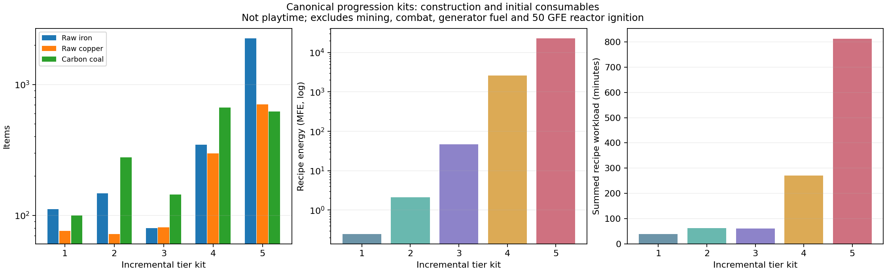
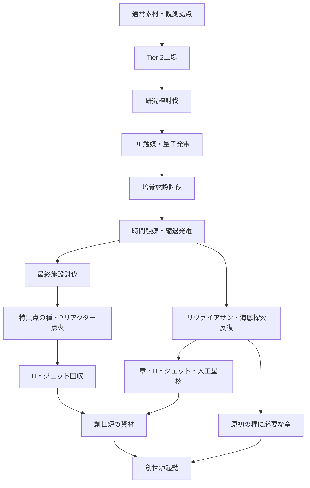
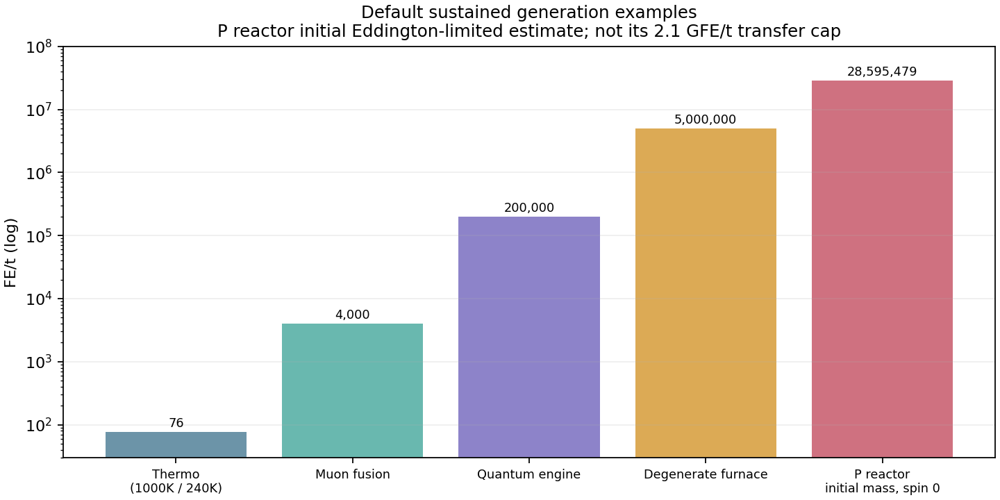

# 0.13.0 開発版 ゲームバランス評価

> 作業時点の記録。現在の変更と検証は[最新の調整報告](balance-adjustment.md)と[テスト手順](../development/testing.md)を参照。

対象: `feature/0.13.0`、コード `d00b4c4d`、Minecraft 1.21.1 / NeoForge、既定設定。評価基準は「探索と工場づくりを両立する中程度の難易度」。ゲーム内バージョン番号は変更していない。

## 判定

**主幹の進行は成立するが、現状を全体として「中程度に調整済み」とは判定しない。** Tier 1–2の建設量は比較的穏当。Tier 3は探索報酬に対して発電能力の伸びが大きく、Tier 4では時間結晶の長い育成工程と再探索が負担になる。Tier 5は圧縮素材と点火・送電設備が主な壁になる。

ボスは全ティアの全機械に一律必須ではない。量子・時間触媒への主幹には討伐が必要だが、先行して作れる周辺装置がある。また、**最終施設のボスはPリアクター初回点火には必須だが、創世炉の起動に必須ではない**。後者には海底探索を繰り返す高コストの代替経路がある。これを許容するかは設計判断が必要。

明確に修正を勧めるのは、自動探査機の出力超過による品物消失と、再訪待ち中の空運転。数値を一括で下げる前に、回収損失と無駄な消費を除く方がよい。

## 素材の継続需要に関する追補

[下位素材の量産と上位装置の材料ティアの追加評価](material-continuity.md)を作成。主要な鋼・セラミック・回路・超伝導・量子素材の依存は後半にも続く。配線には既存の転用レシピがある。一方、SMESセルにはモジュールへの転用経路がなく、モジュールは名目Tier 4でも時間系素材なしで作れるため、投資継承と解禁位置を見直す余地がある。

## 調査範囲と計算条件

- 実サーバーから**補正後の加工レシピ231件**と、Javaの設計図から**15種類・サイズの実ブロック数**を取得。生成済みクラフト・製錬レシピとバニラのレシピも読み込み、原料まで再帰展開した。
- 機能を持つ機械・発電機・輸送／収納装置などを**84項目**集計。Tier別は9 / 20 / 18 / 13 / 24項目。コントローラ単体・完成マルチブロック・拡張を分けているため、84種類の独立した機械を全部足す表ではない。通常の`MachineType`全種を含む。
- [全84項目の原料表](balance-baseline/all-machines.md)、[原料CSV](balance-baseline/raw-materials.csv)、[全内訳JSON](balance-baseline/bills.json)、[進行例CSV](balance-baseline/progression.csv)を添付。JSONには加工回数、余剰品、触媒等の消費使用回数・残使用回数も収録。
- 各装置を**初めて一式作る整数バッチ**と、端数・余剰を継続生産で使い切る**平均原価**を別に計算。個別装置の表は下位加工設備が既設という条件。下位工場の建設費は進行例で別途扱う。
- 原料の「粗鉄・粗銅」は個数であり鉱石ブロック数ではない。銅鉱石は通常でも粗銅を複数落とすため、粗鉄と同数でも同じ採掘負担ではない。幸運、鉱脈探索、建築・運搬時間は未加算。
- 標準ルートを固定し、酸素製鋼・混合圧縮のボーナス・修理再利用・上位触媒・機械アップグレードは使わない。ビスマスは粗銅8→銅6＋ビスマス1の全投入量をビスマスへ負担させ、副産物の銅を他工程へ振り替えない。**再現可能な保守的な所要量であり、全代替レシピを同時最適化した最小資材量ではない。**
- 金属圧縮の標準原料は鉄ブロック。銅ブロック等への代替は可能。水・溶岩は自然資源、青氷は採集品として数える。青氷9個を氷からクラフトする場合は氷729個相当となるため、この部分は採集方法に強く依存する。
- 設計図は再使用可能な資産として別記し、毎回消費する材料に加算しない。遺構品・ボス品・圧力結晶なども無料扱いではなく、原料表の末端として個数を示し、取得条件を別に検査する。
- 冷却塔はTier 2で高さ7、Tier 3以降は10。加速器はTier 3まで8、Tier 4以降16とし、処理時間の丸め・最低サイズを反映。進行例にはTier 4の加速器拡張も加算。液体窒素の固定必要エネルギーも維持する。
- 表のFEは**材料を加工する電力**。発電燃料、常時稼働の触媒損耗、採掘、点火、創世炉の稼働は別。かまど燃料は石炭換算で別記し、炭素材料と混同しない。最初の鋼材をバニラ製錬で立ち上げる手順は可能だが、表の加工電力は焼成炉ルートを基準とする。
- 加工時間は全レシピの仕事量の合計。かまど・複数装置の並列化や待ち時間を含む実プレイ経過時間ではない。ボス戦の強さ・遺構探索距離・各種イベントを含む通しプレイは今回未実施。

## 各ティアの建設負担

進行例は既存の`tools/recipes.py::MILESTONES`を基準にした工場一式。Tier 1は熱電8基等、Tier 2は核融合炉1基・冷却塔・加速器等、Tier 3は量子熱機関と関連設備、Tier 4は縮退熱炉・時間系一式、Tier 5はPリアクターとSMESモジュール25基等。全機械を一つずつ作るシナリオではない。

| 追加するセット | 粗鉄 | 粗銅 | 材料用石炭 | 丸石 | ダイヤ | 加工電力 | 加工仕事量 |
|---|---:|---:|---:|---:|---:|---:|---:|
| Tier 1 | 112 | 76 | 100 | 19 | 0 | 0.246 MFE | 38.5分 |
| Tier 2 | 147 | 72 | 278 | 8 | 1 | 2.124 MFE | 63.1分 |
| Tier 3 | 80 | 81 | 144 | 16 | 12 | 47.178 MFE | 60.1分 |
| Tier 4 | 347 | 298 | 666 | 56 | 27 | 2,615.447 MFE | 270.9分 |
| Tier 5 | 2,254 | 702 | 620 | 38,880 | 83 | 23,113.093 MFE | 812.9分 |

各行は下位の完成素材を在庫ゼロから作る追加セットの原価。これをそのまま足すとバッチ余剰を重複計上する。一つの共有在庫でTier 1から順番に作ると、Tier 5到達までの累計は**粗鉄2,926、粗銅1,203、材料用石炭1,780、丸石38,979、ダイヤ120、加工電力25.325 GFE**。さらにPリアクター点火50 GFE等が必要。液体・希少品・他のバニラ素材は添付表を参照。



左・中央は対数目盛。右は加工仕事量で、クリア時間の予測ではない。[SVG](balance-baseline/progression.svg)。

### Tier 1：資材量は穏当、炭素とセラミック採集が中心

熱電発電機1基の初回原料は粗鉄10・粗銅8・材料用石炭8等。焼成炉は粗鉄11、圧縮機は10。8基構成でも鉄2スタック未満であり、通常の採掘と工場導入として極端に重くない。材料用石炭100個にかまど燃料が別途必要な点は見落としやすい。

序盤のセラミックが粘土・骨系素材・ネザークォーツを要求するため、採掘だけで閉じず探索を促す構成。初回のネザー進出を前提とする難易度は、中程度の工業＋探索として許容範囲。資材を全般的に減らす根拠は薄い。

### Tier 2：完成構造でも過大ではないが、電源余裕は小さい

高さ7の冷却塔は119ブロック、原料は粗鉄65・粗銅20・材料用石炭118等。青氷9・粘土54・クォーツ27・骨27等も必要。加速器8は29ブロック、粗鉄54・粗銅22等。コントローラだけを見た安い評価にはならない。

熱電は1000 K対240 Kの例で1基76 FE/t、8基608 FE/t。核融合炉は既定4,000 FE/tなので、常設供給は合計約4,608 FE/t。核融合炉が触媒を2使用回数/t消費するため、ミュオン触媒20分ぶんが**発電では10分**になる点に注意。初期の触媒確保と液体窒素の継続運転が実際の壁になる。

極低温タービンは液体窒素製造電力の90%までを回収する蓄エネルギー用途。水素燃料電池も電解投入の60%相当の回収で、これらを独立した恒久発電として加算してはいけない。冷却塔拡張で窒素製造だけが無限増益する計算にもなっていない。

### Tier 3：資材は軽め、ボス後の電力報酬は大きい

レーザー冷却器は粗鉄6・粗銅14・ダイヤ2等にセンチネルのコア1。量子熱機関は粗鉄16・粗銅24等、加工約5.394 MFE。量子熱機関の200,000 FE/tは核融合炉の50倍で、建設資材に比べて大きい報酬。

ただし冷却・量子データ・触媒の探索依存があるため、直ちに安すぎるとは言えない。**単基の入口は維持し、増設時の探索負担を調整する**方が目標に合う。量子熱機関を安易に弱体化すると、次の長時間育成がさらに待ち時間へ偏る。

### Tier 4：最も待ち時間へ偏りやすい

完成構造の縮退圧縮炉は粗鉄79・粗銅59、C空洞105・80、縮退熱炉101・93等。構造物を含めた建設資材は増えるものの、極端な採掘壁の中心ではない。

時間結晶触媒は1個12分・432 MFEを要する。進行例の「未使用触媒4個を備蓄する」セットでは、途中で使う分も含め**5個を育成**するため、育成だけで1槽60分、種の復元工程も別にある。加工電力全体は約2.615 GFE。量子熱機関1基の理想供給なら約11分相当なので、ここでは電力より育成時間が支配する。

増設で短縮できるが、育成槽1基にボス素材の縮退核1を要求する。育成槽だけでなく封入台と特異点の種も縮退核を使うため、並列化が同じボスの再討伐へ直結する。候補は育成を12分→8〜10分へ小幅短縮するか、最初の槽を解禁した後の増設用レシピを用意すること。即時大量生産にはしない。

### Tier 5：圧縮材と電力設備の負担を明示すべき

金属原料の質量設定では**鉄ブロック1個＝質量3**。したがって金属圧縮Lv1は鉄27個、Lv2は**鉄243個相当**。インゴット9個や81個ではない。銅ブロックなども使えるため、鉄だけが必須の量ではない。

縮退物質殻1個には丸石4,860＋鉄243相当＋圧力結晶4＋液体窒素1,200 mB等が必要。Pリアクターの完成構造は殻120、ジャイロ6、安定器12で、安定器分も含めて殻ブロック132個＝殻素材6個のバッチとなる。完成炉だけで**粗鉄1,546・丸石29,160等、加工約2.421 GFE**。点火・種・蓄電設備はこの行に含めていない。

この丸石量は自動供給を前提にすれば終盤らしいが、手掘り前提なら単調。金属も銅を選べることを案内し、圧縮材の質量表示を十分見える場所に置く方がよい。現時点で一律半減する根拠はない。

## ボス討伐は必須か

全代替レシピ・上位触媒の代用・構造寸法・加工装置・鍵の作成条件を含む到達可能性を計算し、対応する戦利品と起動処理を照合した。個数・FEを無制限とした論理的な通行可否なので、通れる経路が安いとは限らない。生成済み戦利品の持ち込み、他MOD、設定変更、管理者操作は想定しない。

| 討伐対象 | 必須になる箇所 | 討伐せず可能なこと |
|---|---|---|
| 研究棟センチネル | レーザー冷却器、量子データ／冷却トラップを介したBE触媒主幹 | Tier 1–2、Tier 3の一部周辺装置 |
| 培養施設のボス | 育成槽の縮退核、培養データ／種を介した時間触媒主幹 | BEまでの進行、時間触媒不要なTier 4設備の建設 |
| 最終実験施設のボス | 特異点の種、Pリアクター初回点火、シンギュラリティ・コア | 一部Tier 5の建設、海底ルートを使う創世炉起動 |
| リヴァイアサン | 創世炉用の原初の種に必要なエルゴスフィアの章 | Pリアクター／特異点主幹（ウィザー素材経由） |
| アンドロイド施設のボス | 対応するロボット系素材の探索ルート | 通常の触媒主幹。全進行の必須ボスではない |
| ウィザー | 通常の最初のエキゾチック物質の星核ルート | 海底からエキゾチック物質等を回収すれば代替可能 |

ボスをすべて除外するとBE・時間・特異点触媒の主幹は開かない。一方で「Tier 3へ入る全機械にセンチネル」「Tier 5の全装置に最終施設討伐」という一律の壁ではない。ウィザーとリヴァイアサンを両方除外すると最初のエキゾチック物質を用意できず、それ以降の主幹も停止する。



### 最終施設を通らない創世炉ルート

原初の種は章1＋H凝縮体4＋人工星核1＋エキゾチック物質8等。レシピに特異点コアや最終施設の試料は含まれない。創世炉本体にもH等が必要だが、海底報酬で代替できる。起動処理にも最終施設討伐の進捗チェックはない。

参考シナリオとして、完成創世炉＋原初の種＋縮退熱炉20基＋新品時間触媒20個を計算した。粗鉄3,908、粗銅1,856、材料用石炭3,768、丸石24,620、ダイヤ173等、加工約15.543 GFE。**このケースは既存の加工工場・送電／蓄電・運転燃料の建設／供給を別とする**。H8・ジェット24等を要求するため、ジェット2〜3個/海底戦利品なら約8〜12回の回収が必要。安価な抜け道とは言えない。

縮退熱炉20基で100 MFE/tを供給でき、Pリアクター由来であることは要求されない。安定化イベントに対応する運転も必要なので、資材表だけで安全な完走を保証するものではない。

最終施設討伐もエンディング条件にしたいなら、**原初の種に異常試料1使用回数を追加**するのが小さな変更で済む。代替探索ルートを残したいなら変更せず、P点火と創世炉のルートが異なることを案内する。どちらが意図か未確定のためレシピは変更していない。

## 発電・起動・継続運転



[SVG](balance-baseline/generation.svg)。Pリアクターは投入上限・初期スピンから計算した持続出力の目安。燃料・触媒供給を維持できる条件。

| 段階 | 実際の壁 | 評価 |
|---|---|---|
| 熱電→核融合 | 76→4,000 FE/t、ミュオン触媒の2倍消耗 | 伸びは大きいが維持コストあり |
| 量子熱機関 | BE同Tierで200,000 FE/t。低Tier触媒なら25%出力 | ボス後の大きな報酬。下げるなら時間系も同時に検討 |
| 縮退熱炉 | 同Tierで5 MFE/t。岩石圧縮Lv2を10秒ごとに1個 | 1基あたり丸石8.1個/秒・29,160個/時相当。増設時は採石設備が重要 |
| Pリアクター点火 | 50 GFEを10秒＝250 MFE/t平均で受け渡す | 2 GFEのSMESモジュール25基は容量上の最低。配線・出力余裕を別途確保 |
| Pリアクター初期運転 | 質量500・スピン0で約28.6 MFE/t | 最大転送2.1 GFE/tを初期発電量と見なしてはいけない |
| 創世炉 | 種火1.5 TFE、安定化100 MFE/t、通常4分 | 炉心成長・スピン・蓄電・並列発電を要求する終盤課題 |

P点火用50 GFEは縮退熱炉1基なら理想8分20秒で充電できる。しかしモジュール1基の100 MFE/tという出力上限を考えると、250 MFE/tには少なくとも3経路相当が必要。容量だけ満たしても点火できるとは限らない。

創世炉を100 MFE/tで給電する例では種火12.5分＋通常安定化4分、計1.98 TFEを要する。時間場・イベント・投入停止・蓄電により実際の時間は変わる。20基の縮退熱炉でこの16.5分を連続給電する理想例でも、運転燃料は丸石160,380個相当。先の建設用丸石とは別である。これだけを推奨攻略とするのではなく、Pリアクターを育てる理由を伝えるべき。

## 繰り返し探索と大規模工場

- センチネルはコア2個/討伐。レーザー冷却器・残響共鳴器・探査機は各1個使うため、3種を揃えるだけで最低2討伐になる。冷却器16基なら8討伐。初回解禁は妥当でも、工場を拡張するたびに同じ戦闘を要求する点は中程度の難易度から外れやすい。
- 培養施設ボスの縮退核3個は、育成槽・封入台・特異点の種に各1個で、主幹1基ずつなら1討伐で足りる。育成槽16基なら6討伐。初回ゲートを残したまま、増設用に下位素材＋高めの電力で代替するレシピを検討したい。
- 観測・研究の戦利品再生7ゲーム日＝通常140分、培養・最終施設14日＝280分。新しい施設を探せば短縮できるが、既存施設を待つ遊び方では触媒補給が長く止まる。探索距離を含む実プレイで確認が必要。
- 自動探査機は1任務10分、標準2,000 FE/t。登録があるだけで運転し、全地点が再訪待ちでも停止しない。観測拠点1件・140分の再生待ちなら、基礎消費だけで336 MFEと時間触媒168,000使用回数（約3.11個分）を使う。電力は触媒の摩耗補正でさらに変わる。回収までの空運転を止めることを優先する。
- 任務完了時は再訪可能な**全登録地点**を一度に処理する。多く登録しても出力は27枠なので、回収規模が収納能力を上回りやすい。入り切らない品は保存されず、その地点の再訪時刻だけ更新される。これは報酬の調整ではなく損失を生む実装である。
- 探査機はTier 4固定、既定の自動化条件は「地点Tier≦装置Tier−2」。したがって観測拠点しか自動化できず、Tier 3の研究棟を開くTier 5探査機は存在しない。上位触媒を入れても登録判定の装置Tierは変わらない。後半で研究物資の補給を自動化したいなら、明示的なアップグレードが必要。

## 改善の優先順位

| 優先 | 内容 | 変更案 |
|---|---|---|
| P1 | 探査機の回収品消失 | 残りの品を永続化した搬入待ちキューへ保持。容量不足時は新規回収と素材消費を止め、回収抽選をやり直さない |
| P2 | 探査機の空運転 | 最短の再訪可能時刻まで待機し、待機中は電力・触媒を消費しない。表示を「再訪待ち」にする |
| P2・設計 | 研究棟の自動補給が開かない | Tier 5拡張を作る、または特異点到達後に研究棟のみ解禁する。培養・最終・海底の手動ルールは維持可能 |
| P2・設計 | ボス素材が増設台数に比例する | 初回ボス素材による解禁を残し、増設用の複製／代替部品を電力と通常素材で製造可能にする |
| P2・設計 | 時間結晶の直列待ち | 12分→8〜10分の小幅短縮か、育成槽の増設負担緩和。両方を一度に大きく緩和しない |
| 要判断 | 最終施設を通らないエンディング | 代替ルートとして維持するか、原初の種に試料1使用回数を要求するか決める |
| P3 | 原料と電力の認識差 | 圧縮質量、銅等の代替、発電上限と実出力、点火用送電経路を攻略本／JEIで補足 |
| P3 | 解析用の古い発電能力定数 | `tools/recipes.py::GEN_CAPACITY`の核融合5,000・縮退20 M・P初期2.1 Gという固定想定を廃止／実設定に合わせる。今回の計算では使用していない |

数値調整は全般的な材料削減より、待ち時間と同じボスの繰り返しを減らす方向を勧める。量子発電が強いことだけを理由に下げると、時間段階の長さが悪化する。

## 根拠と再現

主要な根拠（評価時点の固定リンク）:

- [実機の加工装置とティア](https://github.com/GenichiMaruo/Singulo/blob/d00b4c4d/src/main/java/io/github/genichimaruo/singulo/machine/MachineType.java#L7)
- [冷却塔の速度補正](https://github.com/GenichiMaruo/Singulo/blob/d00b4c4d/src/main/java/io/github/genichimaruo/singulo/multiblock/CoolingTowerControllerBlockEntity.java#L60)
- [P炉の効率・投入上限](https://github.com/GenichiMaruo/Singulo/blob/d00b4c4d/src/main/java/io/github/genichimaruo/singulo/reactor/PenroseReactorBlockEntity.java#L220)
- [創世炉の供給条件と安定化処理](https://github.com/GenichiMaruo/Singulo/blob/d00b4c4d/src/main/java/io/github/genichimaruo/singulo/genesis/GenesisCoreBlockEntity.java#L308)
- [原初の種の実レシピ](https://github.com/GenichiMaruo/Singulo/blob/d00b4c4d/src/generated/resources/data/singulo/recipe/singularity_encapsulator/primordial_seed.json)
- [探査機の運転条件と回収処理](https://github.com/GenichiMaruo/Singulo/blob/d00b4c4d/src/main/java/io/github/genichimaruo/singulo/machine/ProbeStationBlockEntity.java#L102)
- [探査機の登録条件](https://github.com/GenichiMaruo/Singulo/blob/d00b4c4d/src/main/java/io/github/genichimaruo/singulo/ruin/RuinDiscovery.java#L40)
- [既定設定の定義](https://github.com/GenichiMaruo/Singulo/blob/d00b4c4d/tools/config_spec.py)

Java 21・Python 3で以下を実行。最初の処理は開発専用ソースを付加して実データを取得する。通常ビルドのソースには加えない。描画のみ`matplotlib`が必要。

```sh
bash ./gradlew --no-configuration-cache -I tools/review/balance.gradle runGameTestServer -PtestNamespace=singulo_rayleigh
python3 tools/balance_audit.py
python3 tools/balance_report.py
python3 -m unittest discover -s tools -p 'test_*.py'
```

サーバーの既存設定を持ち込まず既定値で実行すること。バニラのリソースJARを自動検出できない場合は`balance_audit.py --vanilla-jar PATH`を指定する。再生産に必要な実データは`build/balance/runtime.json`、集計は`build/balance/results.json`に出る。

今回の取得では照明用GameTest 9件を通過。解析用テストは整数バッチの余剰利用・分数原価・金属質量・触媒寿命の共有・循環検出・窒素の固定エネルギー・加速器サイズの7件を追加し、Python全37件が成功した。全84項目で未展開の独自素材・タグは0、ボスを除外しない条件では全項目の資材依存が到達可能になった。

この判定は資材・電力・ゲートの机上／実データ検証。ボスを含む通しプレイや探査機の満杯回収のゲーム内再現は未実施。後者の消失・空運転はコード上で確認した未修正事項として`issue.md`にも記録した。通常ビルドも成功し、製品JARに調査用ハーネスが含まれないことを確認した。今回、ゲーム本体やレシピの値は変更していない。
