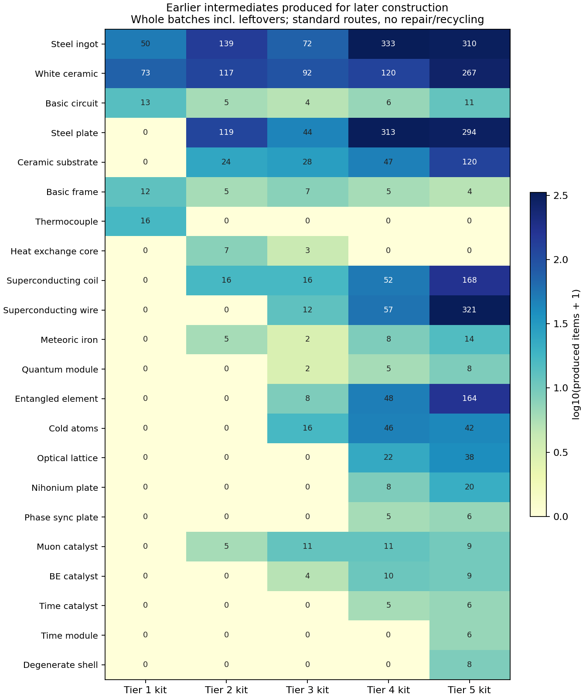
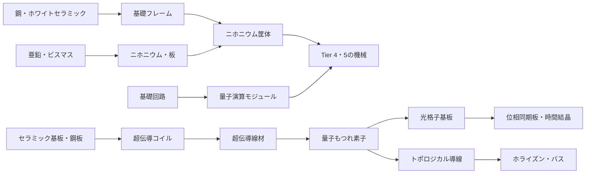

# 0.13.0 追補：素材量産ラインの継続需要とティアの整合性

> 作業時点の記録。現在の変更と検証は[最新の調整報告](balance-adjustment.md)と[テスト手順](../development/testing.md)を参照。

対象: `feature/0.13.0`、`9640c988`。前回評価後、ゲーム本体の変更がないことを確認して同じ実効レシピを使用。[前回の資材・電力・ボス評価](balance-baseline.md)の追補。

## 結論

**主要な下位素材の量産が、次のティアで一斉に無駄になる構造ではない。** 鋼・セラミック・回路・超伝導材・量子素材は、Tier 4–5でも直接または部品を介して消費される。とくに超伝導線材と量子もつれ素子は、後半ほど標準進行セットの製造量が増えている。触媒の製造にも下位触媒と量子素材の継続需要がある。

ただし、全ての下位部品が最後まで必要になるわけではない。熱電対モジュールと熱交換コアは用途が限定され、大規模な専用量産ラインを作っても標準進行だけでは使い切れない。旧設備では**SMESセルの転用経路がなく、上位モジュールの性能に対して建設原価の増加も小さい**点が目立つ。

また、上位装置に一段下の素材しか使わない例は多数あるが、入口装置として必要な設計も多い。装置の名目Tier、材料のTier、ボスによる解禁、運転時の条件を分ける必要がある。最優先で見直すなら、主幹の部品全体ではなくSMESの投資継承と解禁位置を勧める。

## 調査方法

- 通常の機械・発電・収納・輸送・補助装置84項目と、主要触媒・縮退物質殻・原初の種の製造経路から、関係する**素材・専用部品120項目**を抽出した。
- 実効レシピを再帰展開し、完成装置だけでなく、その外装・コントローラ・中間部品の材料まで調べた。「Tier 5外殻」という名前の部品を使うだけで、Tier 5素材を使っているとは判定しない。
- [全120項目の消費先件数・全84装置の確認表](balance-baseline/continuity-all.md)、[CSV](balance-baseline/continuity.csv)、[装置別依存・消費先IDのJSON](balance-baseline/continuity.json)を添付。
- 全件表の「消費先件数」は標準レシピの再帰依存であり、消費台数や実プレイの使用頻度ではない。コントローラ単体と完成構造の双方を含むため、合計して生産数にしない。
- 数量表は前回と同じ段階別の追加工場セットを使い、整数バッチの製造量を集計。余剰品を含む。各Tierのセットは独立計算で、鉱石最小化・修理・戦利品・触媒リサイクルで下位生産を減らす経路は基準にしない。
- Tierはレシピ設計上の区分。JSONの`stage`や部品名の数字が、そのまま独立した解禁条件になるわけではない。今回の全件表だけで到達可否を決めず、前回のボス除外計算・実際の加工装置・運転条件を照合した。

## 下位素材はどれだけ使い続けるか

次の値は、各段階の工場セットを追加するときに必要な中間素材の**製造量**。全機械を1台ずつ作る量ではない。例としてTier 5セットはPリアクター、SMESモジュール25基、ホライズン・バス16本、関連設備・触媒などを含む。SMES用超伝導材など、構成台数による偏りがある。

| 素材・部品 | 名目Tier | T1追加セット | T2 | T3 | T4 | T5 |
|---|---:|---:|---:|---:|---:|---:|
| 鋼鉄インゴット | 1 | 50 | 139 | 72 | 333 | 310 |
| ホワイトセラミック複合材 | 1 | 73 | 117 | 92 | 120 | 267 |
| 基礎回路 | 1 | 13 | 5 | 4 | 6 | 11 |
| 鋼板 | 1 | 0 | 119 | 44 | 313 | 294 |
| セラミック基板 | 1 | 0 | 24 | 28 | 47 | 120 |
| 基礎フレーム | 1 | 12 | 5 | 7 | 5 | 4 |
| 熱電対モジュール | 1 | 16 | 0 | 0 | 0 | 0 |
| 熱交換コア | 2 | 0 | 7 | 3 | 0 | 0 |
| 超伝導コイル | 2 | 0 | 16 | 16 | 52 | 168 |
| 超伝導線材 | 2 | 0 | 0 | 12 | 57 | 321 |
| 隕鉄インゴット | 2 | 0 | 5 | 2 | 8 | 14 |
| ビスマスインゴット | 2 | 0 | 0 | 0 | 16 | 40 |
| 量子演算モジュール | 3 | 0 | 0 | 2 | 5 | 8 |
| 量子もつれ素子 | 3 | 0 | 0 | 8 | 48 | 164 |
| 冷却原子 | 3 | 0 | 0 | 16 | 46 | 42 |
| 光格子基板 | 3 | 0 | 0 | 0 | 22 | 38 |
| ニホニウム板 | 3 | 0 | 0 | 0 | 8 | 20 |
| 位相同期板 | 4 | 0 | 0 | 0 | 5 | 6 |
| 時間結晶モジュール | 4 | 0 | 0 | 0 | 0 | 6 |

0は「その追加セットでは作らない」であり、レシピが存在しない／用途が皆無という意味ではない。例えば衝撃発電パネルは熱電対を使うが、この標準セットに含めていない。



色は`log10(製造数+1)`、数値は実個数。[SVG](balance-baseline/continuity.svg)。

気体・冷媒も継続需要がある。以下は同じセットの製造量で、単位はmB。窒素は一度作った塔を動かして生産し続けるため、冷却塔の建材自体の追加需要とは別になる。

| 中間流体 | T2 | T3 | T4 | T5 |
|---|---:|---:|---:|---:|
| 水素 | 600 | 1,200 | 1,200 | 1,000 |
| 液体窒素 | 500 | 700 | 1,700 | 18,300 |
| 液体ヘリウム | 0 | 300 | 600 | 500 |
| アクシオン凝縮体 | 0 | 0 | 100 | 300 |

### 主要な接続経路



- **回路の継承はある。** 量子演算モジュールは基礎回路1＋量子もつれ素子4＋冷媒カートリッジ1。高級回路が完全に別原料へ切り替わる構造ではない。
- **筐体の継承もある。** ニホニウム筐体は基礎フレーム1＋ニホニウム板2＋超伝導線材2。基礎フレーム用の鋼・セラミック生産を維持する理由になる。
- **基板は間接的にもつながる。** 光格子基板はセラミック基板を直接使わないが、量子もつれ素子→超伝導線材→コイルの経路でセラミック基板を使う。名前だけを比べて「旧基板が不要」とは判定できない。
- **亜鉛・ビスマスも終盤につながる。** ニホニウム製造に各1、インゴットにニホニウム2を使う。ニホニウムを使う筐体・板を増やすほど初期化学素材の需要も増える。
- **隕鉄は狭いが上位用途がある。** 加速器の収束磁石、C空洞の磁気シールド、Pリアクターのジャイロ駆動部などへ入る。標準Tier 5セットでも14個使う。大量の主材ではなく磁性部品としての位置づけで、未使用ではない。

## 建設後の消耗品にも下位素材が必要か

ある。建設のたびにだけ下位素材が必要で、触媒は完全に別系統へ移る構造ではない。

| 上位の製造物 | 下位から受け継ぐ直接投入 |
|---|---|
| BE凝縮触媒 | ミュオン触媒または失活ミュオン触媒1、超伝導線材2、冷却原子4、液体窒素・液体ヘリウム |
| 時間結晶触媒 | BE触媒36,000使用回数、量子もつれ素子2、位相同期板1、残響の欠片1、時間結晶の種1使用回数 |
| 位相同期板 | 冷却原子1、光格子基板1、アメジスト2 |
| シンギュラリティ・コア | 時間触媒54,000使用回数、縮退物質殻1、エキゾチック物質2、H4、星核1、試料1使用回数 |

修理・逆方向リサイクルを使わない平均製造原価では、時間結晶触媒1個につき、種の初回復元分も割り当てて**BE触媒1.125個、ミュオン触媒1.125個、冷却原子5.5個、超伝導線材3.5625個相当**を製造する。整数1個の初回原料表とは違い、余剰・部品寿命を使い切る平均である。

失活ミュオンをBE原料にする経路や、上位の使用済み触媒4個から下位へ戻すレシピがあるため、すべてを新品生産で賄う必要はない。それでも量子素子・冷却原子・基板などの需要は残る。リサイクルで一部の旧ラインが休止することは、回収の報酬として自然。

一方、Pリアクターの発電燃料は質量系であり、既設の工場を拡張せず発電だけ続ければ、鋼板・量子演算モジュール等が常に減るわけではない。**「上位化で用途がなくなる」と「設備完成後に建設部品のラインが待機する」は別**である。後者を防ぐためだけに人工的な常時消耗を追加する必要はない。

## 本当に需要が先細るもの

| 対象 | 確認できた用途 | 評価 |
|---|---|---|
| 熱電対モジュール | 熱電発電機、ペルチェ冷却器、衝撃発電パネル | 後半の主幹素材にならず、大量備蓄の回収は弱い。用途限定部品としては成立 |
| 熱交換コア | 冷却塔・その拡張、極低温タービン | 増築需要はあるが、冷媒生産量に比例して消費しない。初期構築中心で、常設の大量生産は不要 |
| 冷却塔・加速器・各炉の専用外装・窓 | 該当設備の建設／増設 | 専用部品なので次ティアの原料にならなくても自然。全機種の外装を鎖状に継承すると、むしろ不要な工程が増える |
| SMESセル | 小型蓄電としての設置 | レシピ材料としての消費先なし。上位モジュールへの転用もなく、早い段階の大量投資が残りにくい |

熱電対などに用途を足すなら、関連性のある少量に留める。例えば縮退熱炉の制御部へ温度監視用として熱電対1個を使う案は、1台につき鉄2・銅2・レッドストーン1相当の追加で済む。ただし需要は機械台数に比例するだけで、これを足しても熱電対の大工場が必要になるわけではない。

## 配線の投資は既に引き継げる

基準レシピに旧配線が書かれていなくても、代替レシピがある。

| 旧資産 | 実在する転用経路 | 判定 |
|---|---|---|
| 銅導線4 | ＋超伝導線材1→超伝導ケーブル4 | 既設配線を上位配線へ転用できる |
| 銅導線8 | 焼成炉→銅インゴット2 | 元の銅3個から全量は戻らないが、余剰を回収できる |
| 超伝導ケーブル16 | ＋量子もつれ素子1→トポロジカル導線8 | 数は半分になるが、旧配線を活用できる |
| トポロジカル導線4 | ＋エキゾチック物質1＋ニホニウム板1→ホライズン・バス8 | 基準ルート自体が下位配線を継承する |

従って配線について「上位が下位を使わず、旧ラインと在庫が全部無駄」という指摘は当たらない。既存の転用レシピを攻略情報で見つけやすくする方が先。

## 上位装置なのに下位素材しか使わない例

### 正常な入口・補助装置

- **量子もつれ合成器・レーザー冷却器**はTier 3だが、構築は主にTier 1–2素材。ここで量子もつれ素子・冷却原子を要求すると、自分の出力が自分の建設に必要になる。冷却器にはボス品もあり、下位素材主体だから無条件に安すぎるわけではない。
- **時間結晶育成槽**がBEとTier 3素材で作れるのも同じ。自分でしか作れない時間結晶モジュールを追加してはいけない。縮退核の討伐条件もある。
- **C空洞・縮退圧縮炉**はTier 4だが、主要な制御部はTier 3素材とBE。最初のエキゾチック物質や縮退物質殻を生産する入口として自然。
- **重力パネル・受電器**はTier 3区分でも主にTier 2以下。補助機能を低コストにする選択として許容でき、全てに量子演算モジュールを付ける必要はない。
- **Pリアクター等のTier 5機械**が時間結晶モジュール・縮退物質殻・エキゾチック物質などTier 4素材中心なのも通常の段階進行。最初の炉や封入台の建設へ、そこで初めて得るシンギュラリティ・コアを追加すると循環する。炉は建設と別に種・点火電力が必要。
- **ジェット・コレクター**はTier 5区分なのに内包する汎用素材がTier 3までで、時間結晶・エキゾチック物質も使わない。ただし単独設置でジェットを得る装置ではなく、稼働するPリアクターへ装填して初めて回収する部品。上位炉の建設・点火条件を飛ばす経路ではない。
- **不安定なワームホールの口**は生成時に物質投入がないが、完成した生成器と100 MFE/tを10秒続けて供給する条件がある。生成器の建設を無視して「原料ゼロのTier 5装置」と判定してはいけない。

### 要検討：SMESモジュールの解禁位置と旧セル

| 項目 | SMESセル | SMESモジュール |
|---|---:|---:|
| 名目Tier | 2 | 4 |
| 容量 | 10 MFE | 2,000 MFE（200倍） |
| 入出力上限 | 100 kFE/t | 100 MFE/t（1,000倍） |
| 初回粗鉄 | 10 | 10 |
| 初回粗銅 | 12 | 12 |
| 初回材料用石炭 | 20 | 20 |
| 初回ダイヤ | 0 | 2 |
| 初回加工電力 | 約0.229 MFE | 約6.789 MFE |

両方とも下位工場は既設、整数バッチの原価。モジュールには追加の量子素材・データ・加工電力があり、完全な同コストではない。しかし主要な採掘資源の増加に対して性能差は大きい。

モジュールの直接材料はトロイダル磁気コイル2＋量子もつれ素子1＋冷媒カートリッジ2。コイルはトポロジカル導線から作れ、その導線も量子もつれ素子＋超伝導線材。**時間結晶・ニホニウム・培養施設討伐を必要とせず、研究棟後の量子素材で製造可能**。前回のボス除外計算でも培養施設ボスを除外して製造可能だった。名目Tier 4ほど遅い解禁ではない。

このため、量子に入るまでセルを少数使い、その後モジュールへ飛ぶ方が効率的。旧セルの容量用途自体は残るが、蓄電量を目的に大量生産したセルの価値が大きく下がる。

勧める順序は以下。

1. **セルを使う任意のアップグレードレシピを追加する。** 例：セル1＋トロイダル磁気コイル1＋量子もつれ素子1＋冷媒カートリッジ2→モジュール1。新規製造ルートは残し、既設セルはコイル1個分の投入を代替できる形にする。無損失で全材料を返す必要はない。
2. 名目Tier 4の意味を決める。量子段階の大型蓄電を意図するなら、攻略上もその位置づけに揃える。時間段階に厳密に置きたいなら、時間結晶モジュール等の**本当に時間系を経由する材料**を要求する。ただし前回指摘した育成待ちが増えるため、同時に負担を再計算する。
3. 数字のTierだけを揃える目的で「位相同期板」を足しても、同じ量子素材から作れるため培養施設へのゲートにはならない。表示上のTierと実依存を混同しない。

アップグレードを実装する場合、充電済みセルのエネルギーを引き継ぐのか空にするのかを決め、充電量の複製や素材増殖が起きないように検証する必要がある。今回レシピは変更していない。

## 改善の判断

| 優先 | 対応 | 理由 |
|---|---|---|
| P2・設計 | SMESセルの任意転用レシピ | 実際に旧設備の回収経路が欠けている部分へ絞って改善できる |
| P2・設計 | SMESモジュールの解禁・性能と原価を再検討 | 名目Tier 4に対して量子段階で製造でき、旧セルとの性能差が大きい |
| P3 | 配線転用レシピと部品の必要規模を攻略情報へ記載 | 配線は既に再利用可能。熱電対・熱交換コアは過剰量産を勧めない |
| 任意 | 関連する制御部へ熱電対などを少量追加 | 用途を広げる案。主幹全体の必須修正ではない |
| 維持推奨 | 回路・筐体・超伝導・量子・触媒の既存依存 | 下位量産ラインを活用する接続が既にある |
| 避ける | 全ての上位設備にそのティア自身の出力を要求 | 入口の循環依存や無意味な組立工程を生みやすい |

## 根拠と再現

コード参照は前回評価時点から変わっていない実装へ固定している。

- [量子演算モジュール](https://github.com/GenichiMaruo/Singulo/blob/d00b4c4d/src/generated/resources/data/singulo/recipe/precision_assembler/quantum_computing_module.json)、[ニホニウム筐体](https://github.com/GenichiMaruo/Singulo/blob/d00b4c4d/src/generated/resources/data/singulo/recipe/precision_assembler/nihonium_frame.json)
- [時間結晶触媒](https://github.com/GenichiMaruo/Singulo/blob/d00b4c4d/src/generated/resources/data/singulo/recipe/time_crystal_incubator/time_crystal_catalyst.json)、[位相同期板](https://github.com/GenichiMaruo/Singulo/blob/d00b4c4d/src/generated/resources/data/singulo/recipe/entanglement_synthesizer/phase_sync_plate.json)
- [銅導線からの転用](https://github.com/GenichiMaruo/Singulo/blob/d00b4c4d/src/generated/resources/data/singulo/recipe/crafting/superconducting_cable_from_copper_wire.json)、[超伝導ケーブルからの転用](https://github.com/GenichiMaruo/Singulo/blob/d00b4c4d/src/generated/resources/data/singulo/recipe/cryogenic_cooling_tower/topological_wire_from_superconducting_cable.json)
- [SMESセルの実レシピ](https://github.com/GenichiMaruo/Singulo/blob/d00b4c4d/src/generated/resources/data/singulo/recipe/crafting/smes_cell.json)、[SMESモジュールの実レシピ](https://github.com/GenichiMaruo/Singulo/blob/d00b4c4d/src/generated/resources/data/singulo/recipe/precision_assembler/smes_module.json)、[容量・レート](https://github.com/GenichiMaruo/Singulo/blob/d00b4c4d/src/main/java/io/github/genichimaruo/singulo/machine/SmesCellBlockEntity.java#L25)
- [ジェットの生成条件](https://github.com/GenichiMaruo/Singulo/blob/d00b4c4d/src/main/java/io/github/genichimaruo/singulo/reactor/PenroseReactorBlockEntity.java#L520)

前回の実データ取得・集計を実行した後、以下で追補の全件表・CSV・JSON・グラフを再生成できる。描画に`matplotlib`が必要。

```sh
python3 tools/balance_audit.py
python3 tools/balance_continuity.py
```

今回の追補はソース・レシピと依存計算による評価で、プレイ時間・設備の使用頻度の実測ではない。Python全37件は成功。数量の照合、SMESのボス前提、参照リンクとグラフを確認した。ゲーム本体・レシピ・バランス値は変更していない。
