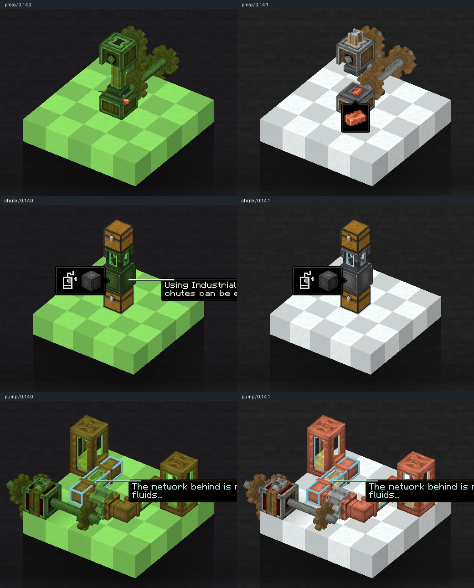

# 0.14.1 — Minecraft 1.20.1 / Issue #52

対象: Forge 47.4.26 / NeoForge 47.1.106 / Java 17。公開済み0.14.0（4215b4b5）から、1.21.1の4811352cで実装したPonder照明分離を移植する。[Issue #52](https://github.com/GenichiMaruo/Singulo/issues/52)が対象。

## 変更

- 実ワールドの光エンジンを借りる仮想Levelへ、実ワールドのレイリーパネル照明を付与しない。
- Ponderのシーン描画とバッファ排出中だけ、先頭256画素と同じ色の通常16×16ライトマップを使う。終了時・入れ子描画・例外時には元のシェーダーテクスチャを戻す。
- 追加GPUテクスチャは固定1枚。LightTexture.closeで解放する。実ワールドの16×512ライトマップとレイリーパネルの演出を維持する。
- 1.20.1のCreateに同梱されたMixinExtras 0.4.1にはWrapMethodがないため、追加の依存更新をせず標準Mixinで呼び出しを包む。Ponder 1.0.91のrenderVisibleScenesと従来のrenderWindowの両方を対象にする。
- レシピ・素材量・電力・通信形式の変更はない。

## 確認した構成

Create 6.0.8（Modrinth 8amzvn9x、Ponder 1.0.91 / Flywheel 1.0.5同梱）、Embeddium 0.3.31（UTbfe5d1）、Oculus 1.8.0（iQ1SwGc3）を固定する。報告の全modpackを再構成した検証ではない。

Forgeのシェーダーパックなしの構成では、0.14.0のプレス画面も正常で、黒化は未再現。修正後はプレスと報告画像にあるシュートの両画面が正常で、借用光エンジンの分離、256画素の一致、GPU補間、入れ子・例外時の復元が成功した。

追加のシェーダー検査はComplementary Reimagined r5.9.3のPOTATO設定を使用する。この構成でも修正前0.14.0のプレス・シュートは正常で、黒化は未再現。報告者が使用したパック名は不明なので、同じパックを再現したとは扱わない。

## 検証結果

基本移植6c175a18でForge・NeoForgeとも全656件のGameTestに成功。Python単体25件、1.20.1 API、全370レシピの移植元との一致も成功。追加のAlex’s Caves対策はクライアントの照明更新に限定する。全656件の結果は基本移植時点のものとして区別し、追加修正後の描画検査と関連サーバー検査で補う。

CIは既存4ジョブを維持し、Forgeの既存ジョブ内でPonderの実画面と照明契約を検査する。CIのPonder検査はシェーダーパックなしで実行し、外部シェーダーの検証結果とは区別する。

## modlistから抽出した描画関連候補

[報告のmodlist](https://mclo.gs/Rbw7zqk)は853件。名前だけで不具合の原因と断定せず、描画・光源・モデル・バッファ処理へ介入する候補のJARや公開ソースを確認した。

| 優先度 | mod | 確認内容 |
|---|---|---|
| 高 | Alex’s Caves 2.0.2 + Citadel 2.6.3 | `LightTextureMixin.ac_updateLightTexture`が標準更新をキャンセルして独自計算・アップロードする。追加照明バンクが更新されない数値的不具合を実行再現し、修正。 |
| 高 | Create Better FPS 1.1.3 | CreateのSuperByteBufferを置き換える種類の最適化。公開ソースは1.20.1の1.1.2で、頂点形式と照明値の受け渡しを確認。追加検証で[指定版の配布JAR](https://www.curseforge.com/minecraft/mc-mods/create-better-fps/files/8918086)を取得し、下記の実配布クライアント比較に導入した。 |
| 中 | Sodium Dynamic Lights 1.0.10 / Sodium Options API 1.0.10 | LevelRendererとEmbeddiumのFlatLightPipeline / LightDataAccessへ介入する。確認した動的光の合成経路は`0xFFF00000`で上位ビットを保持し、Singuloの追加光ビットを消す処理は見つからなかった。実行による全経路の保証ではない。 |
| 中 | Stellar Create Optimization 1.1.1fix | 追加検証で[指定版の配布JAR](https://www.curseforge.com/minecraft/mc-mods/stellarcreateoptimization/files/9076130)を取得し、下記の実配布クライアント比較に導入した。 |
| 中 | ImmediatelyFast 1.5.4 | バッファ統合とシェーダー変更の検出に介入。単独でライトマップを書き換えるコードは候補JARから見つからない。 |
| 低〜中 | GPU Memory Leak Fix 1.8 | 公開1.20.1ソース（0d327b0）ではRenderTargetのfinalizeでIDを回収し、クライアントtickで解放する。ライトマップの更新置換はない。同一配布JARの実行検証ではない。 |
| 低〜中 | Fusion 1.3.16 / ModernFix 5.27.91 | モデル・描画レイヤー・キャッシュを変更するが、共有ライトマップ更新の直接置換は見つからない。 |
| 低〜中 | ETF 7.2.6 / EMF 3.3.12 / FlickerFix 4.0.1 | エンティティ、テクスチャ、発光や描画状態に介入。Ponderの地形全体が暗くなる直接原因は未確認。 |

追加mod群の開発実行では、EMFとImmediatelyFastが、Mojang名の開発環境でSRG名のMixinターゲットを解決できず起動失敗した（`m_7939_` / `m_172767_`）。これは実配布環境の不具合と判定する材料にはしない。これらを原因と断定したり、報告者へ削除を勧めたりはしていない。

Alex’s Caves Trimmedを含む全mod・リソースパック・個別設定まで含めた報告環境の完全再現は未実施。元の黒化そのものと、こちらで確認した照明の契約違反は区別する。

## 追加で数値再現できた不具合

初期移植案6c175a18にCreate / Embeddium / Oculus / Alex’s Caves / Citadelを導入し、自然光0・パネル光15の実ワールドと同じ座標にPonderを開く検査を追加した。仮想世界の分離に加え、実ワールドの追加照明バンクを全256画素で確認すると、`Custom lightmap update skipped the noon bank`で失敗した。画面上の黒化の完全再現と同一視はしないが、Alex’s Cavesによる更新置換で追加バンクの計算が抜けることは確認できた。

標準計算のRETURN注入だけに依存せず、GameRendererの呼び出し側から未完了のNoonパスを補完する。Alex’s Cavesの独自照明は通常パスに残し、合成する真昼のパスに限って通常の計算を使用する。設定値の一時書換や追加ライブラリ導入は行わない。

互換処理はAC由来の注入済みコールバックを所有元・名前・引数で特定し、合成Noonパスだけ早期returnさせる。通常のAC照明や設定は変更しない。AC未導入時には処理を加えない。Forge・NeoForgeとも修正後にプレス・シュート両画面と256画素のNoonバンク検証が成功した。画像の台座も画素検査に成功。

参考: [Create Better FPS公開ソース](https://github.com/MoePus/CreateBetterFPS)、[GPU Memory Leak Fix 1.20.1ソース](https://github.com/someaddons/gpumemleakfix/tree/0d327b0ffd675dbcb25b3de21adf0f965484268e)。

## 最終検査の内訳

| 検査 | 構成・結果 |
|---|---|
| 全体GameTest | 基本移植6c175a18でForge 656/656、NeoForge 656/656。 |
| Ponder | 修正dd046003で両ローダーともCreate + Embeddium + Oculus + AC/Citadel。プレス・シュート各1枚、照明契約各256画素、Noonバンク・入れ子・例外復元・台座の画素検査に成功。シェーダーパックなし。 |
| 通常のレイリーパネル | 修正dd046003、Forge + Embeddium + AC/Citadel、Create/Oculus/DHなし。256色、241頂点、発光面の検査を完了。晴れの真昼・雨天深夜の点灯・消灯・再点灯の4枚を撮影。床84,000画素で真昼と点灯時のRGB差は0、再点灯も差0。消灯時には各色平均172〜178暗くなる。 |
| 追加修正後のサーバー | Forge・NeoForgeとも専用サーバー起動と関連9/9件に成功。全体656件のログ・結果JSONは別ディレクトリのまま保持。 |
| 配布JAR | 両ローダーともJava 17、902クラス。検証用・試作クラスの混入なし、新規Mixinのrefmapを確認。 |
| Python・移植契約 | 単体25件、1.20.1 API・リソース配置、370レシピの一致を確認。 |

配布物は検証用ソースを追加するinit scriptを外してビルドし、検証用クラスの混入がないことも確認した。Issueの黒化を再現した構成と断定せず、完全なmodpackでの最終確認は未実施として残す。

## 配布候補の識別

- `Singulo-0.14.1-1.20.1F.jar` — SHA-256 `3258eb901e4b6724ccc21a8f1e4e36f856a94b3086f864de7cb08bd71a767bd2`
- `Singulo-0.14.1-1.20.1N.jar` — SHA-256 `3117262223baaf6999e225f26c0cb245ae950c8dff4733e642824c258cf0108e`

修正ブランチは`release/0.14.1-1.20.1`。今回の作業ではマージ・CurseForge公開・GitHubへのJAR公開は行わない。

## 追加検証: 実配布環境での0.14.0 / 0.14.1比較

**黒化そのものは未再現。ただし0.14.0では台座・機械・流体に緑色への変色を確認し、0.14.1では通常の色で描画された。** 報告画像の黒化と、この変色を同一現象と断定しない。

### 実行範囲

取得した全量をそのまま起動する試行では、欠けた必須依存を持つアドオンを分離した768 JAR構成が環境のメモリ上限を超え、OSに終了された（exit 137、cgroup `oom_kill=1`）。185 JARの描画関連構成でも、モデル焼き込み中に5 GiBヒープがほぼ満杯となり、Full GCが継続した。これらは**描画検査の成功結果ではない**。

また、この検証構成ではLodestoneの`MultiPlayerGameModeMixin`が変数注入の競合で起動を止めたため、Lodestone・Malum・Maledictを分離した。これは元のmodpack全体の非互換性を確定したものではなく、Singuloの黒化とは別に扱う。

最終的な比較は29 JAR（内包分を含む37 mod）で行った。Singulo以外の28 JARは[ファイル名とSHA-256](comparison-mods.json)を固定した。主な導入modは以下。

- Create 6.0.8、同梱Ponder 1.0.91（最終29 JAR構成の内包メタデータを確認）
- **Create Better FPS 1.1.3 / Stellar Create Optimization 1.1.1fix**（指定版を取得・導入済み）
- Embeddium 0.3.31 / Oculus 1.8.0 / ImmediatelyFast 1.5.4
- ETF 7.2.6 / EMF 3.3.12 / Fusion 1.3.16 / FlickerFix 4.0.1
- Alex’s Caves 2.0.2 / Citadel 2.6.3 / LighterCitadel 1.0
- Distant Horizons 3.3.3 / GPU Memory Leak Fix 1.8 / ModernFix 5.27.91
- Sodium Dynamic Lights（ファイル名1.0.10、内部表示1.0.9）/ Sodium Options API 1.0.10、Ixeris、Chloride、Quark、Vistaなど

Forge 47.4.26、Java 17、Linux / Mesaソフトウェア描画、1280×800、GUI倍率2、描画距離2。Minecraftの正式ランタイムで実配布JARを使い、検査コードをmodへ追加していない。Oculusは導入するが、外部シェーダーパックは無効。Stellarのログでは`beltRenderPath=CREATE_BETTER_FPS`が選択されている一方、永続VBOには`shaderOff`へのフォールバックも記録されている。**シェーダー使用時だけの最適化経路を網羅した検査ではない。**

### 同条件の作り方

晴れの真昼（時刻6000）に固定し、天候・日照サイクルを停止。座標-1〜9に不透明な部屋を作り、y=8の0〜8へ通電状態の研究所用レイリーパネル81枚を配置した（`lit=true`を直接設定し、電力網自体は検査対象外）。プレイヤーは(3.5, 2, 3.5)。プレス、シュート、ポンプを`/ponder create:mechanical_press`、`/ponder create:chute`、`/ponder create:mechanical_pump`で開いた。

修正版で撮影して通常の保存終了を行い、設定・ワールドを保存した後、Singuloだけ0.14.0へ差し替えて同じシーンを撮影した。アニメーションの進行度・キャプションは完全な同一フレームではないため、全画面のRGB完全一致は要求していない。

### 台座以外も含めた観察

| シーン / 対象 | 0.14.0 | 0.14.1 |
|---|---|---|
| プレス: 台座・筐体・歯車・軸 | 全体が緑色に偏る | 白〜灰色の台座、灰色の金属、茶色の歯車を確認 |
| シュート: 台座・本体 | 緑色に偏る | 台座と本体が通常の白〜灰色 |
| シュート: チェスト | 茶色を保持 | 同じ茶色を保持 |
| ポンプ: 筐体・タンク・配管・黄色い流体 | 緑色への偏りを確認 | 金属・銅色・ガラス枠・流体の色を確認 |

元画像: プレス [旧版](images/baseline-press.png) / [修正版](images/fixed-press.png)、シュート [旧版](images/baseline-chute.png) / [修正版](images/fixed-chute.png)、ポンプ [旧版](images/baseline-pump.png) / [修正版](images/fixed-pump.png)。

[対象部位の画素集計](target-pixels.json)では、シュート本体の平均RGBが旧版`(43.17, 64.72, 30.14)`、修正版`(72.23, 70.17, 70.74)`。チェストは両版とも`(102.18, 77.46, 39.32)`で一致した。プレス台座は旧版`(125.95, 199.92, 90.17)`、修正版`(215.77, 219.96, 220.27)`。これは比較用ROIの診断値であり、一般的な黒化判定器ではない。流体や可動部はアニメーション差もあるため、元画像の目視確認を併用した。

比較した0.14.0 Forge JARのSHA-256は`94d2b1a126dc23fa33cab324dadcb879e4b3a8f5a6195b96519a2c0f599164f7`。0.14.1 Forge JARは本記録の配布候補と同じ`3258eb901e4b6724ccc21a8f1e4e36f856a94b3086f864de7cb08bd71a767bd2`を使用した。

修正版へ戻す再検証では、共通28 JARのハッシュ一致を確認し、保存した設定・ワールドを復元してプレスを再撮影した。[再検証画像](images/fixed-repeat-press.png)でも通常の白〜灰色の台座と機械の色に戻ることを目視確認した。

### 限界

- 全853件を同時に動かせた結果ではない。未取得・除外modや元のconfig / リソースパックは再現していない。
- 元のGPU・ドライバー・外部シェーダーの条件は不明。この比較はソフトウェア描画かつシェーダーなしに限定する。
- 旧版で確認したのは緑色への変色で、Issueの黒化写真そのものではない。元の黒化を修正できたと断定したり、Issueを解決済みと扱ったりしない。
- 一方、指定版のCreate Better FPSとStellar Create Optimizationはこの比較では未取得要素ではなく、実際に導入した検証要素である。
