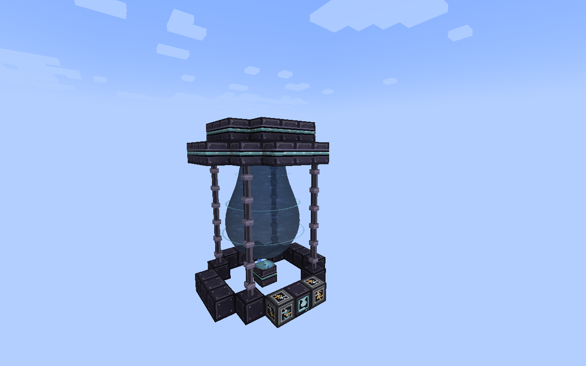
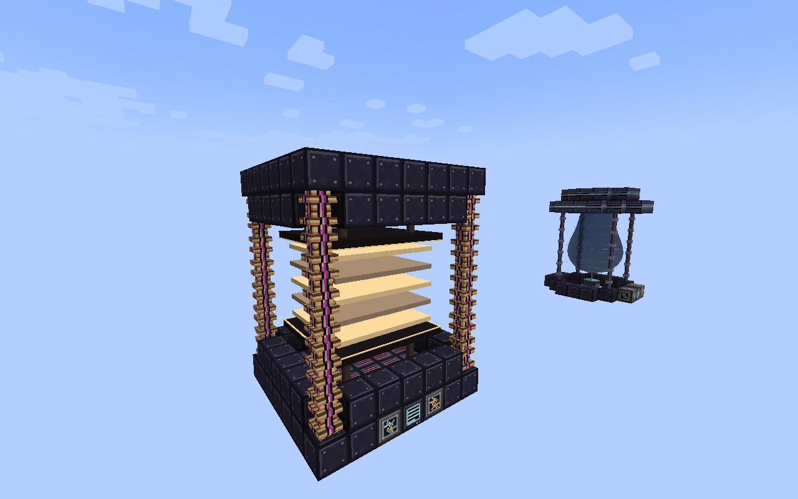
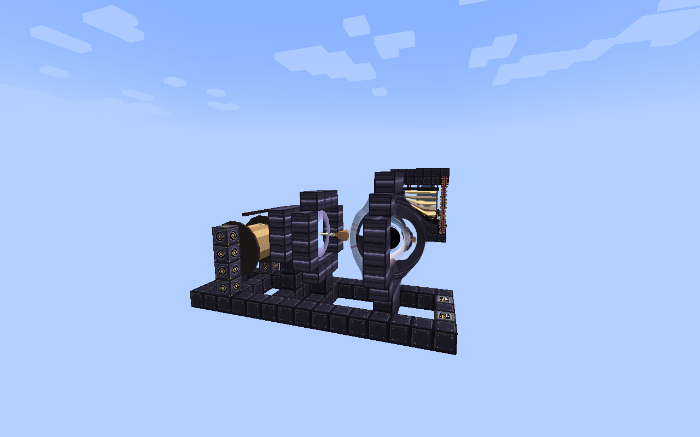
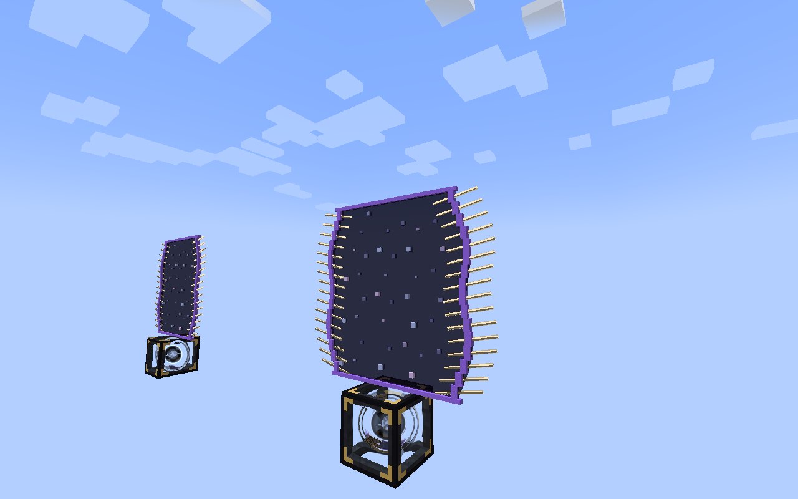

# 0.16.0 実装と検証

基点は `feature/0.16.0` の `f2fb5932`。Minecraft 1.21.1 / NeoForge / Java 21 向け。
本書は開発ブランチの記録であり、公開済みリリースの案内ではない。

## 機能

| 機能 | 実装 |
| --- | --- |
| 重力懸垂タンク | 7×9×7、16,000,000 mB。通常の FluidStack 液体・気体を八角の冠から涙の形に吊るす。制御卓の正面が排出、他面が注入。 |
| 核パスタ積層蓄電庫 | 7×9×7、8 TFE、入出力は各 2 GFE/t。外から受け取った電力だけを蓄え、蓄電量で押し板が締まり、核パスタが粒・棒・板と形を変える。 |
| 潮汐紡糸機 | 7×8×15。最初に特異点の種と10 GFEで核を形成する。コラプサー・ビレット1、エキゾチック物質1、液体ヘリウム500 mBを、60秒・20 MFE/tで潮汐繊維4本に加工。 |
| 核パスタ | 既存Jet Forgeで、縮退物質殻1、質量ペレット32、液体ヘリウム2,000 mBを90秒・125 MFE/tで加工。新蓄電庫を先に要求しない。 |
| 並列カセット | 既存Jet Forgeの画面の右の枠、または任意の部品への右クリックで取り付け、同一レシピを最大4バッチ同時処理。材料・冷却材・照射電力と成果物を数量分予約する。進行中の処理は取り付けで変えない。 |
| ワームホール縫合拡張 | 既存の両端へ取り付ける。開いていて読み込み済みの相互接続だけを通行できる。既存物流も使える。安全な足場・空間・世界境界・危険ブロックを確認し、搭乗中・睡眠中・クールダウン中は移動しない。 |
| 配管の観測 | 既存の測量メガネで矢印、流体、転送量、閉塞を表示。自動接続の操作は維持する。 |

値は既存SMES、Jet Forgeの消費量と進行に合わせた初期バランス。長時間プレイでの調整余地は残る。
装備・ツール本体は追加していない。

## 外観例

シェーダーパックを使わず、Sodium 0.6.13とDistant Horizons 3.3.3を併用した検証クライアントでの例。

| 天井から吊るす流体 | 蓄電量で縮む層 |
| --- | --- |
|  |  |

| 潮汐で伸ばして巻き取る繊維 | 四角く縫い開いた通行口 |
| --- | --- |
|  |  |

## 保存と入出力

- 新3装置は読み込み済みの構造を毎回確認してから、外部入出力・加工を進める。壊れた構造や読み込まれていない構造は資源を保持して停止する。
- 蓄電庫はlong型の有限容量と、面をまたいで共有する1 tickの入出力予算を持つ。simulateでは資源や予算を消費しない。
- 潮汐紡糸機は材料、冷却材、成果物、所要時間、照射コストを開始時に確定し、途中保存する。出力満杯でも成果物を捨てない。対応しない副産物・触媒・流体出力付きのデータパックレシピは、資源を消費する前に拒否する。
- 新3装置は制御卓を通常採掘すると、中身と進行を保持したスタック不可の1アイテムを返す。レンチでも同じ内容を運べ、他プレイヤーが開いているメニューを閉じてから梱包する。
- 通行処理はチャンクを読み込むためのチケットを作らない。別次元でも相手側が読み込まれていなければ待つ。
- 通行は毎tick判定する。通常の走行が5 tick間隔の物流処理をまたいでも、入口を取りこぼさない。

## 表示と互換性の範囲

- 新装置と縫合開口の描画は通常の描画パイプラインで動く。専用の画面フラッシュや全画面後処理は追加しない。
- 配管矢印は端点間の実転送に対する代表的な連結経路。分岐や環状配管の全経路を物理シミュレーションする表示ではない。
- 観測は24ブロック以内。ネットワークごとの送信候補は近い256本、クライアントの描画は128本。経路探索は4,096本、経路キャッシュは128件、観測パケットはサーバー全体で64件/tickを上限とする。資源輸送自体は表示キャッシュに依存しない。
- タンクはNeoForge FluidStackを扱う。Mekanismの独立したChemical APIは対象外。
- 今回の移植対象は1.21.1のみ。1.20.1対応や他描画Modとの全組み合わせ、低性能GPUでの性能は別途確認が必要。

## 検証手順

通常の手順は [開発テスト手順](../development/testing.md) を参照。
追加GameTestは容量・入出力、構造破損、停電、出力満杯、保存復元、梱包・再設置、並列加工、通行・次元間移動、配管観測を確認する。

新GUIの15画面（5言語×3装置）は、通常の22画面に続けて次の開発専用ハーネスで撮影できる。GUIは共通の枠（FramedScreen）と宇宙のスキンで描き、タンクは吊られた液体、蓄電庫は押し板と核パスタ、紡糸機はブラックホールからスプールまでの工程を小さく描く。

```sh
python tools/review/prepare_gui.py --cosmic
./gradlew -I tools/review/gui.gradle runClient -PmachineGuiReview -PcosmicGuiReview
```

装置の9状態と、縫合開口・配管の流れ／閉塞・4バッチ照射の計13状態は `tools/review/cosmic.gradle` と `cosmic-src` を使い、`build/cosmic-review/saves/Review` の使い捨てワールドで撮影する。
実チャンク・実2クライアントの追加検証は、`tools/review/lifecycle.gradle` に `-PcosmicLifecycle` を渡す。
通常の専用サーバー終了・再起動による保持確認は、`tools/review/cosmic-restart.gradle` を使い、使い捨ての `build/cosmic-restart` を2回起動する。
これらのReviewHarnessは通常の配布JARに含めない。

## 実施結果

下の表と検証記録は作り直し前の初期実装のもの。形・GUI・描画を作り直したあとの確認は「作り直し後の確認」を見る。

[検証記録とJARのSHA-256](validation.json) に集計を保存している。[独立レビューの2指摘への修正](review-fixes.md) も含む。

| 確認 | 結果 |
| --- | --- |
| 通常GameTest | 697件成功。ソースの列挙と実行結果の完全一致を確認。 |
| Mekanism連携 / Python | 1件 / 51件成功。 |
| 翻訳 | 5言語、各3,419キー。欠落・余分・書式引数の整合を確認。 |
| 既存GUI | 262画面。空スロット、見出しの重なり、字体の検証を通過。 |
| 新GUI | 5言語×3画面を実描画し、各言語の代表画面を目視。流体名と量を同じメニュー同期で更新する。 |
| 装置・観測の描画 | 13状態。標準描画とSodium / Distant Horizons併用を確認。 |
| 実チャンク・実2クライアント | 4バッチの予約、退避・復元、同時閲覧、再接続、紡糸機の40スロットと進行の同期を確認。検証用の保持チケットを解放して正常終了。 |
| 通常の専用サーバー再起動 | 流体、long蓄電量、加工予約、進行、入力材料を保持。2回とも正常終了。 |
| 配布JAR | Java 21、NeoForge、Minecraft 1.21.1、テスト数、開発用クラスの除外を検証。 |

並列処理は同一レシピの最大4バッチ。別々のレシピを同時に進める機能ではない。
次元間通行はServerPlayerのGameTestで確認し、実2クライアント試験はForgeと紡糸機の同期・再接続を対象とした。
低性能GPU、大人数・長時間の運用、実プレイヤーが次元間を往復する手動試験、最終バランスは未確認。
独立した人によるレビュー、PR作成、リモートCI、マージ、公開は実施していない。

## 作り直し後の確認

GameTest 701件（ポートの向き、制御卓の灯、実際の右クリックでのカセットの取り付け、細い部品の当たり判定を確かめる4件を追加）、Python検証、翻訳5言語、モデル、配布JARの検査を通した。標準描画で16状態（ブラックホールが開く途中2枚、水とガラスの手前の光1枚を含む）と新GUIの代表画面を撮影して目視した。
Sodium / Distant Horizons併用、実チャンク・実2クライアント、専用サーバー再起動、既存GUI 262画面は作り直し後に再実行していない。効果音は合成して生成したが、耳での確認は未実施。
