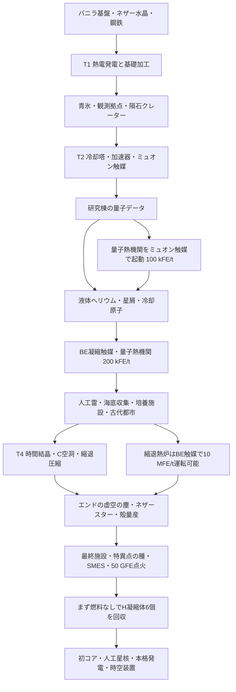
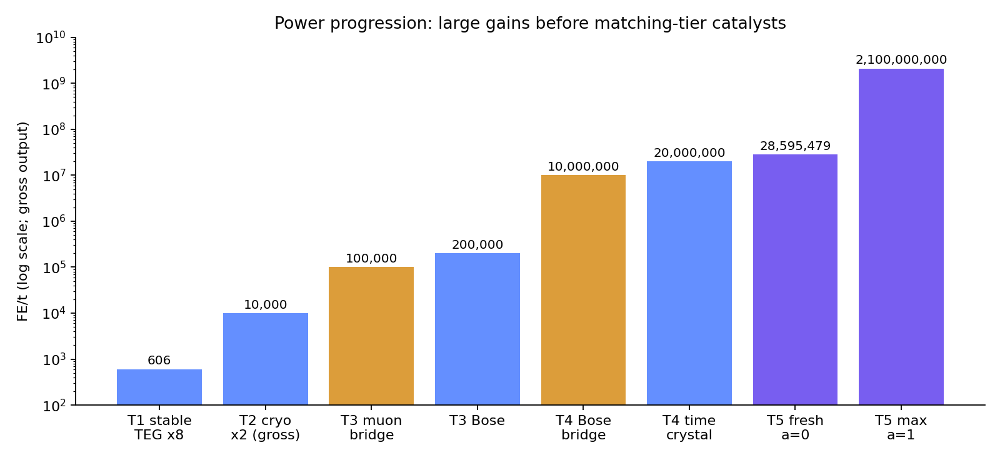
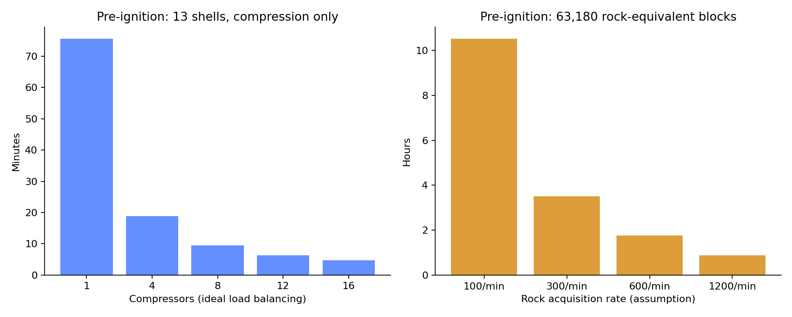
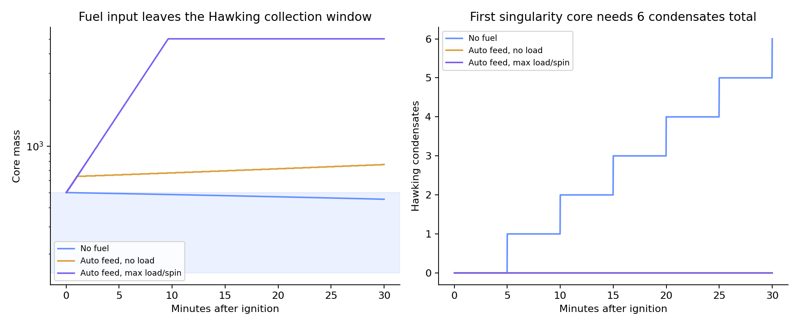

# Singulo 0.3.0 ゲームバランス評価と正式版への提案

> **対応状況：** この評価への対応（0.3.1 予定）は [RESOLUTION.md](RESOLUTION.md) を参照。以下は評価時点（`b45f478`）の記録。

評価日：2026-10-11  
対象：Minecraft 1.21.1 / NeoForge、main `b45f478819fa205091358a0f715edd9761d45862`、既定設定  
目標：**探索と工場づくりを両立する、中程度の難易度**（作者指定）

## 1. 判定

**現状はベータ継続を推奨する。理由は単なる高コストではなく、通常の材料投入では終盤へ進めないレシピがあるため。** それを直した後も、負担が「序盤の素材探索」と「終盤の鉱石・岩石集め」に偏り、電力は途中から急に余る。正式版では、発電量を一律に落とすより、進行不能の解消、資源供給の手段、発電の段階差、ブラックホールの運転案内を整えるのが効果的。

| 優先度 | 発見 | 判定・対応 |
|---|---|---|
| P0 | 時間結晶触媒4個／2個を要求する精密組立レシピに、触媒を1個しか投入できない | 炉心制御装置・特異点封入台などが通常作成不能。正式版前に修正 |
| P1 | 難易度プリセット・育成時間・殻コストなどの設定に、実行コードからの参照がない | 設定で調整できると思っても変わらない。設定とレシピの責任を整理 |
| P1 | Pリアクターへ燃料を入れると質量が500を超え、H凝縮体を作れなくなる | 最初のコア製作を遅らせる。回収モードの追加・初回案内が必要 |
| P1 | 点火前の殻13個だけで岩石63,180個＋鉄／銅換算6,318インゴット | Singulo単体の中難度としては採集負担が大きい |
| P1 | 縮退熱炉がBE凝縮触媒で10 MFE/t、時間結晶で20 MFE/t | 時間技術のご褒美を下位触媒で先取りできる。段階差の見直し候補 |
| P2 | 汎用加工機の触媒挙動が、ハンドブックの一般説明と一致しない | 説明を直すか、運転用触媒を別概念として実装 |
| P2 | 冷却塔の高さ倍率、青氷、圧縮ラインの台数、送電網全体の上限が見えにくい | JEI・手引き・GUIに「必要な実効能力」を表示 |

魅力は明確にある。遺構から回収した技術を工場で復元し、極低温→量子→時間→特異点へ進む構成、建造物の見た目、終盤の時空操作は、一連の体験としてつなぎやすい。改善の焦点は、その途中にある「理解して解ける課題」と「単に長く待つ課題」の配分に置く。

## 2. 調査方法と数字の読み方

この報告は**静的なコード監査、レシピの再帰展開、tick単位の独立した数値モデル**によるもの。Minecraftクライアントの通しプレイ、GameTestサーバー、配布JARとの同一性確認は実施していない。Forge/NeoForgeの1.20.1移植ブランチも対象外。したがって「実プレイ済み」「正式版の動作保証」とは扱わない。

- 20 TPS、常時チャンクロード、既定設定、外部Modの無料電力・鉱石増殖・高速輸送はなし。
- `tools/recipes.py` は末尾で形付きレシピの材料数を上書きする。**import後のデータ**を用いる。例：基礎回路の銅は冒頭の1個ではなく実際には2個。
- 加工時間は生成JSONと実行コードを照合する。冷却塔は高さ7で1.4倍、高さ10で2倍。実行コードのtick丸めを反映する。
- 資材表は作者の `MILESTONES` を基にした**設備＋各段階で指定された在庫を確保する保守的なバスケット**。段階2の触媒4個、段階4の時間結晶4個・エキゾチック物質8個などは、その時点の保有目標として確保し、後続建造用には別途計上する。最短攻略の最小コストではない。
- 表の点火前は、Hコレクターを前倒しで用意し、ジェット・コレクターと初コアを点火後へ分離したもの。
- 復元品は新品から復元し、使用回数の余りを次の加工に回す。原本は「新品換算の使用量」を分数で示す。修復を選ぶ場合の節約は別記する。
- **運転中の発電燃料・触媒交換、かまど燃料、通常の配線・ポート・ホッパー・工具・防具・建築用足場、採集／移動／戦闘時間は資材表から除外**。バニラのピストン・バケツ等は展開するが、青氷は青氷のまま数える。
- 加工負荷の「分・台」は1台が占有される時間。並列化・投入作業・電力不足を含む完了時刻ではない。進行不能レシピを直した場合の計画値として読む。
- 稀な単極子、オーバークロック・チップ、ストレンジ物質ルート、時間場による加速は基準計算に入れない。
- 加速器は成立条件を満たす最小構成（加速管21・磁石7）を採用。既定ホロ投影の一辺8構成は四隅＋4個おきに磁石を置くため磁石10・加速管18となり、資材内訳は少し変わる。

最終確認では、生成元と生成JSONのアイテム加工レシピ126件について時間・FE/t・出力数の一致を確認した。流体専用レシピと専用装置の処理はこの126件に含めず、本文の主要値を個別照合した。進行停止候補4件の走査、数値モデルの再実行、リンク先ファイルの存在、チャートの目視も確認した。Javaビルド・GameTestを通過したという意味ではない。

再現用：[analyze.py](analyze.py)、[計算結果JSON](calculation-results.json)、[資材CSV](resource-costs.csv)、[全計算付表](calculation-tables.md)、[Pリアクター時系列CSV](penrose-simulation.csv)。Python標準ライブラリで数値を計算し、Matplotlibがあればグラフも再生成する。

```sh
MPLCONFIGDIR=/tmp/singulo-mpl python docs/balance-review-0.3.0/analyze.py
```

根拠：[レシピ生成元](https://github.com/GenichiMaruo/Singulo/blob/b45f478819fa205091358a0f715edd9761d45862/tools/recipes.py)、[生成レシピ](https://github.com/GenichiMaruo/Singulo/blob/b45f478819fa205091358a0f715edd9761d45862/src/generated/resources/data/singulo/recipe)、[汎用加工処理](https://github.com/GenichiMaruo/Singulo/blob/b45f478819fa205091358a0f715edd9761d45862/src/main/java/io/github/genichimaruo/singulo/machine/MachineBlockEntity.java)。

## 3. まず修正すべき進行上の問題

### 3.1 複数触媒を要求するレシピが投入できない（P0）

`UsesItem` は `stacksTo(1)`。精密組立台の通常入力枠は触媒を拒否し、触媒専用枠は1枠しかない。`getSlotLimit=64` でも、通常の挿入はアイテム自体の最大スタック数1を超えない。GUIのShift移動も触媒を専用枠だけに送る。

生成レシピを機械的に走査すると、以下の4件が該当する。

| 出力 | 必要な時間結晶触媒 | 通常投入可能 | 影響 |
|---|---:|---:|---|
| 炉心制御装置 | 4 | 1 | Pリアクターを建造できない |
| 特異点封入台 | 2 | 1 | 特異点の種・初コアを製作できない |
| シールド発生塔コア | 2 | 1 | シールドに進めない |
| ワームホール生成器コア | 2 | 1 | ワームホールに進めない |

これはソース上の投入経路とレシピ条件の矛盾であり、単なる難易度評価ではない。実機での再現手順は「精密組立台に他の材料をそろえる→新品触媒を通常入力に入れる→拒否される→専用枠に1個入れる→2個目を入れられずレシピ不成立」。

**改善案：触媒を加工素材として使う場合の中間部品を追加する。** 例えば「時間結晶モジュール」を触媒1個から作る非触媒・スタック可能な部品にし、設備レシピの2個／4個要求をこのモジュールへ置換する。運転用の寿命付き触媒と設備に埋め込む材料を分けられる。

通常入力枠にも触媒を許す修正だけでは不十分。特異点封入台は他の材料が5種類あり、非スタック触媒2個と合わせて7枠になる。触媒専用枠との併用やスロット配置まで検証する必要がある。既存のスロットテストは「通常入力が触媒を拒否すること」を検証しており、この進行レシピの成功を保証しない。`setStackInSlot` で非合法な複数スタックを直接作るテストも避けたい。

根拠：[UsesItem](https://github.com/GenichiMaruo/Singulo/blob/b45f478819fa205091358a0f715edd9761d45862/src/main/java/io/github/genichimaruo/singulo/item/UsesItem.java)、[MachineType](https://github.com/GenichiMaruo/Singulo/blob/b45f478819fa205091358a0f715edd9761d45862/src/main/java/io/github/genichimaruo/singulo/machine/MachineType.java)、[投入判定](https://github.com/GenichiMaruo/Singulo/blob/b45f478819fa205091358a0f715edd9761d45862/src/main/java/io/github/genichimaruo/singulo/machine/MachineBlockEntity.java)、[GUI移動](https://github.com/GenichiMaruo/Singulo/blob/b45f478819fa205091358a0f715edd9761d45862/src/main/java/io/github/genichimaruo/singulo/machine/MachineMenu.java)、[炉心制御装置レシピ](https://github.com/GenichiMaruo/Singulo/blob/b45f478819fa205091358a0f715edd9761d45862/src/generated/resources/data/singulo/recipe/precision_assembler/core_controller.json)、[既存スロットテスト](https://github.com/GenichiMaruo/Singulo/blob/b45f478819fa205091358a0f715edd9761d45862/src/main/java/io/github/genichimaruo/singulo/test/MachineSlotGameTests.java)。

### 3.2 難易度設定の一部が実際の加工へ反映されない（P1）

`ServerConfig` の宣言・初期化はあるが、`src/main/java` から参照されない項目として、少なくとも次を確認した。

- `preset`
- ネザースター必要数、エキゾチック物質の出力数、人工星核の許可・必要ジェット凝縮体数
- `timeCrystalGrowthTicks`
- 殻の岩石量・金属核数・冷却材量、殻から作れる炉殻数
- リサイクル率、複製時のスカルク数

`MachineRecipe` はJSONの時間・材料を読み、そのまま処理に使う。これらの設定をレシピへ適用する経路は見当たらない。`preset=casual` にすればスター不要になる、と案内するのは現状では危険。一方、発電出力倍率、触媒寿命、加工電力倍率などは実際に参照されているので、**すべての設定が無効という意味ではない**。

正式版では「実行時設定で上書きする項目」と「データパックで変更する項目」を統一する。未接続の設定を残すより、未対応と表示する方がよい。今回の提案値を試す際も、未接続項目は `tools/recipes.py` を修正して再生成するか、データパックで変更する必要がある。

根拠：[設定定義](https://github.com/GenichiMaruo/Singulo/blob/b45f478819fa205091358a0f715edd9761d45862/tools/config_spec.py)、[生成ServerConfig](https://github.com/GenichiMaruo/Singulo/blob/b45f478819fa205091358a0f715edd9761d45862/src/generated/java/io/github/genichimaruo/singulo/generated/ServerConfig.java)、[MachineRecipe](https://github.com/GenichiMaruo/Singulo/blob/b45f478819fa205091358a0f715edd9761d45862/src/main/java/io/github/genichimaruo/singulo/recipe/MachineRecipe.java)、[設定登録](https://github.com/GenichiMaruo/Singulo/blob/b45f478819fa205091358a0f715edd9761d45862/src/main/java/io/github/genichimaruo/singulo/Singulo.java)。参照なし項目の全リストは計算結果JSONに収録。

### 3.3 「加工素材の触媒」と「運転用触媒」を混同しない

触媒の下位速度0.5倍、消耗2倍、残量による電力増は `CatalystDeviceBlockEntity` を使う発電機・アンカー等に適用される。一方、汎用の加工機は、レシピに含まれる触媒を個数または使用回数として消費する。

例：精密組立台の量子熱機関レシピは、別途運転用ミュオン触媒を要求しない。BE凝縮触媒の加工はミュオン触媒を1個消費するが、低ティア運転として80秒になるのではなく**40秒**。時間結晶はBE凝縮触媒1個を材料に**12分**で成長し、下位運転で24分になるわけではない。C空洞のエキゾチック物質はレシピ完了時に時間結晶の残り2,400 tickを消費する。

この違いを説明した上で現行仕様として残すことは可能。逆に、後から全加工機に運転用触媒を一律追加すると、触媒を初めて作る工程で循環依存が起こり得る。単なる説明修正のつもりで実装へ足さない方がよい。

また、時間結晶は30,000 FE/tを要求するものの、部分給電が24,000 FE/t以上なら純度ペナルティがない。極端に不足した状態でも正の給電が続けば12分で寿命最小1 tickの触媒になる。設備レシピの `count` 消費は残寿命を見ないため、低純度触媒を設備素材に使える。これを認めるか、設備用モジュールの製作時に最低純度／残寿命を要求するかを明文化したい。

根拠：[触媒デバイス](https://github.com/GenichiMaruo/Singulo/blob/b45f478819fa205091358a0f715edd9761d45862/src/main/java/io/github/genichimaruo/singulo/machine/CatalystDeviceBlockEntity.java)、[触媒効果](https://github.com/GenichiMaruo/Singulo/blob/b45f478819fa205091358a0f715edd9761d45862/src/main/java/io/github/genichimaruo/singulo/item/CatalystHelper.java)、[時間結晶育成槽](https://github.com/GenichiMaruo/Singulo/blob/b45f478819fa205091358a0f715edd9761d45862/src/main/java/io/github/genichimaruo/singulo/machine/TimeCrystalIncubatorBlockEntity.java)、[時間結晶レシピ](https://github.com/GenichiMaruo/Singulo/blob/b45f478819fa205091358a0f715edd9761d45862/src/generated/resources/data/singulo/recipe/time_crystal_incubator/time_crystal_catalyst.json)。

## 4. ティア間の障壁と遊ぶ順序



P0の修正後を想定した進行図。研究棟を訪れる前に量子データを作れるわけではなく、ミュオン起動は**探索ゲートを飛ばさず、電力ゲートだけを緩める**ルート。

| 区間 | 実際の主な障壁 | 中難度としての評価 |
|---|---|---|
| バニラ→T1 | ネザー水晶、粘土・骨粉・石炭、発電用の温冷源 | 最初の電気以前にネザーが必要。序盤工業を期待する人には遅い |
| T1→T2 | 青氷、観測拠点の制御ユニット、加速器用の隕鉄 | 工場と探索が接続する良い区間。ただし青氷探索の振れ幅が大きい |
| T2→T3 | 研究棟、ヘリウム、星屑。量子熱機関はミュオンで先行起動可能 | 起動の救済として良いが、100 kFE/tは直前の5 kFE/tから20倍 |
| T3→T4 | 培養施設、番人の投影核、古代都市の残響の欠片・スカルク、雷ガラス、高圧結晶 | 新しい探索先が同時に増える。順次解放するクエストが有効 |
| T4→T5 | 岩石・金属、時間結晶の設備素材、エンド、ウィザー、最終施設 | 要求が一度に集中する。電力不足より調達待ちが主役 |
| 点火→初コア | 質量150〜500でH凝縮体、アノマリー復元 | 案内なしだと発電を始めた行為が進行の妨げになる |

遺構の `spacing` は観測拠点40、研究棟56、培養施設64、最終施設96 chunk。配置グリッドの一辺なら640／896／1,024／1,536 blockだが、これは最寄り施設までの距離や所要時間ではない。バイオーム・生成可否・地形・既生成範囲に左右されるので、**探索時間の平均値はソースだけからは出せない**。コンパスの導線は有用。古代都市、氷山、エンドに関しても道案内が必要。

根拠：[構造物配置設定](https://github.com/GenichiMaruo/Singulo/blob/b45f478819fa205091358a0f715edd9761d45862/src/generated/resources/data/singulo/worldgen/structure_set)、[機械種別](https://github.com/GenichiMaruo/Singulo/blob/b45f478819fa205091358a0f715edd9761d45862/src/main/java/io/github/genichimaruo/singulo/machine/MachineType.java)、[レシピ](https://github.com/GenichiMaruo/Singulo/blob/b45f478819fa205091358a0f715edd9761d45862/tools/recipes.py)。

## 5. 序盤の電力と青氷

熱電発電は `0.10 × (高温K − 低温K)` FE/t。温度差が低温源の許容差を超えると、各tickに超過分を蓄積し、120,000で低温源が劣化する。

| 組み合わせ | 発電量 | 最初の劣化まで・通常世界 | 評価 |
|---|---:|---:|---|
| 焚き火800 K＋水293 K | 50.7 FE/t | 約19.5秒 | 水の補充・再生が必要 |
| 溶岩1,300 K＋水293 K | 100.7 FE/t | 約7.4秒 | 一見強いが維持方法を理解する必要 |
| 焚き火800 K＋氷塊253 K | 54.7 FE/t | 劣化なし | 安定した開始案 |
| マグマブロック1,000 K＋青氷243 K | 75.7 FE/t | 劣化なし | 基準にできる安定電源 |
| 溶岩1,300 K＋青氷243 K | 105.7 FE/t | 約38.2秒 | 青氷も消耗する。恒久電源と誤解しやすい |

単一の発電機が一つの低温源を使う計算。複数発電機で共有したときや水流の再生成は別条件。ネザーでは劣化がさらに速い。

8基の安定熱電発電は**605.6 FE/t**。焼成40＋圧縮20＋電解80＋アーカイブ40＝180 FE/tの基本工場には十分。冷却塔のコイル加工300＋加速器300を同時に走らせるとほぼ余裕がなくなり、銅線の損失も効く。T2への移行は順番に加工すれば成立する。

ただし、熱電8基を最初から作るのは重い。1基は鉄10・銅8・石炭8・セラミック6個（セラミック用水晶3個、他材料・焼成燃料別）。最初は焚き火＋氷塊で2〜4基、加工を交互運転し、冷却塔向けに増設する導線が適する。

冷却塔高さ7＋タービン2基の設備材料だけで**青氷13個**。高さ10への増築を含めると累計18個。氷から全量クラフトするなら青氷1個＝氷81個なので、13個で1,053個、18個で1,458個の氷になる。自然の青氷をSilk Touchで採る／交易するルートでは違う負担になる。発電用低温源の設置分は別。

**提案：** 初期セラミックの水晶代替をOverworld素材で用意するか、「ネザー探索後に始めるMod」と明示する。T2の冷却部品は氷塊でも作れ、青氷を高効率版・高さ10以降に使う構成が中難度向き。安定した温冷源の組をハンドブックに実数で載せる。

根拠：[温度データ](https://github.com/GenichiMaruo/Singulo/blob/b45f478819fa205091358a0f715edd9761d45862/src/generated/resources/data/singulo/thermal/default.json)、[熱電発電処理](https://github.com/GenichiMaruo/Singulo/blob/b45f478819fa205091358a0f715edd9761d45862/src/main/java/io/github/genichimaruo/singulo/machine/ThermoelectricGeneratorBlockEntity.java)、[形付きレシピ上書き](https://github.com/GenichiMaruo/Singulo/blob/b45f478819fa205091358a0f715edd9761d45862/tools/recipes.py)。

## 6. 発電と消費の釣り合い



グラフは総出力。下位触媒の起動ルートを橙色で示す。Pリアクターの「fresh」は燃料を供給し質量500・無回転と仮定した瞬間的な理論平均であり、そのまま質量500を維持できる運転ではない。

| 電源・運転 | 出力 | 燃料・触媒条件 | 代表的な負担 |
|---|---:|---|---|
| 安定熱電×8 | 605.6 FE/t | 温冷源 | 基本工場180 FE/t |
| 極低温タービン×2 | 10,000 FE/t | 溶岩、窒素合計4 mB/t | BE触媒加工8,000 FE/t |
| 量子熱機関＋ミュオン | 100,000 FE/t | ミュオン1個で10分 | 1個で1.2 GFE |
| 量子熱機関＋BE | 200,000 FE/t | BE1個で30分 | 1個で7.2 GFE |
| 縮退熱炉＋BE | 10,000,000 FE/t | BE1個で15分、Lv2を10秒に1個 | 時間結晶を作る前に使える |
| 縮退熱炉＋時間結晶 | 20,000,000 FE/t | 45分、Lv2を10秒に1個 | 1触媒期間で1.08 TFE |
| Pリアクター・M=500、spin=0 | 約28.60 MFE/t | 最大0.5 pellet/s | 点火直後から2.1 GFE/t出るわけではない |
| Pリアクター・M=5,000、spin=1 | 上限2.1 GFE/t | 最大5 pellet/s | 上限出力には燃料供給ラインが必要 |

### 冷却塔は資料の素のレシピより速い

窒素100 mBの基準レシピは20 tick・240 FE/t。実機では高さ7で `round(20/1.4)=14 tick`、高さ10で10 tick。

- 高さ7：142.86 mB/s。タービン約3.57基分。窒素専用の平均製造コストは33.6 FE/mB。
- 高さ10：200 mB/s。タービン5基分。平均製造コスト24 FE/mB。
- 高さ7でタービン2基なら窒素製造に稼働時間の56%が必要。窒素製造電力の平均は134.4 FE/t、タービンの差引出力は約9,865.6 FE/t。

同じ塔でコイル・線材・ヘリウムも作るため、専用運転で5基という値を共有運転にそのまま使えない。入力のあるレシピが窒素製造より優先される。T2は窒素バッファ、T3は製造と発電を分ける配管・運転計画が役に立つ。

### 量子熱機関は触媒を作るコストに対して高収益

ミュオン触媒の主要な機械電力は、触媒加工80,000 FE＋束2個48,000 FE＋カード8,000 FE＋窒素・基板等。生成電力1.2 GFEに対して十分小さい。観測ログ新品1個は16回コピーできるため、量子熱機関をミュオンで回すだけなら原本1個で160分、最低3個の観測ログでも8時間分ある。ほかの用途・修復費を除いた計算。

BE触媒の主要な加工は自身6.4 MFE、冷却原子2回1.6 MFE、ヘリウム・線材等を足しても生成7.2 GFEに対し大きな負担ではない。**電力を稼ぐための大規模燃料工場より、探索素材と触媒交換が中心になる設計**と理解するのが正しい。

### T4発電はほとんどの加工を一気に軽くする

代表的な同時稼働を、C空洞100,000＋縮退圧縮50,000＋育成30,000＋レーザー8,000＋もつれ4,000＋冷却2,000＝194,000 FE/tと置くと、BE運転の縮退熱炉10 MFE/tでも使用率1.94%、時間結晶運転なら0.97%。特異点の種1 MFE/tを足しても20 MFE/t炉の約6%。

縮退熱炉の燃料はLv2を10秒に1個＝岩石質量8.1/s。45分でLv2 270個＝岩石21,870個。安価な燃料ではあるが、バニラ手掘りでは継続調達が必要。満充電でも燃料・触媒の消費を止める条件がなく、余剰電力は捨てられるので、蓄電待ちだけ運転する方が有利。

**提案：** 満充電による自動待機を先に入れる。その後、量子50〜100 kFE/t、縮退2〜5 MFE/tを試験候補とし、下位触媒での発電量だけを別設定で抑える。全装置共通の `lowerTierSpeed` を変更すると探索機やアンカーにも影響するので、発電機固有の調整にする。下位触媒を「次の触媒の製作を助ける仮運転」にするなら、量子の下位出力は定格の10%、縮退の下位出力は定格の5%程度を出発点に検証する。

根拠：[冷却塔倍率](https://github.com/GenichiMaruo/Singulo/blob/b45f478819fa205091358a0f715edd9761d45862/src/main/java/io/github/genichimaruo/singulo/multiblock/CoolingTowerControllerBlockEntity.java)、[タービン](https://github.com/GenichiMaruo/Singulo/blob/b45f478819fa205091358a0f715edd9761d45862/src/main/java/io/github/genichimaruo/singulo/machine/CryogenicTurbineBlockEntity.java)、[量子熱機関](https://github.com/GenichiMaruo/Singulo/blob/b45f478819fa205091358a0f715edd9761d45862/src/main/java/io/github/genichimaruo/singulo/machine/QuantumHeatEngineBlockEntity.java)、[縮退熱炉](https://github.com/GenichiMaruo/Singulo/blob/b45f478819fa205091358a0f715edd9761d45862/src/main/java/io/github/genichimaruo/singulo/machine/DegenerateFurnaceBlockEntity.java)、[触媒寿命](https://github.com/GenichiMaruo/Singulo/blob/b45f478819fa205091358a0f715edd9761d45862/src/main/java/io/github/genichimaruo/singulo/item/UsesHelper.java)。

## 7. 終盤の資材コスト：重いのは殻の大量生産

### 殻1個の計算

通常レシピは以下。

```text
岩石 = Lv3×4 + 前駆体×4
     = (729×4) + (Lv2×6×4)
     = 2,916 + 1,944 = 4,860 質量
金属 = 金属Lv2×2 = 162 金属質量
     = 鉄／銅ブロック54個 = インゴット486個
高圧結晶 = 前駆体用4個
液体窒素 = 6,000 mB
```

金属換算は鉄または銅ブロックの質量3を使用。金ブロックは7なので必要ブロック数は減るが、入手負担が同じではない。主表の鉄・銅インゴットと金属質量は別勘定であり、**表の鉄955個だけで点火できるわけではない**。

Pリアクターは炉殻120＋安定化コイル12個分の炉殻12＝132枚。特異点封入台にも1枚必要なので133枚。炉殻は12枚ずつ作るため12バッチ＝殻12個。特異点の種に殻1個を足して、**点火前に殻13個**。初コアまでなら14個。

| 範囲 | 殻 | 岩石換算 | 鉄／銅インゴット換算 | 殻用高圧結晶 | 窒素 | 圧縮機の理想加工負荷 |
|---|---:|---:|---:|---:|---:|---:|
| 殻1個 | 1 | 4,860 | 486 | 4 | 6,000 mB | 5分49秒 |
| 点火前 | 13 | 63,180 | 6,318 | 52 | 78,000 mB | 75.62分・台 |
| 初コアまで | 14 | 68,040 | 6,804 | 56 | 84,000 mB | 81.43分・台 |

高圧結晶は圧縮炉アンビル用にさらに2個必要。深海収集器2基・水深48なら点火前合計54個を27分で供給できる。水深16では81分。これはチャンクロードと回収が継続している場合。深海収集器は早く設置し、別の探索中に在庫を作ると意味のある並行作業になる。

殻の圧縮機時間は、岩石Lv1 540回×0.5秒＋岩石Lv2 60回×1秒＋Lv3 4回×2秒＋金属Lv1 18回×0.5秒＋金属Lv2 2回×1秒＝349秒/殻。さらに殻自体の加工45秒、前駆体40秒、炉殻成形60秒/バッチがある。材料投入・モード切替・搬出待ちを除く下限で、圧縮機8台で正確に8倍速になる保証はない。



岩石だけでも、採集速度100個/分で10.53時間、300個/分で3.51時間、600個/分で1.76時間、1,200個/分で52.7分。これらは測定値ではなく、道具・採掘方式による感度分析。金属・他資材・移動は別途。岩石を深層岩質量1.2で供給すれば52,650個相当へ減るが、採掘速度まで速くなるとは限らない。

Lv2の混成ボーナスは岩石側を8/9にできるので、63,180→56,160質量。節約は約11.1%で、終盤の負担の桁を変えるほどではない。

### 設備バスケットの累計抜粋

| 資材 | T1 | T2 | T3 | T4 | 点火前 | 初コア後 |
|---|---:|---:|---:|---:|---:|---:|
| 鉄インゴット（大量圧縮用を除く） | 112 | 271 | 348 | 628 | 955 | 959 |
| 銅インゴット（大量圧縮用を除く） | 76 | 146 | 209 | 345 | 743 | 745 |
| 石炭（鋼材料。燃料別） | 100 | 402 | 540 | 1,072 | 1,726 | 1,734 |
| ネザー水晶 | 37 | 93 | 145 | 321 | 652 | 661 |
| ダイヤモンド | 0 | 1 | 13 | 42 | 125 | 127 |
| 青氷（設備材料のみ） | 0 | 13 | 18 | 18 | 18 | 18 |
| 金属質量（上の鉄・銅と別枠） | 0 | 0 | 0 | 0 | 2,106 | 2,268 |
| ネザースター | 0 | 0 | 0 | 1 | 4 | 5 |

点火前に必要なエキゾチック物質は、炉心制御用6＋封入台4＋種4＋ホライズン・バス16本分2＋Hコレクター1＝**17個**。この部分だけなら3バッチ・ネザースター3個。Hコレクターを点火後へ回せば点火自体は16個・2バッチまで減らせるが、その後のHコレクター用には追加スターまたは人工星核の準備が必要になる。表の4個はT4時点の8個在庫も保持する計画だから。初コア用のスター1個は、点火後に人工星核へ置換できる。表は比較を簡単にするため天然スターで統一しており、スター5個を最小必須数とはしていない。

研究棟の量子データは、点火前バスケットで113回分を消費する。新品換算7.0625個。1遠征3〜5個なので、新品だけなら2〜3遠征になる。一方、原本1個の実装上の総使用回数は `16+12+9+6=43`（各修復で切り捨て）。最低3個でも129回分あるため、修復すれば1遠征で賄える。最低収量3個なら113回を満たすのに7回程度の修復が必要で、追加の線材・ダイヤ・加工時間は別途かかる。**再探索と修復を選べる点は良いバランス**。

### 推奨するコスト調整の試験値

中難度なら、まず次の小さな組み合わせを試す。

| 変更 | 現行 | 試験案 | 点火前の効果 |
|---|---:|---:|---|
| 殻1個から作れる炉殻 | 12枚 | 24枚 | 炉殻133枚に殻6個＋種1個＝合計7個 |
| 殻に必要な金属Lv2 | 2個 | 1個 | 7個の殻に鉄／銅換算1,701インゴット |
| 岩石側レシピ | 4,860/殻 | ひとまず維持 | 7個の殻なら34,020質量 |

岩石は約46%減、金属は約73%減。大きな削減なので、いきなり確定せず、まず炉殻24枚だけでプレイテストし、金属がなお重ければ2→1を適用する。代案はコスト維持＋T3/T4の採掘装置。ただし新装置の追加は実装・検証量が大きいので、初回正式版には出力枚数調整の方が取り組みやすい。

根拠：[殻レシピ](https://github.com/GenichiMaruo/Singulo/blob/b45f478819fa205091358a0f715edd9761d45862/src/generated/resources/data/singulo/recipe/degenerate_compactor/degenerate_matter_shell.json)、[質量設定](https://github.com/GenichiMaruo/Singulo/blob/b45f478819fa205091358a0f715edd9761d45862/src/generated/resources/data/singulo/mass_values/default.json)、[リアクター形状](https://github.com/GenichiMaruo/Singulo/blob/b45f478819fa205091358a0f715edd9761d45862/src/main/java/io/github/genichimaruo/singulo/multiblock/Structures.java)、[深海収集器](https://github.com/GenichiMaruo/Singulo/blob/b45f478819fa205091358a0f715edd9761d45862/src/main/java/io/github/genichimaruo/singulo/nature/DeepSeaCollectorBlockEntity.java)、[使用回数・修復](https://github.com/GenichiMaruo/Singulo/blob/b45f478819fa205091358a0f715edd9761d45862/src/main/java/io/github/genichimaruo/singulo/item/UsesHelper.java)。

## 8. 待ち時間と実プレイ向けの工程表

### 時間結晶の12分は、単独では妥当だが設備にも多数使う

新品の時間結晶は寿命45分、成長12分なので、1槽の供給は毎時5個、同ティア装置なら理論上3.75台分。3台を維持すると毎時4個を使い、設備材料へ回せる余りは毎時1個しかない。しかも種の復元、BE触媒・残響の欠片・同期板の生産が別途必要。育成槽が20%ほど止まるだけで、3台分の維持余裕がなくなる。

作者の在庫バスケットでは点火前に時間結晶11個の育成132分＋種の復元4分＝**136分・台**。これは「点火まで136分で終わる」という意味ではない。炉心制御に4個、封入台に2個を使うので、運転用と設備用の育成を競合させない2槽構成を案内するとよい。

残響共鳴器の出力も通常の残響の欠片なので、出力を次の型にできる。初期の1個から「生涯17個まで」ではなく、材料を用意すれば継続複製できる。古代都市への初回探索はゲートだが、継続的な再遠征を必須にする仕様ではない。

### 工場稼働後のスケジュール例

以下は通し攻略の予測時刻ではなく、**必要資材・対象遺構を発見した後の段取り例**。稼働時間は計算し、移動・建造は未測定として分ける。

| 順序 | 工場側の作業 | 並行するプレイヤー作業 | 計算上の目安・条件 |
|---|---|---|---|
| T2到達 | 窒素を備蓄してタービン2基を安定化 | 研究棟・クレーターを探索 | 窒素100 mB/0.7秒、高さ7 |
| T3到達 | 量子熱機関をミュオンで仮起動、BE系統を生産 | 海底収集器2基を設置 | 仮起動10分/触媒。BE化後は30分 |
| T4準備 | 高圧結晶と雷ガラスを先行確保 | 培養施設・古代都市を攻略 | 高圧結晶54個は最良条件2基で27分 |
| T4初期 | 育成槽2基と圧縮ラインを動かす | ウィザー準備、エンドの虚空捕集 | 育成負荷136分・台なら理想約68分。起動・材料待ち別 |
| T5建造 | 圧縮機8台に分業、殻・炉殻・SMESを製作 | 設備組立と最終施設攻略 | 殻用圧縮75.62分・台→理想9.45分。岩石採集時間とは別 |
| 点火準備 | 種を目覚めさせ、SMES25基を満充電 | 配線チェック・Hコレクター設置 | 種10分・12 GFE、蓄電125秒@20 MFE/t |
| 点火直後 | 燃料なし、H凝縮体回収 | 周辺を整備、人工星核用設備を準備 | H凝縮体6個まで30分。初コア工程は下節 |

列ごとの時間は重複するため足し算しない。総所要時間を最も変えるのは採掘方法・探索運・事前在庫であり、未プレイ段階で「何時間でクリアできる」と断定するより、**初回正式版の実測対象を明確にする**方がよい。

ソロの中難度として、プレイテスト時の目標を仮に「初発電まで1〜2時間、各技術更新で30〜90分程度の新しい体験、点火後に1〜2時間以上楽しめる用途」と置くことはできる。ただしこれは提案する目標値であり、現行版の予測値ではない。ネザー先行・古代都市探索・金属6,318個を残す現行版では、地形と準備によって大きく超える可能性が高い。

根拠：[時間結晶レシピ](https://github.com/GenichiMaruo/Singulo/blob/b45f478819fa205091358a0f715edd9761d45862/src/generated/resources/data/singulo/recipe/time_crystal_incubator/time_crystal_catalyst.json)、[残響複製](https://github.com/GenichiMaruo/Singulo/blob/b45f478819fa205091358a0f715edd9761d45862/src/generated/resources/data/singulo/recipe/echo_resonator/echo_shard.json)、[MILESTONES](https://github.com/GenichiMaruo/Singulo/blob/b45f478819fa205091358a0f715edd9761d45862/tools/recipes.py)。

## 9. 点火・送電・ブラックホール運用

### 9.1 点火は総電力量より送電帯域が課題

```text
必要電力量 = 50,000,000,000 FE
制限時間 = 10秒 = 200 tick
必要平均入力 = 250,000,000 FE/t = 250 MFE/t
SMESモジュール = 2 GFE/基、100 MFE/t/基
```

25基で50 GFEを保持でき、合計出力帯域も足りる。20 MFE/tの縮退熱炉1基なら125秒で充電。BE触媒の10 MFE/tでも250秒。充電損失・他設備の消費を除く。

| ケーブル | 同一ネットワークの上限 | 点火時の注意 |
|---|---:|---|
| 銅導線 | 2,000 FE/t | 1本でも混じると全体の上限が下がる |
| 超伝導ケーブル | 1 MFE/t | 蓄電はできても点火瞬間の帯域不足 |
| トポロジカル導線 | 100 MFE/t | 1ネットワークで10秒に20 GFEしか送れない |
| ホライズン・バス | 実装上は無制限 | Singulo間の長整数転送に対応 |

ネットワーク上限は、接続されたケーブルの最小値。ホライズン幹線に古い銅線を枝として残しても失敗する。十分な蓄電量があるのに点火できない理由をGUIで示したい。点火前チェックに「蓄電量」「受電見込み」「細いケーブルの混在」を表示するのが有効。

理論上は縮退熱炉13基の直接給電でも260 MFE/tに達するが、中難度ではSMESの方が自然。**50 GFEを下げる前に、蓄電と瞬間電力を学べる案内を整える**ことを推奨する。

根拠：[SMES](https://github.com/GenichiMaruo/Singulo/blob/b45f478819fa205091358a0f715edd9761d45862/src/main/java/io/github/genichimaruo/singulo/machine/SmesCellBlockEntity.java)、[ネットワーク](https://github.com/GenichiMaruo/Singulo/blob/b45f478819fa205091358a0f715edd9761d45862/src/main/java/io/github/genichimaruo/singulo/cable/EnergyNetwork.java)、[ケーブル登録値](https://github.com/GenichiMaruo/Singulo/blob/b45f478819fa205091358a0f715edd9761d45862/src/main/java/io/github/genichimaruo/singulo/registry/SinguloBlocks.java)、[点火処理](https://github.com/GenichiMaruo/Singulo/blob/b45f478819fa205091358a0f715edd9761d45862/src/main/java/io/github/genichimaruo/singulo/reactor/PenroseReactorBlockEntity.java)。

### 9.2 点火後、先に発電を始めるとH凝縮体が取れなくなる

H凝縮体は質量150〜500で5分に1個。初期質量500、ペレット1個は質量を4増やす。自動投入は満充電後も最低投入を続けるため、普通に燃料をセットして起動すると質量500を超える。

独立モデルでは、初期500・spin目標0・負荷0でも、燃料ありの自動運転は30分後に質量約761、H凝縮体0個。燃料なしでは質量約452、H凝縮体6個。最大負荷・spin目標1なら質量5,000へ成長し、やはりH凝縮体は得られない。



初コアには直接4個、アノマリー・サンプルの初回復元に2個、合計**6個**のH凝縮体が必要。Hコレクターを点火前に作り、燃料なしで30分待てば集まる。復元は途中で済ませ、残りの材料・給電を用意しておけば、その後コア加工5分で、点火後約35分が工程上の目安になる。炉心付近の時間膨張を避けた加工配置、20 TPS、出力回収が条件。

無給餌の蒸発は `dM/ds = -6000/M²`。質量500→150は約112.6分なので、必要な30分は成立する。ただし、これを知らず先に質量5,000へ育てると、自然蒸発で500へ戻るまで連続稼働換算で約80.3日。チャンク未ロードでは進まない。永久的に詰むとは限らないが、実用的な復旧手段とは言いにくい。

**推奨案：** GUIに「触媒回収運転」を設け、質量450〜480付近を維持するよう給餌を制御する。最初の点火はこのモードを既定にし、H凝縮体を6個確保したら大出力運転へ案内する。育てすぎた炉心から質量を安全に取り出す操作、または回収可能質量帯を調整する代替案もある。単に説明へ小さく書き足すより効果が大きい。

### 9.3 2.1 GFE/tは燃料供給を含めて評価する

実装の降着効率はspin 0で5.719%、0.9で15.575%、1で42.265%。

```text
出力上限の理論値 = min(2.1 GFE/t,
  M / 1000 / 20 × 20 GFE/ペレット × 降着効率)
```

質量5,000・spin1では5 pellet/s、原料は80岩石質量/s＝288,000/h。通常の圧縮機はペレット1個2秒なので、フル出力の持続には理想10台。入力・出力を運び続ける能力も必要。初期質量500なら最大0.5 pellet/sなので1台分だが、その状態では最大出力にはならない。

電気の用途として、ワームホール1対の生成は100 MFE/t×200 tick＝20 GFE。最大出力リアクターには余裕がある。中難度の終盤として、効率競争・大容量の遠隔輸送・重力装置等を遊びの目標へ結びつければ、高出力のご褒美を残してよい。単に満充電の電池を増やすだけでは、巨大な発電能力を活用する理由が弱い。

根拠：[Pリアクター全処理](https://github.com/GenichiMaruo/Singulo/blob/b45f478819fa205091358a0f715edd9761d45862/src/main/java/io/github/genichimaruo/singulo/reactor/PenroseReactorBlockEntity.java)、[アノマリー復元](https://github.com/GenichiMaruo/Singulo/blob/b45f478819fa205091358a0f715edd9761d45862/src/generated/resources/data/singulo/recipe/singularity_encapsulator/restore_degraded_anomaly_sample.json)、[コアレシピ](https://github.com/GenichiMaruo/Singulo/blob/b45f478819fa205091358a0f715edd9761d45862/src/generated/resources/data/singulo/recipe/singularity_encapsulator/singularity_core.json)、[ワームホール生成器](https://github.com/GenichiMaruo/Singulo/blob/b45f478819fa205091358a0f715edd9761d45862/src/main/java/io/github/genichimaruo/singulo/wormhole/WormholeGeneratorBlockEntity.java)。

## 10. 同系統Modとの比較

比較はFE単位、既定設定の範囲で行う。Modpackの調整値、アップグレード、燃料条件で出力が変わるため、発電量だけを同じにすることを目標にはしない。

### Powah：同じMinecraft版の公開ソースを基準にする

比較対象はMinecraft 1.21.1系の公開タグ `v6.2.10`、commit `a5a8f25b5bafb58b694dc44ef0e4c0f14d9e4c11`。`DefaultEnergies` のReactor定格系列は250／1,000／2,500／10,000／25,000／100,000／**500,000 FE/t**。Nitroの実出力は燃料充填度・温度・炭素・レッドストーンで減るため、500 kFE/tを常時の実測値とはしない。よく見かける250 kFE/tという説明を、この版の確定値として流用しない。

Nitro結晶はネザースター1＋赤石ブロック2＋Blazing結晶ブロック1＋20 MFEで16個。終盤素材にスターを要求すること自体は特殊ではない。Singuloはスター1個からエキゾチック物質8個、加工電力240 MFEに加えて前工程がある。異なる素材・用途なので、1個あたりの数字だけで「12倍難しい」とは判断しない。

Singuloの量子熱機関200 kFE/tはPowah Nitro定格の0.4倍、縮退熱炉20 MFE/tは40倍、Pリアクター上限2.1 GFE/tは4,200倍。SinguloがT4から別の出力帯に入ることは明確。発電専門Modと併用すると、Singulo側の発電が選ばれやすくなる可能性がある。重い探索・設備コストで相殺できるかは、Modpack条件別の検証が必要。

出典：[Powah既定電力](https://github.com/Technici4n/Powah/blob/a5a8f25b5bafb58b694dc44ef0e4c0f14d9e4c11/src/main/java/owmii/powah/config/v2/DefaultEnergies.java)、[実発電式](https://github.com/Technici4n/Powah/blob/a5a8f25b5bafb58b694dc44ef0e4c0f14d9e4c11/src/main/java/owmii/powah/block/reactor/ReactorTile.java)、[Nitroレシピ](https://github.com/Technici4n/Powah/blob/a5a8f25b5bafb58b694dc44ef0e4c0f14d9e4c11/src/generated/resources/data/powah/recipe/energizing/nitro_crystal.json)。

### Mekanism：大出力と供給網を組み合わせる例

公式Wikiの現行Fusion Reactor説明では、別々の重水素・三重水素による最大注入で約20 MFE/t、D-T燃料を直接大量供給すると約200 MFE/t。レーザー点火は少なくとも1 GFE、別の外部加熱法はおよそ18 GFE。Wikiは固定されたMinecraft/Modパッチの検証資料ではないので、厳密な同版ベンチマークではなく設計上の比較値として扱う。

Singuloの縮退熱炉は、Mekanismの通常核融合規模の出力を岩石圧縮と触媒で得る。Pリアクター最大はWikiの大量D-T運転値の約10.5倍。Mekanismが燃料供給網を拡張する課題を持つ一方、Singuloは探索と触媒・質量／スピン運転に負担を置いている。差別化として成立するが、Singuloの下位触媒だけで10 MFE/tを出せる段階は再検討したい。

出典：[Mekanism公式Wiki：Fusion Reactor](https://wiki.aidancbrady.com/wiki/Fusion_Reactor)（2026-10-11参照）。

### 比較からの判断

| 観点 | Singuloへの判断 |
|---|---|
| 序盤の数十FE/t | 自然な規模。ただし発電以前の水晶・冷却素材の探索が重い |
| T3の数十〜数百kFE/t | 終盤発電Modと重なる帯域。探索を終えた報酬として許容範囲 |
| T4の10〜20MFE/t | 中難度工業の「途中の発電」としては強い。特に下位触媒での解放が早い |
| T5の最大2.1GFE/t | 科学的な巨大装置の最終報酬として残す余地がある。出力用途と運転UIが必要 |
| スター・ボスによる進行 | 同系統Modでも終盤の希少素材は使うが、探索の振れと戦闘リセットが重なる点を検証したい |
| 大量の通常ブロック要求 | 比較Modの出力値では正当化できない。採集手段・自動化・達成感との組で評価すべき |

## 11. 正式版へ向けた改善案

### 最初の正式版で優先すること

1. **4件の複数触媒レシピを正常に作れるようにする。** 設備材料用の時間結晶モジュール案が第一候補。JEIにも表示する。
2. **設定の実効性を保証する。** casual/standard/expertが実際に変える項目をテストし、未対応項目は削除または説明を限定する。
3. **最初のブラックホールを回収運転へ誘導する。** Hコレクターの事前製作、必要6個、質量上限をGUI・クエストで明示する。
4. **炉殻の出力12→24を試す。** 金属Lv2 2→1はそのプレイ結果を見て追加する。
5. **発電機の満充電待機を入れる。** 冷媒・圧縮燃料・触媒を無駄にしない。再開時の電力欠損も検証する。
6. **初期発電とT2の材料案内を整える。** 焚き火＋氷塊、青氷の採集法、冷却塔の実速度、銅線混在を説明する。
7. **発電量は別のテスト設定で比較する。** 基準版と「量子100 kFE/t・縮退5 MFE/t・下位発電抑制版」を比較し、採集が重いまま電力だけ下げない。

縮退熱炉を5 MFE/tへ下げても、50 GFEの充電は8分20秒。T4までの余裕を残しつつ、点火準備に意味を持たせやすい。2 MFE/tなら20分50秒で、単炉では待ち時間が長くなる。中難度の最初の試験値は5 MFE/tを推す。レシピの基準消費を同時に上げる必要はない。

### 遊ぶ目的を補強する案

- **「初点火」で終わらない研究課題。** 初H凝縮体→人工星核でスター依存を解消→初コア→遠隔採集拠点へのワームホール→時間加速で触媒ラインを縮小、の順に短い達成目標を置く。
- **設備ごとの生産計画カード。** 「タービン2基なら窒素80 mB/s」「このレシピの残り時間」「殻あと何個」「配線の最小帯域」を表示する。追加の大型装置より、既存設備を計画できる情報の方が効果が大きい。
- **探索の救済を中難度設定に入れる。** 初回の必須回収物は最低収量保証。青氷・残響の欠片・虚空の塵の入手経路を段階ごとに案内する。探索先すべてを同時に要求しない。
- **時間結晶を長期設備と消耗材で分ける。** 設備モジュールは寿命を持たず、運転用触媒は現在の時間制約を維持する。プレイヤーが何のために育てるのか判断しやすくなる。
- **戦闘装備の推奨を段階に合わせる。** ホライズン・ウォーデンは設定上HP1,200、無人判定約5回で撤退リセット。実効DPSを仮に10／20／40と置けばHP分だけで120／60／30秒だが、装甲・回避・出現演出・攻撃不能時間は含まない。勝率や適正HPは実戦で決める。ソロ標準装備と他Mod装備を分けてテストする。

戦闘根拠：[HorizonWarden](https://github.com/GenichiMaruo/Singulo/blob/b45f478819fa205091358a0f715edd9761d45862/src/main/java/io/github/genichimaruo/singulo/ruin/HorizonWarden.java)。HP1,024上限に対して被ダメージ倍率で設定HP相当に調整しているので、単純に内部最大HPだけを読み取らない。

## 12. リリース判定に使う検証項目

| 検証 | 成功条件 | 主な記録 |
|---|---|---|
| 通常投入だけで全必須レシピを製作 | 4件の複数触媒レシピを含め、GUI・ホッパー／パイプから成功 | 通常操作の動画、使用レシピ、スロット状態 |
| 新規standardワールド通し | クリエイティブ支給・手動NBT修正なしで初コアまで到達 | 下記の時刻・待ち理由 |
| JEIあり／なし | 手引きだけでも必須素材と次の目標が分かる | 説明不足で止まった箇所 |
| 設定変更 | プリセット・育成時間・殻出力・スター数が実際の結果に反映 | UI表示と消費／出力の照合 |
| 電力不足・過給電・満充電 | 品質と寿命が説明どおり。余剰時に不要な消耗がない | FE/t、純度、触媒交換周期 |
| 点火帯域 | 同じ50 GFEでもTopo単一網は失敗、Horizon網は成功 | 10秒間の受電量と失敗理由 |
| 初回副産物 | 推奨操作でH凝縮体6個と初コアを取得できる | 質量推移、回収時間 |
| チャンク離脱・再ログイン | 育成・炉心・SMES・発見済み遺構の状態が保持される | 前後の蓄電量・進捗・触媒寿命 |
| 自動化Mod併用 | 触媒の使用済み排出、流体出力分離、圧縮原料供給が安定 | 1時間の供給／消費、停止原因 |
| ソロ戦闘・2人以上 | 必須ドロップ不足や撤退リセットによる過大なやり直しがない | 装備、死亡回数、時間、参加人数 |

最初の計測は3ワールド程度で始め、統計的に十分な標本とは扱わず、問題箇所を洗い出す。次のCSV列を記録すると、調整の方向が決めやすい。

```text
seed,player,mod_list,preset,milestone,wall_clock_minutes,
loaded_processing_minutes,mining_minutes,exploration_minutes,
building_minutes,power_wait_minutes,material_wait_minutes,deaths,notes
```

マイルストーンは「初発電」「初窒素」「初ミュオン」「量子熱機関」「初時間結晶」「縮退熱炉」「初殻」「点火」「H凝縮体6個」「初コア」「初ワームホール」。工程中に探索していた時間を単純な待ち時間へ二重計上しない。

**正式版の判断は、P0解消→設定・説明の整合→通常操作で初コアまで通ること→負担の実測、の順で行う。** 現状の計算ではT1〜T3は段階的な工場づくりとして成立しやすい。T4〜T5は「大量採集」と「点火後の予備知識」を緩める余地が大きい。新コンテンツを増やす前に、ここを整える価値が高い。

## 付記：今回確認した説明のずれ

| 説明・コメント | 実装 | 修正方向 |
|---|---|---|
| 日本語説明書の時間結晶24,000 tick・20分 | 生成JSONは14,400 tick・12分 | 現行値を同期 |
| タービンのコメント「塔1基で約2.5基」 | 高さ7なら約3.57基、10なら5基。専用運転時 | 高さと共有運転の条件を明記 |
| 旧レシピ注記のHorizon 4 GFE/t | 登録値は長整数の実質無制限 | 生成元も更新 |
| 全加工機に触媒の一般規則が適用されるような説明 | デバイスとレシピ消費で処理が異なる | 適用対象を区別 |
| 設計上のプリセット・コスト設定 | 一部がレシピへ未接続 | 接続するかデータパックへ誘導 |

この報告で変更したのは報告書と計算用ファイルだけ。Mod本体・レシピ・公開リポジトリ・CurseForgeの公開状態は変更していない。

関連：[要修正・要検証事項を集約した issue.md](issue.md)
