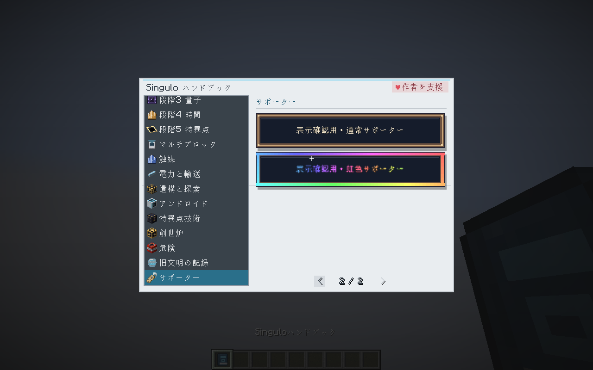
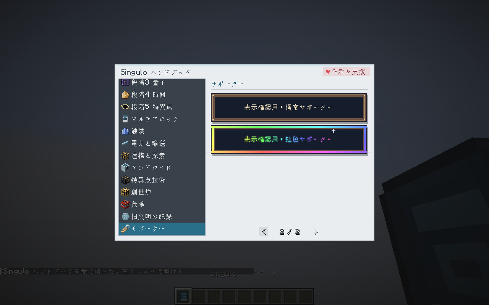
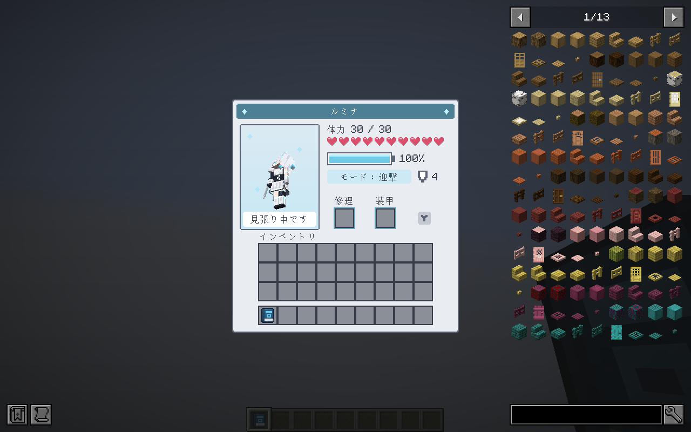
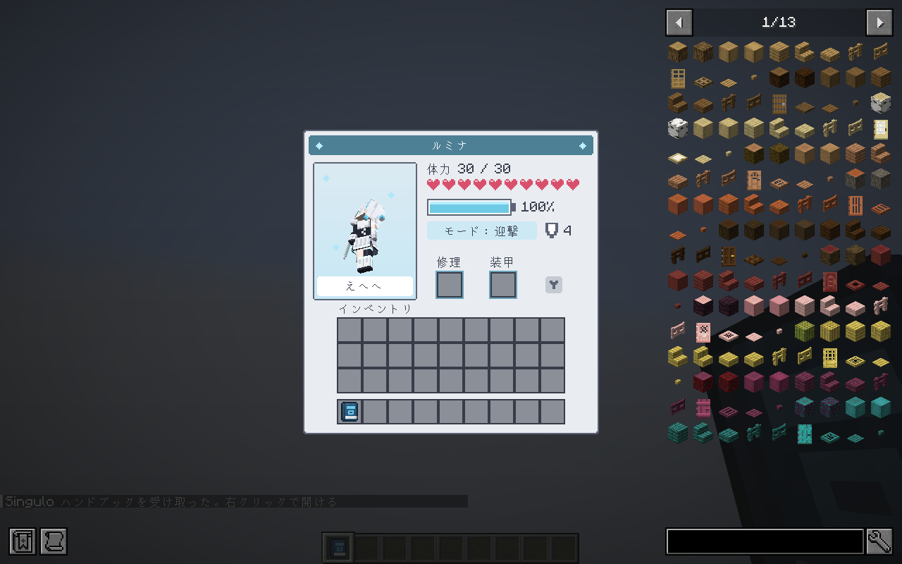
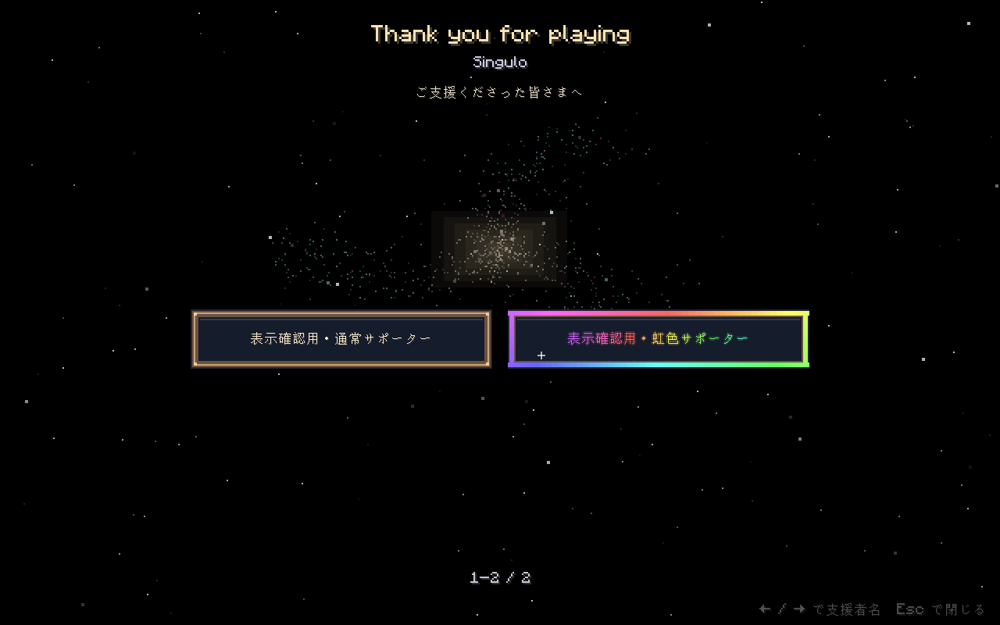
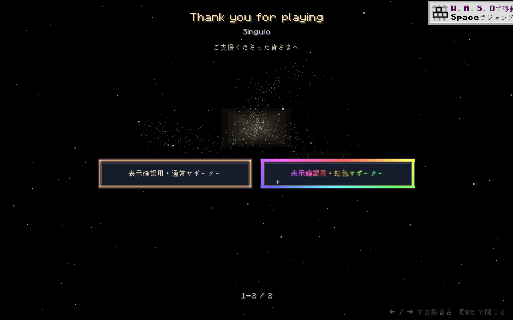

# Singulo 0.6.0 / Minecraft 1.20.1 検証記録

基準: `main` の `aee3da04a20a000933ef7a4a274ab2511ab6c334`（0.6.0）。
検証日: 2026-10-14（日本時間）。Gradle: 完全な JDK 21、Minecraft: JDK 17。

## 対象

| 版 | ローダー | PR の対象ブランチ | 配布用 JAR |
| --- | --- | --- | --- |
| F | Forge 47.4.26 | `port/1.20.1-forge` | `Singulo-0.6.0-1.20.1F.jar` |
| N | NeoForge 47.1.106 | `port/1.20.1-neoforge` | `Singulo-0.6.0-1.20.1N.jar` |

両版の共通 Java ソースは一致します。ゲームバランスを変えるための独自のレシピ・消費電力・報酬調整は加えていません。1.20.1 用の形式変換と API の実装差への対応を行っています。`main` の変更やリリースの公開は行いません。

## 静的検証

両版で以下が成功しました。

- `python3 tools/check_models.py`: 問題 0 件。
- `python3 tools/localization.py --check`: 簡体字・繁体字・韓国語、各 1,994 項目。
- `python3 tools/check_supporters.py`: 0 / 100 名。表示確認用の名前は製品の名簿には含めません。
- `python3 tools/check_port_1201.py`: Java API とデータ配置の検査。
- `git diff --check`。

配布 JAR は `tools/check_port_1201.py --jar ...` で、Java 17 のクラス形式、Minecraft とローダーの依存バージョン、Access Transformer、リソースの複数形ディレクトリ、pack format 15、新機能のクラス、確認用コードの混入がないことを検査します。

## ゲーム内の回帰検証

全体 GameTest の結果は確認後に記録します。両版ともクリーンビルドと再難読化、配布 JAR の検査に成功しました（各 548 クラス、すべて Java 17）。

1.20.1 固有の追加テストは充電器の Capability／NBT、防具板のエンチャント保存、翼の滑空、新規通信の往復、段差移動高さの計 5 件です。戦闘ログには死亡とダメージの両方が残り、ダメージ後の HP を記録することも確認します。

時間結晶の純度試験は最大 25,000 tick を確保しているため、全体実行には時間が掛かります。

試験設備の相互干渉を減らすため、クレーター生成は専用の 64×24×64 の領域を使用し、ボム吸収の判定は自分の試験領域のエンティティだけを対象にします。模擬プレイヤーは各試験の成功／失敗時にログアウトさせ、後続のボス戦の参加人数に数えられないようにします。シールド試験はブロックエンティティの初回 tick を待ってから反発を調べます。炉心やボスの本来の挙動・値は変更しません。前回の試験ワールドは次の GameTest 実行前に削除します。

## クライアント確認

JEI 15.20.0.129 を含む実クライアントをソフトウェア描画（llvmpipe、1280×800）で起動します。隔離した確認用プロジェクトだけに通常／虹色のサンプル名を読み込ませ、攻略本・アンドロイドの装備画面・エンディングの表示を確認します。製品のリソースと JAR にはこのコードや名前を含めません。

両版とも実ワールドへの参加、攻略本の通常／虹色の額、アンドロイドの装備画面、エンディングの支援者表示まで到達し、確認用クライアントが正常終了しました。GUI 背景の描画も 1.20.1 の呼出し方式に修正しています。音声デバイスのない環境のため音声出力は未確認です。

| Forge | NeoForge |
| --- | --- |
|  |  |
|  |  |
|  |  |

自動テストと画面確認は長時間のサバイバル通しプレイの代わりにはなりません。既存 1.20.1 ワールドの更新はバックアップ後に行ってください。1.21.1 ワールドのダウングレードは対象外です。

## 検証した配布 JAR

| ファイル | SHA-256 |
| --- | --- |
| `Singulo-0.6.0-1.20.1F.jar` | `9b73d7099ffb48188340f4d720ea21e0d1dab9da3a3f4f94eba96eabfff9b802` |
| `Singulo-0.6.0-1.20.1N.jar` | `b148451dab97dc1e0c3ad7ea54c5d47eb4249fa2439a3e0b0f0a3b9e6bdc3ef2` |
