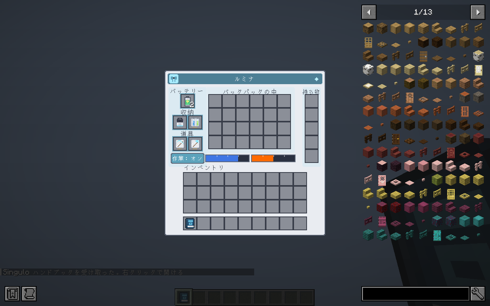
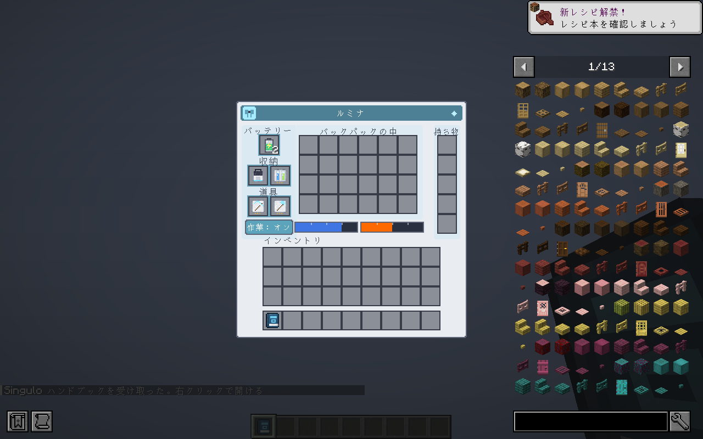
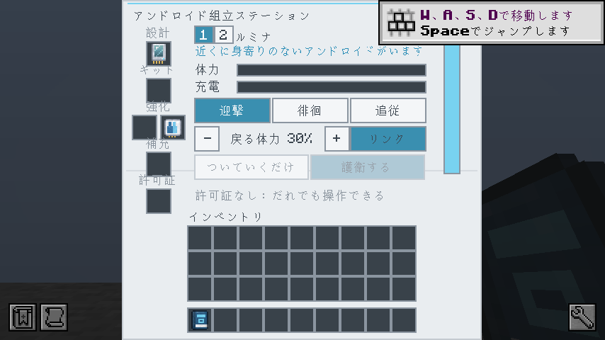
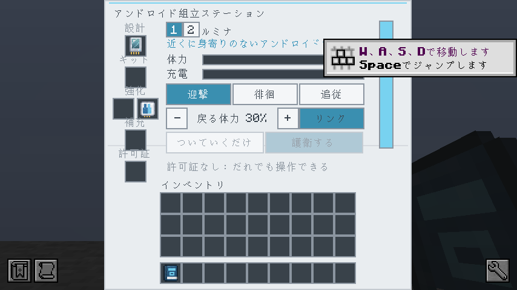
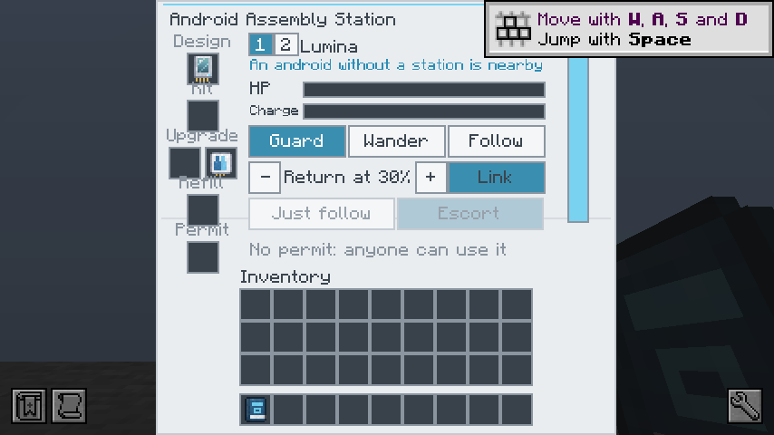
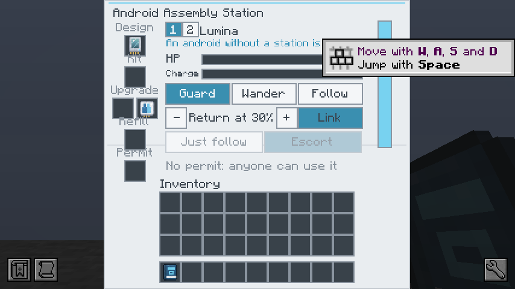

# Singulo 0.7.0 / Minecraft 1.20.1 移植検証

基準はmain `933373a8f5158bf427d5ebccca33b1309ff23ad9`。既存の `port/1.20.1-neoforge` と `port/1.20.1-forge` を更新する。mainへのPR・変更は行わない。記録日: 2026-10-15（日本時間）。

## 対象と検証

| 対象 | NeoForge | Forge |
| --- | --- | --- |
| PR / マージ先 | [#19](https://github.com/GenichiMaruo/Singulo/pull/19) / `port/1.20.1-neoforge` | [#20](https://github.com/GenichiMaruo/Singulo/pull/20) / `port/1.20.1-forge` |
| Minecraft / Java | 1.20.1 / 17 | 1.20.1 / 17 |
| ローダー | 47.1.106 | 47.4.26 |
| 配布ファイル | `Singulo-0.7.0-1.20.1N.jar` | `Singulo-0.7.0-1.20.1F.jar` |
| 全体GameTest | 312必須テスト成功（[CI](https://github.com/GenichiMaruo/Singulo/actions/runs/38672277316)） | 312必須テスト成功（[CI](https://github.com/GenichiMaruo/Singulo/actions/runs/38672289508)） |
| 実クライアントGUI | 15画面完了 | 15画面完了 |

上表は成功した全体実行の記録。追加の後片付け修正と文書を含む最終コミットでも、同じ検証を再実行し、PRのチェックが成功したことを確認してからマージする。

全体試験は空の新規GameTestワールドから実行する。必須試験の完了をログとGradleの終了判定で検査し、未実行や失敗を成功扱いしない。重点試験の成功だけではマージしない。

翻訳（中国語簡体・繁体・韓国語各2,302項目）、モデル問題0件、支援者名簿0/100、1.20.1のAPI・リソース配置を検査した。配布JAR内のクラスはJava 17形式（NeoForge 632、Forge 633）。GUI・診断用クラスと専用テスト構造物は通常の配布JARに含めない。

## 移植内容と修正

- アンドロイドの作業指令台・資材口・納品口・棚・手順カード、追加アップグレード、装飾、タンクを移植した。既存0.6.0の機能・支援者表示も維持する。
- Java 17、1.20.1のForge系API、NBT、SimpleChannel、メニューと描画API、レシピJSONへ変換した。追加通信には新しいIDを割り当て、プロトコルを3に更新した。
- 記録済みカードのスタック制限、装飾の染色、採掘・伐採アップグレードのエンチャント、流体の種類・量・NBT保存を移植した。
- **指令台の接続先保存を修正。** 1.20.1の `NbtUtils.writeBlockPos` はCompoundTagを返すため、一覧の読込型もCompoundTagとした。実際の作業位置カードで納品口を接続してから保存・読込する回帰テストを追加した。
- **言語切替時のツールチップを修正。** 検索インデックスの生成中はLevelがnullになり得るため、カード情報をLevelに依存せず読む。
- 遺構の構造物は既存1.20.1互換のNBT（DataVersion 3465）を使用する。1.21.1の構造物NBTをそのまま配布しない。

## 試験環境の修正

1.20.1ではチャンクの準備を20tick待ち、模擬プレイヤーの接続には既存のLegacy helperを使う。終了した試験の装置・エンティティ・模擬プレイヤーが次の試験へ影響しないよう片付ける。別の試験が共有しているチャンクの強制読込は解除しない。装置撤去時にはブロックエンティティを先に除去し、試験用の荷物が後の炉に吸い込まれないようにする。ボス出現の体力検査も別バッチに分け、他の戦闘試験と同時に動かさない。

空の構造物には工場の床がなかったため、作業場に床を明示した。収穫試験には照明・水・湿った耕地を用意し、実際の明るさが十分になってから作物を植える。元の「小麦2個を納品し、2か所を植え直す」という期待値は維持する。試験の必須判定・製品の消費量や速度は緩和していない。

重点試験は `repro/review.init.gradle` を明示した場合だけ読み込む。通常の検証と公開では全体試験を使う。

## ゲームバランス

mainの生成済み243レシピを両版と照合した。NBT形式、出力の `id` / `item`、共通タグ名（`c`→`forge`、`obsidians`→`obsidian`、`sands`→`sand`）を正規化すると、**全243件で材料・数量・出力・加工時間・消費電力・要求ティアが一致**する。移植のための独自のコスト調整は行わない。

これは0.7.0本体との一致確認であり、全ティアの長時間サバイバル通しプレイや、あらゆる他Modとの相互作用を保証するものではない。

## GUI

JEIを有効にした実クライアントで、アンドロイド3ページ、ステーション、注文・各記録・確認・棚・納品口・詳細スクロール、日本語/英語の854×480表示の計15画面を撮影した。3ページそれぞれの空きインベントリ35スロットは、書き出したPNGの画素でも検査する。

| NeoForge | Forge |
| --- | --- |
|  |  |
|  |  |
|  |  |

画面内にMinecraftの操作チュートリアル通知が重なる場合がある。画像は切り取らず保存している。6人の一覧・長文スクロールの画面検査はUI用データで行っており、6人同時稼働の負荷試験ではない。

## マージと公開

各PRの最終コミットのCI成功を確認してから対応する既存portブランチへマージし、そのマージコミットに専用タグ `v0.7.0-1.20.1N` / `v0.7.0-1.20.1F` を作成する。通常のブランチpushでは公開しない。

タグの公開ワークフローでもビルド・全必須GameTest・Java 17 JAR検査を再実行する。成功した同一JARをCurseForgeへ **Beta** として送信し、GitHub Releaseにも添付する。CurseForgeのアップロード成功と公開審査の完了は区別する。実際のマージ・タグ・ファイルURLと公開状態は各PRの完了コメントに記録する。

## 公開前の追加検証

最初のタグの公開ワークフローで、点火の停止・ホーキング出力・ペレット上限の試験が不安定になり、アップロード前に停止した。元のタグは変更しない。炉の試験領域が15ブロック幅しかなく、外向きの接続検証用電源が領域外に残り得たため、専用の64×15×64領域の中央に炉を配置し、各炉を別バッチにする。ハスク・収集器・タンクの相対位置は維持し、試験の電力・質量・時間と合格条件は変更しない。電力不足の試験は、形成が完了して実際に点火を開始してから260tickを測る。

追加修正も各portブランチ向けPRで検証・マージする。公開の再試行には `v0.7.0-1.20.1N-r1` / `v0.7.0-1.20.1F-r1` を使い、modの版番号と配布ファイル名は0.7.0のままとする。失敗した最初のタグからはCurseForgeへ送信していない。

固定setupTicksだけでは、早送りされるGameTestServerで非同期チャンク昇格が完了したと保証できない。試験開始時に領域内の全チャンクを明示して強制読込し、サーバーのタスクを処理してentity-ticking状態を待つ。準備中は試験のゲーム内時計を進めず、30秒以内に準備できなければ明示的に失敗する。64ブロック幅の構造物は原点がチャンク境界とずれると5チャンクにまたがるため、Minecraft既定の原点周辺の固定範囲だけに頼らない。

投影器破壊の試験では、破壊直後の空気の確認は維持し、30tick後は「空気のまま」ではなく「投影器が存在しない」を検査する。物理更新で砂利が落ちた場合でも、防御装置の破壊とは無関係な失敗にしない。投影器数0と20ダメージがそのまま通る本来の検査は維持する。

再実行で炉の周囲のItemEntity混入と、別試験への影響が残った。終了時の座標範囲だけでは、外へ移動した敵や投射物を除去できないため、試験中のEntityJoinLevelEventで生成個体と所有者の投射物を記録し、終了時には移動先によらず除去する。また、Minecraftのバッチ進行リスナーより前に後片付けを実行し、次のバッチ開始後に旧試験の清掃を走らせない。試験の合格条件や製品仕様は変更しない。

生成追跡は、同じレベルの実行中試験が1件だけの場合、領域外に意図的に生成した補助Entityもその試験の所有として記録する。複数試験の同時実行中は、この推測による割当を行わない。

生産アップグレードの2体印刷試験では、工場とは別のstation helperに床がなかったため、1体目が上からどく足場も明示する。実際に置いたステーションと同じように所有者を設定し、他の身寄りなし個体の試験から別バッチに分ける。2体印刷・キット2個消費・両UUIDの管理という判定と600tickの上限は維持する。

Forgeの経験値合流試験では、保護経験値は一致したが通常経験値の計数が1件不一致となったため、試験開始前の無関係なXPを除き、保護印を持つサンプルを選ぶ。オーブの初速と重力だけを固定し、回収できる近接プレイヤーがいないことを明示する。バニラの合流処理、値・個数・保護印・寿命には介入せず、保護経験値と通常経験値の両方の合計一致を維持する。

公開タグ-r1の再確認では、ペレットの上限試験に砂利ItemEntityが入り、5000.499まで増加して失敗した。製品は外部投入で上限を超えられる設計で、崩壊試験もそれを検査している。ペレットだけの試験では64×15×64の6面を岩盤で閉じ、開始前の落下ブロック・ドロップを除去する。水平の余白だけでは上方からの砂利を遮断できなかった。ペレット数の減少・質量5000以下・非崩壊という判定と100tickの測定期間は維持する。製品コードは変更しない。
