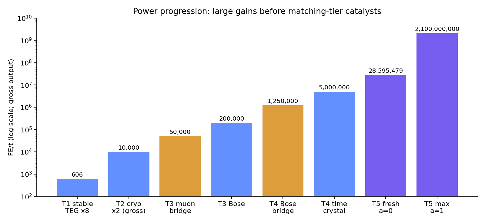
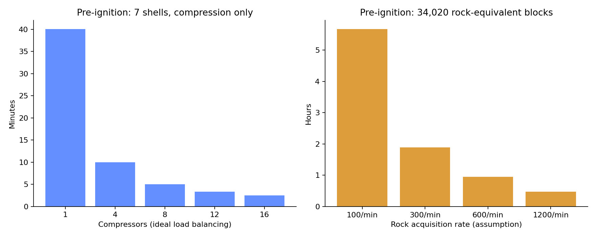

# Singulo PR #7 コードレビュー

対象：[PR #7](https://github.com/GenichiMaruo/Singulo/pull/7)／HEAD `0df86848ad8d694df534fedc48d11af480fe076f`／比較元 `176ee06e5250e5a28e2669dfe733b227bf40d217`。検証日：2026-10-11。Minecraft 1.21.1、NeoForge 21.1.256、Java 21。

## 判定

前回の主要な実装不具合 SNG-021〜025 は、コードと実行結果の両方で改善を確認した。通常構成のビルドと既定の **191件のGameTestが成功**。今回、進行不能やクラッシュに相当する新しいP1問題は確認していない。

ただし、**ゲーム内説明と計算資料には修正が残る**。正式版のリリース判断には、以下の指摘と通しプレイの結果を反映したい。全課題はルートの [issue.md](issue.md) に集約した。これは対象コミットへのレビューであり、サバイバル全体のバランスが適正だと実証したものではない。

## 指摘事項

### SNG-032 / P2 — 寿命に比例する新仕様がゲーム内説明へ反映されていない

変更箇所：[RecipeTweaks.java:207](https://github.com/GenichiMaruo/Singulo/blob/0df86848ad8d694df534fedc48d11af480fe076f/src/main/java/io/github/genichimaruo/singulo/recipe/RecipeTweaks.java#L207)。必要寿命を新品の最大寿命に比例させる実装自体は妥当。

しかし、配布される `ja_jp.json` / `en_us.json` の `desc.singulo.time_crystal_module` と `guide.singulo.stage4.time.body` は「30分以上が必要」「30分切り出して15分残る」と固定値を案内する。生成元も [descriptions.py:203](https://github.com/GenichiMaruo/Singulo/blob/0df86848ad8d694df534fedc48d11af480fe076f/tools/descriptions.py#L203) と `tools/guide.py` のままなので、単に再生成しても直らない。`SinguloClient.describe()` はこの翻訳を実際のアイテム説明に使用する。

例えば `timeCrystalLifetimeMinutes=20` なら新品24,000 tickに対しモジュールの必要量は16,000 tick、約13分20秒。casualの既定なら新品90分に対して必要60分。前者では「作れない」と誤案内し、後者では30分残った触媒から作れると誤案内する。外部マニュアルと `tools/recipes.py` の注記は更新済みだが、ゲーム内では食い違う。

**改善案：** 日英の説明・ガイド・変更履歴を「設定とプリセットを反映した新品寿命の2/3、既定standardでは30分」に統一し、翻訳資産を再生成する。実値を表示できる箇所では調整後レシピの必要量を使う。

### SNG-026 / P2、継続 — 個体数の補正が資材・電力・加工時間へ伝播していない

変更箇所：[analyze.py:198](https://github.com/GenichiMaruo/Singulo/blob/0df86848ad8d694df534fedc48d11af480fe076f/docs/balance-review-0.3.0/analyze.py#L198)。`time_crystals_integer` の追加で、点火前の新品10個・124分を再現できた。これは前進。

一方、同じJSONの `cumulative`、`resource-costs.csv`、付表の累計資材・加工負荷は、時間結晶9個の分数モデルを使い続ける。付表には育成槽「112分」と、後段の個体表「124分」が同居する。READMEは分数モデルの制限を説明しているが、整数モデルの実物を用意するための資材と電力までは計算していない。

現在の設備バスケットで不足する時間結晶1個を、既存の素材展開モデルに追加すると、育成槽だけで **432 MFE・12分**、さらにダイヤモンド1個、銅2個、ネザー水晶5個、星屑2個などが増える。付帯加工も増える。原本の分数使用・修復摩耗を完全に整数化した見積もりではないため、この差分自体も下限の補正として扱う必要がある。

また「初コア後11個・136分」は、コア材料にも新品を別途使うシナリオ。実装のコアレシピは時間結晶を `count=1` で丸ごと取り、残寿命を要求しない。モジュール加工後の残り15分の個体が材料照合を通ることを追加テストで確認した。運転用4個を別枠で維持し、6個のモジュール用個体の残寿命でエキゾチック物質4バッチを処理し、別の残余個体を初コア材料に使えば、**時間結晶の追加育成は不要**。この条件では初コア後も新品10個・育成と種復元124分になる。これは時間結晶の加工負荷であり、H凝縮体の回収待ちやコア自身の加工時間を含まない。

**改善案：** 個体ごとの残寿命と転用先を素材展開にも反映する。「実行可能な整数シナリオ」と「寿命の総量による下限」を別名で出力し、表・CSV・電力計算を同じシナリオにそろえる。初コア用の新品投入／残余転用も前提を明記する。

### SNG-034 / P2、既存の取り残し — 縮退熱炉のゲーム内説明が20 MFE/tのまま

このPRで新たに発生したものではなく、正式版準備として残っている問題。`desc.singulo.degenerate_furnace` の日本語説明と、日英の `jei.singulo.mb.degenerate_furnace` は **20 MFE/t** のまま。既定出力は5 MFE/tで、このPRの設定移行も旧20 MFE/tを5 MFE/tへ変更する。

生成元は `tools/descriptions.py:226`、`tools/gen_data.py:596`。`MultiblockInfoCategory.draw()` が翻訳をそのまま表示するため、JEIで設備を選ぶと4倍の出力を期待させる。ミュオンなど下位触媒使用時の実効出力はさらに異なる。

**改善案：** 少なくとも既定standardの同ティア出力を5 MFE/tへ訂正する。可能なら現在の設定・触媒から出力を表示し、固定説明には「既定値」と明記する。これはSNG-029の生産量表示とは別の誤記修正。

### SNG-033 / P3 — 付属の再現テストが修正成功時に例外を投げる

追加された [MergedFixReviewGameTests.java:68](https://github.com/GenichiMaruo/Singulo/blob/0df86848ad8d694df534fedc48d11af480fe076f/docs/merge-review-176ee06/repro/java/io/github/genichimaruo/singulo/test/MergedFixReviewGameTests.java#L68) は、`assertTrue(isEmpty(), message)` のメッセージ内で `getFirst()` を呼ぶ。Javaはメッセージも先に評価するため、冷却材ゼロが正しく反映されて空リストになった場合に `NoSuchElementException` が出る。

記載されたinit scriptをそのまま実行し、**5件中1件がこの例外で失敗**した。[実行ログ](evidence/gametest-original-repro-5.log)。前回の指摘用コードには私の側でこの欠陥があった。今回の製品修正の失敗と解釈してはいけない。既定で走る `BalanceGameTests` の移植版にはこの問題がなく、191件は成功している。

**改善案：** メッセージを空リストでも安全に計算する。変更案は [1行の差分](evidence/repro-message-fix.diff)。今回の外部検証ではこのメッセージだけ修正し、元の5ケースを含む10件が成功した。

## 前回指摘への対応判定

| ID | 判定 | 今回の根拠 |
|---|---|---|
| SNG-021 | 改善確認 | expertの通常殻は窒素8,000 mB、代替殻は4,500 mB。倍率適用後にタンク容量で制限 |
| SNG-022 | 改善確認 | 寿命20分でもモジュール製作可能。48通りの寿命・倍率・プリセットで新品は通り、残量半分は拒否 |
| SNG-023 | 改善確認 | 覚醒戦開始前の再生期限処理を確認。勝利直後に保管庫が再封鎖されない |
| SNG-024 | 改善確認、一部受入待ち | 3台稼働→上限1で停止。起動順を保存し、逆順にNBT読込・再登録しても最古の1台が残る。プロセス再起動は別途受入対象 |
| SNG-025 | 改善確認 | 冷却材0・1・4,000・6,000・8,000 mB × standard/casual/expertの15条件で通常版と代替版を確認 |
| SNG-026 | 一部改善 | 10個・124分を再現。全体BOMの整数化と初コアへの残余転用は上記指摘 |
| SNG-027 | 設定移行は改善確認 | 実ファイルで旧既定3値の移行、7 MFE/t・核3個・炉殻17枚の保持、version=1の再移行防止を確認。旧サバイバルセーブは未検証 |
| SNG-028 | 未完 | 自動テストは進展。通しプレイ、実クライアント、他mod併用の受入検証が残る |
| SNG-029 | 未対応 | 実効生産量のGUI表示は今回の変更範囲にない |
| SNG-030 | 再生成の問題は改善確認 | 現行ソースで正常終了し、コミット・殻数・発電出力を更新。旧版JSONの既存キーも一致 |
| SNG-031 | 配布物の版番号は改善確認 | 通常ビルドのJAR名とmod情報が0.3.1。CurseForgeの公開作業は別途 |

## 実行した検証

| 検証 | 結果 | 証拠 |
|---|---|---|
| `compileJava` / 通常構成の `build` | 成功。非推奨APIの警告あり | [compile.log](evidence/compile.log)、[build.log](evidence/build.log) |
| 既定 `runGameTestServer` | 全191件成功 | [ログ](evidence/gametest-default-191.log) |
| PR付属の歴史的再現コードそのまま | 4件成功、1件はテスト自身の例外 | [ログ](evidence/gametest-original-repro-5.log) |
| 診断メッセージ修正後の旧5件＋追加5件 | 全10件成功 | [ログ](evidence/gametest-additional-10.log)、[検証コード](repro/java/io/github/genichimaruo/singulo/test/Pr7AdditionalGameTests.java) |
| 旧既定TOMLを実際に読込 | 20 MFE/t→5 MFE/t、核2→1、炉殻12→24、移行印1 | [入力](evidence/legacy-config-before.toml)、上記歴史的再現ログの移行記録 |
| カスタムTOMLを実際に読込 | 指定値保持、移行印1。次回起動も保持 | [入力](evidence/custom-config-before.toml)、[保存後](evidence/custom-config-after.toml) |
| `analyze.py` 現行HEAD | 成功、PRに含まれる付表・主要JSON値と一致 | [再計算JSON](evidence/recalculated/calculation-results.json) |
| `analyze.py --root <b45f478>` | 旧JSONの既存キーは全一致。新しいキー2個は追加 | [比較結果](evidence/baseline-comparison.json) |
| 通常JARの内容 | `Singulo-0.3.1-1.21.1N.jar`。外部レビュー用テストクラス混入なし | [配布物確認](evidence/jar-check.json) |

追加テストは製品コードを変更せず、外部のsourceSetsから読み込んだ。GameTestの即時設定変更ではキャッシュを明示的に破棄しているため、稼働中のTOML監視・JEI表示更新まで保証するテストではない。アンカーの追加ケースはNBT保存／読み込みと `onLoad()` 再登録であり、プロセスの完全再起動やチャンクチケットの永続データを端から端まで検証したものではない。これらはSNG-028に残す。

再現にはJava 21を用意し、リポジトリルートで次を実行する。依存取得のネットワーク設定は環境に合わせる。

```bash
bash ./gradlew build
bash ./gradlew runGameTestServer
# 以下は報告書付属の外部テストを使用する。歴史的reproのinit scriptとは同時に使わない。
bash ./gradlew -I docs/pr7-review-0df8684/repro/review.init.gradle \
  -PtestNamespace=singulo_review runGameTestServer
MPLCONFIGDIR=/tmp/singulo-mpl python docs/balance-review-0.3.0/analyze.py \
  --out /tmp/singulo-pr7-calculation
```

外部テストの移行印確認ケースは、通常のサーバー設定が読み込まれて `settingsVersion=1` になった状態を前提にする。保存済みのカスタム値保持は、添付TOMLを用いた別の実起動で確認した。

## 中程度の難易度としての評価と改善案

点火前の通常殻7個は岩石34,020質量、金属1,701インゴット相当、窒素42,000 mB。殻の圧縮系列だけの加工負荷は40.075分・台で、4台へ理想的に分散すると約10分。300質量/分で岩石を取得できる条件なら採集だけで約113分になる。全バスケットの他の圧縮製品・設備・燃料・探索を含む到達時間ではない。

時間結晶は新品10個を育成・復元する124分・台が、一つの実行可能な建設シナリオ。育成槽2台なら育成120分は理想的に約60分へ分散できるが、復元・搬送・素材供給の待ちを別途要する。この規模は工場を増設する動機になり得る。実プレイの採集能力と遺構の発見頻度が不明なので、適正さの確定にはそれらの記録が必要。



発電量の段差は大きい。新規既定の縮退熱炉5 MFE/tへの調整が反映された。図は総出力で、触媒の育成電力、燃料、輸送上限を引いた正味出力ではない。



正式版前には、standardでT1→初コアまでを一度通し、ティアごとの探索・採集・加工待ち・電力不足・触媒消耗を記録する。遊び心地が重い場合は、新たな発電倍率を大きくする前に、探索の発見支援、余剰触媒の搬送・再利用、並列育成の案内を改善すると、探索と工場づくりを両立しやすい。冷却塔の専用運転と共用運転の実効能力表示も、その後の優先度が高い。

今回のPRは前回の欠陥を直す変更であり、同型modとの新しい定量比較は実施していない。前回の比較の限界も維持する。191件の成功だけで他mod相当のプレイ時間や正式版の受入完了を宣言しない。
