# レシピ一覧

すべてのレシピを、段階ごとに画像で並べたもの。`tools/gen_data.py` を実行すると自動で作り直される（手で書き換えない）。

## 段階1　起動

### 鋼の素

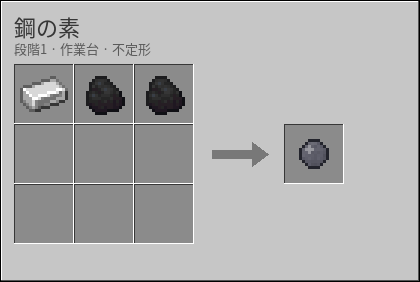

不定形レシピ

### 鋼鉄インゴット

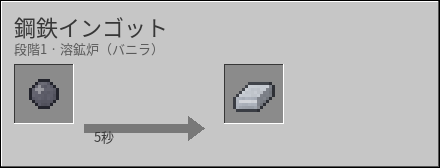

焼成炉なら2.5秒。共通タグ c:ingots/steel の他mod鋼鉄も可

### 未焼成セラミック

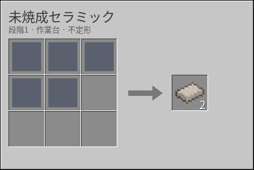

### ホワイトセラミック複合材

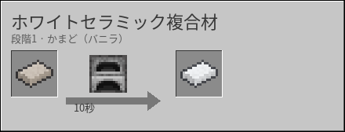

焼成炉なら2.5秒

### 基礎回路

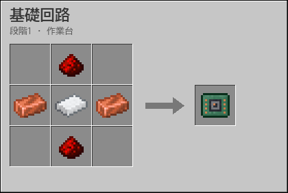

### Singuloハンドブック

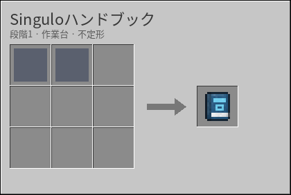

初めて入ったときにも1冊もらえる

### 設定カード

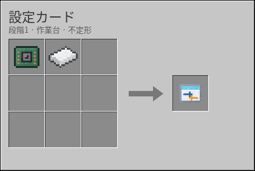

スニークして装置に使うと設定を写し、ほかの装置に使うと貼る

### 探索コンパス

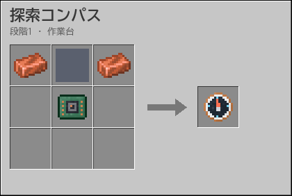

選んだ種類のいちばん近い遺構を指す

### ホロ投影機

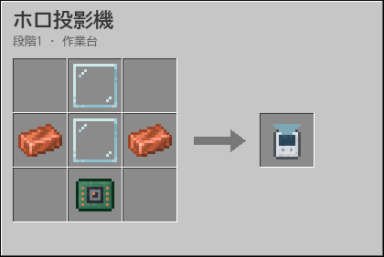

コントローラに使うと、マルチブロックの組み方を半透明で投影する

### 熱電対モジュール

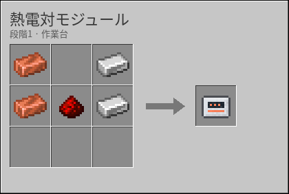

### 基礎フレーム

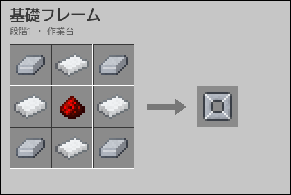

全装置の土台。白い外装

### 鋼板

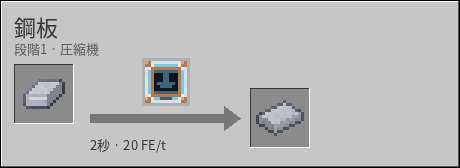

作業台なら鋼鉄2→1（効率半分）

### セラミック基板

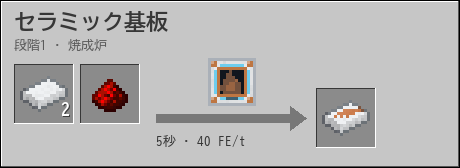

### 水素

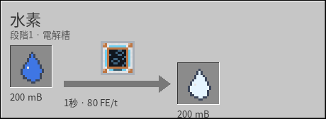

単位mB。副産物 酸素100 mB

### 銅導線

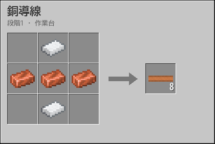

送電2 kFE/t、長距離で少し損失

### 白紙データカード

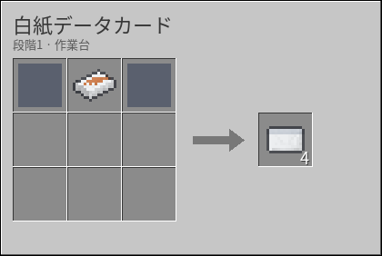

セラミック基板は焼成炉で作る

### データカード（観測ログ）

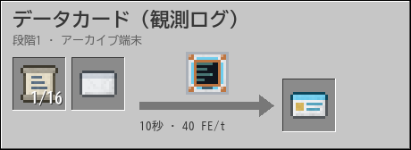

原本を1回ぶん読んで書き写す。レシピにはカードを使う

### 解読した記録

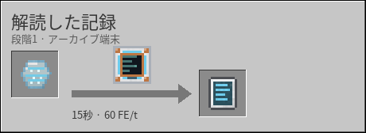

右クリックで読むと、ハンドブックの「旧文明の記録」に次の記録が加わる

### 圧縮ブロックLv1

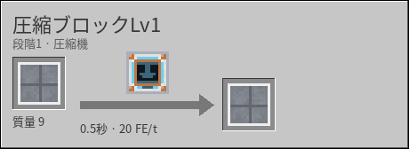

質量値9ぶんの任意ブロック（丸石なら9個）

### 質量ペレット

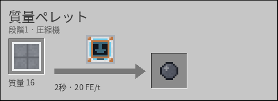

Pリアクターの燃料

### 熱電発電機

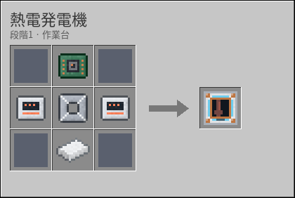

出力0.10 FE/t × 温度差K

### 焼成炉

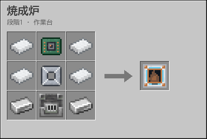

稼働時40 FE/t。焼成・製鋼を2倍速

### 圧縮機

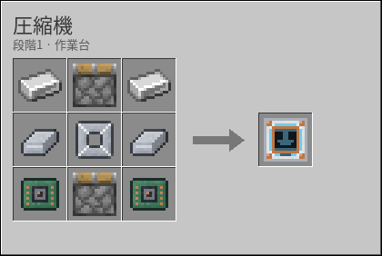

稼働時20 FE/t。圧縮・粉砕

### 電解槽

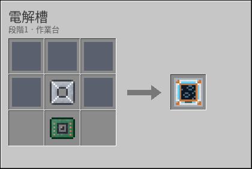

稼働時80 FE/t

### アーカイブ端末

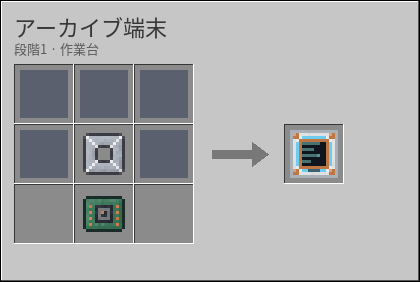

クリスタルメモリの復号、次の目標パネル

### ホワイトパネル

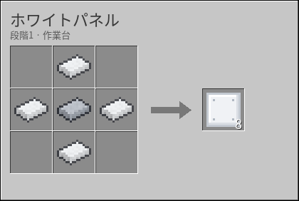

### 発光ホワイトパネル

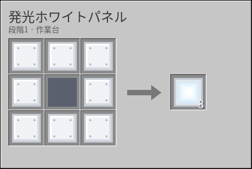

### 黒色強化パネル

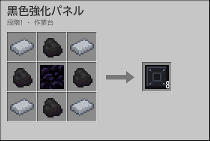

### ホワイトガラスパネル

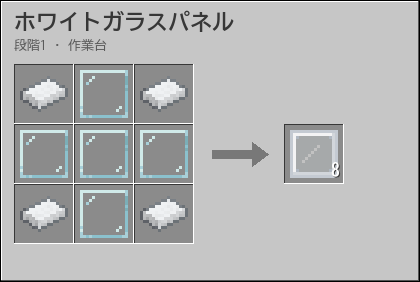

### 四芒星ホワイトガラスパネル

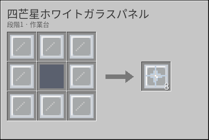

### 黒色強化ガラス

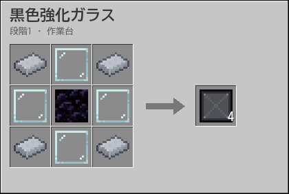

### 四芒星黒色強化ガラス

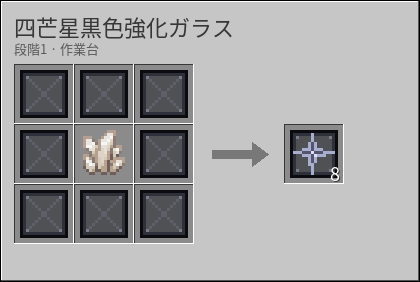

### リボン

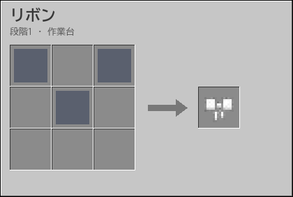

アンドロイドの装飾。染料で染められる

### 髪飾り

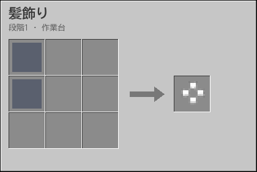

アンドロイドの装飾。染料で染められる

### ベレー帽

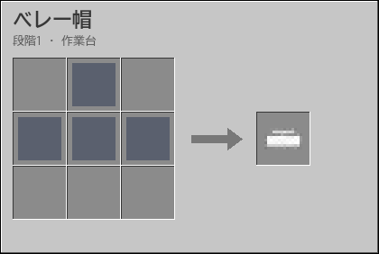

アンドロイドの装飾。染料で染められる

### ヘッドドレス

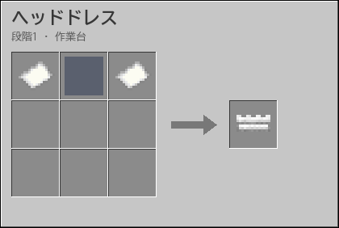

アンドロイドの装飾。染料で染められる

### マント

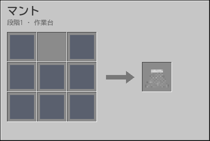

アンドロイドの装飾。染料で染められる

### マフラー

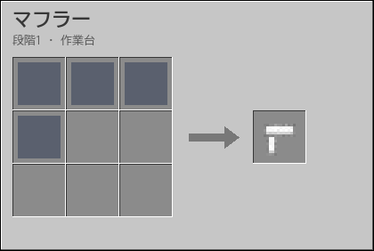

アンドロイドの装飾。染料で染められる

### 腰リボン

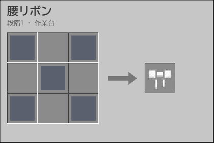

アンドロイドの装飾。染料で染められる

### 文庫本

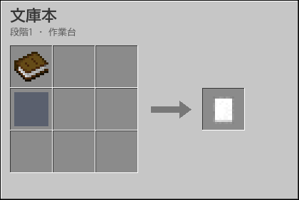

アンドロイドの装飾。染料で染められる

### 花束

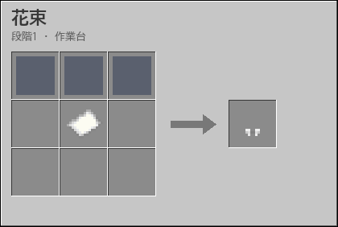

アンドロイドの装飾。染料で染められる

### ティーカップ

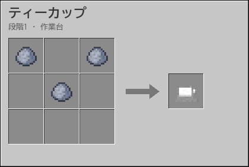

アンドロイドの装飾。染料で染められる

### 傘

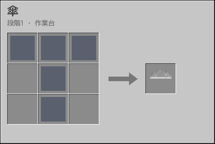

アンドロイドの装飾。染料で染められる

### 未焼成セラミック（火打石）

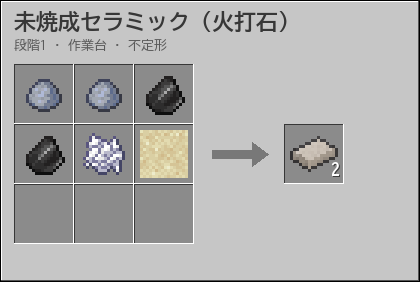

ネザー水晶の代わりに火打石2個。ネザーへ行く前から始められる

## 段階2　極低温

### 隕石コンパス

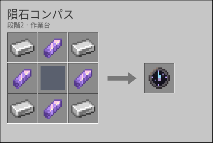

まだ掘り出されていない、いちばん近い隕石の核を指す

### 冷却塔基部

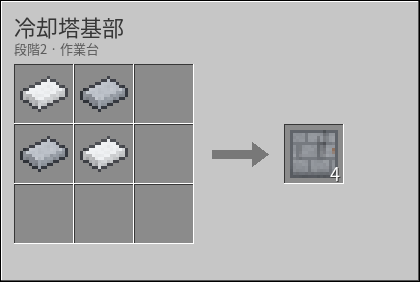

### 冷却塔外壁

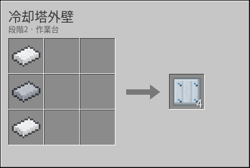

### 冷却塔ガラス

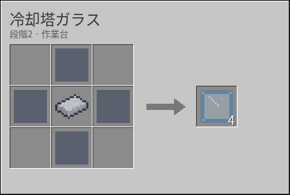

### 熱交換コア

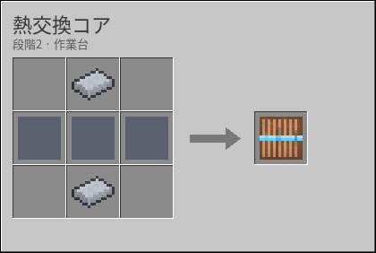

### 冷却塔冷却帯

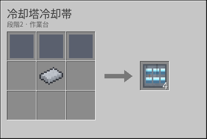

### 冷却塔頂部リム

### 冷却塔通気格子

### マルチブロック搬入出ポート

マルチブロックの外装板の代わりに置く（枠には置けない）。つないだケーブルやパイプはコントローラへ届き、出力は隣へ自動で押し出す

### 冷却塔コントローラ

### 極低温冷却塔

5×5の双曲面の塔、高さ7〜15（これは高さ7）。高さ10以上で液体ヘリウム可

### 液体窒素

単位mB。空気から分離・液化（入力なし）

### 超伝導コイル

### 超伝導線材

### 冷媒カートリッジ

液体窒素100 mBを詰めた鋼の容器。液体を入れられない精密組立台で、極低温の組み立てに使う

### 隕鉄インゴット

隕石クレーターの隕鉄塊から採れる。鉄とニッケルの天然の合金で、強い磁性を持つ

### 超伝導ケーブル

送電1 MFE/t、損失ゼロ

### 加速管

### 収束磁石

隕鉄（鉄とニッケルの天然の合金）の磁極片で、超伝導コイルの磁場をビームに絞る。2個ずつできる

### 加速器コントローラ

### 粒子加速器

最小は一辺8の正方形の環（成立する最小構成は加速管21・収束磁石7。ホロ投影の既定は加速管18・収束磁石10）。一辺を広げるほど高速・単極子が出やすい

### ミュオン束

宇宙線ミュオン収集器でも無電力で少量

### 触媒反応器

### ミュオン触媒

寿命20分（ティア2装置）

### 極低温タービン

出力5 kFE/t。高温源×液体窒素の膨張

### 宇宙線ミュオン収集器

### SMESセル

10 MFE蓄電

### 精密組立台

段階3以降の装置・部品・道具を組み立てる。材料は種類と個数だけで指定（入力6枠、各枠は何個でも可）

### ワールドライン・アンカー（小）

### アンドロイドキット

組立ステーションで1体印刷するたびに1つ使う

### アンドロイド組立ステーション

小型クリスタルメモリ（遺構の印刷台のアンドロイドを全部倒すと、半分の確率で出る）で型を決める

### アンドロイド遮断ガラス

アンドロイドだけが通れない

### 模様入りアンドロイド遮断ガラス

### アンドロイド透過ガラス

アンドロイドだけが通れる

### 模様入りアンドロイド透過ガラス

### 転送アップグレード

組立ステーションの強化スロットに積む

### 生産アップグレード

組立ステーションで2体まで印刷できる

### バッテリーアップグレード

アンドロイドの充電の満タン +50%（2個まで）

### バックパックアップグレード

アンドロイドの持ち物 +12スロット（バックパックの1段目）

### タンクアップグレード

アンドロイドが液体・ガスを運べる（2種類まで、各32,000 mB）

### ガスタンクアップグレード

アンドロイドが Mekanism のガス・化学物質を運べる（2種類まで、各32,000 mB）。Mekanism が必要

### ガス・液体アップグレード

液体と化学物質を2種類ずつ運べる（各16,000 mB）。Mekanism が必要

### 採掘アップグレード

アンドロイドが採掘できる。ツルハシのエンチャントを付けられる

### 伐採アップグレード

アンドロイドが木を切れる。斧のエンチャントを付けられる

### アンドロイド作業指令台

資材口・レシピの記録を兼ね、アンドロイドに作業を割り当てる

### アンドロイド資材口

隣のストレージを作業の素材置き場にする

### アンドロイド納品口

注文の完成品が届く

### アンドロイドレシピ棚

レシピカードを並べる

### アンドロイド作業台

アンドロイドが速く作れる作業台

### 作業位置カード

ブロックの位置を記録する。作業指令台へのつなぎにも使う

### 範囲カード

2つの角で囲った範囲を記録する。経路の対象範囲・進入禁止ゾーンに使う

### 測量メガネ

掛けると、手に持ったカードの記録した場所と、アンドロイドの作業の印が見える

### レシピカード

作業指令台の「記録」でレシピを記録する

### 手順カード

投入・取り出し・採掘の手順を記録する

### 自己修理キット

護衛のアンドロイドが体力の減ったときに使う

### アンドロイド用装甲板

護衛のアンドロイドの防具。エンチャントできる

### アンドロイド用無線充電器

300,000 FE。アンドロイドの満充電30回分

### ミュオン束（リサイクル）

### 単極子アップグレード

磁気単極子は粒子加速器の衝突で約1/1000

### 磁気錠の鍵

隕鉄の天然の磁性に、錠の磁気パターンを書き込む

### 封印コンテナ（磁気錠）

### 熱交換コア（氷塊）

青氷の代わりに氷塊3個（氷27個ぶん。青氷1個は氷81個ぶん）

### 冷却塔冷却帯（氷塊）

青氷の代わりに氷塊3個

## 段階3　量子

### 冷却塔拡張（高さ10）

高さ7→10の増築分（くびれを3段のばす）

### 強化バックパックアップグレード

アンドロイドの持ち物 +18スロット（バックパックの2段目）

### ヘリウム

単位mB。玄武岩でも可（粉砕モード）

### 液体ヘリウム

高さ10以上の冷却塔が必要

### データカード（量子データ片）

### 量子演算モジュール

量子もつれ素子4個を1つの部品にまとめる

### 量子もつれ合成器

### 量子もつれ素子

必ず2個1組で出る

### レーザー冷却器

### 冷却原子

### 光格子基板

雷で溶けて固まった高純度の石英ガラスに、量子もつれ素子の光で格子を刻む

### BE凝縮触媒

寿命30分。ミュオン触媒は失活品でも可

### 量子熱機関

出力200 kFE/t。BE凝縮触媒を消費。1段下のミュオン触媒でも定格の25%（50 kFE/t）で仮運転できる。蓄電がいっぱいの間は待機して触媒を減らさない

### 重力波検出器

隕鉄の重い試験質量を吊るし、ダイヤモンドの鏡で揺れを測る

### ニュートリノ・スキャナー

### ニュートリノ観測所

電力で半径48を調べ続け、見つけた鉱石と遺構を近くの人に見せ続ける

### 慣性スタビライザー

### ケラウノス放電塔

超伝導コイルで高電圧をため、16ブロック以内の避雷針へ人工の雷を撃つ。砂の上の避雷針なら雷ガラス塊ができる

### 深海圧力収集器

水深16以上の海底に置くと、水圧で鉱物を押し固めて高圧結晶を作る（水深48で1分に1個）

### 重力パネル受電器

### 衝撃発電パネル

上に落ちても落下ダメージなし。落ちた高さ1ブロックにつき1,000 FE をためて重力パネルへ配る

### 低重力パネル

電力の届いたパネルに乗ると、次の着地まで重力×0.2

### 高重力パネル

電力の届いたパネルに乗ると、次の着地まで重力×2.5

### 残響共鳴器

稼働時4 kFE/t。型の残響の欠片の振動をスカルクに転写する

### 残響の欠片

型の欠片は消費されず、使用回数を1減らして16回で割れる。できた欠片もまた型にできるので、材料があれば複製を続けられる

### 慣性制御ガントレット

### ミュオン触媒（リサイクル）

### 量子錠の鍵

### 封印コンテナ（量子錠）

## 段階4　時間

### 工場式印刷ユニット

組立ステーションの印刷ユニットのスロットに積む。印刷の時間と電力が半分、修理が2倍速

### 大型バックパックアップグレード

アンドロイドの持ち物 +24スロット（バックパックの3段目）

### 圧縮ブロックLv2

質量値81

### 圧縮ブロックLv3

質量値729

### 縮退圧縮炉コントローラ

### 縮退圧縮炉フレーム

### 縮退圧縮炉装甲板

### 縮退圧縮炉ラム

### 縮退圧縮炉アンビル

高圧結晶を受け面にはめた金床（ダイヤモンド・アンビル・セルの大型版）

### 縮退圧縮炉冷却口

### 縮退圧縮炉観察窓

### 縮退圧縮炉

5×5×5の閉じたプレス。天面のラムが底のアンビルへ打ち下ろす

### 金属圧縮ブロックLv1

質量値9ぶんの金属ブロック（鉄・銅・金・他modの金属タグ）。鉄ブロックなら3個

### 金属圧縮ブロックLv2

質量値81。重力崩壊の「鉄の核」

### 圧縮ブロックLv2（混成）

成果物は圧縮ブロックLv2。材料のLv1が3種類以上の元ブロックから作られているときだけ8個で済む（Lv2段だけ・約11%節約）

### 縮退前駆体

高圧結晶を種にして、圧縮ブロックLv2を縮退の手前まで押し固めたもの（質量値486）。殻の岩石を減らす

### 縮退物質殻

質量値約5,000。金属の核がないと崩壊が始まらない。前駆体の結晶が崩壊をそろえるので、量子もつれ素子は要らない。圧縮熱を液体窒素で除去（質量1あたり約1 mB）

### 縮退物質殻（ストレンジ物質）

ストレンジ物質（質量値100）はすでに縮退しているので、液体窒素が半分で済む

### 鏡面プレート

### C空洞コントローラ

### C空洞フレーム

### C空洞真空ポンプ

### C空洞容器壁

### C空洞磁気シールド

### C空洞観察窓

### C空洞

5×5×5の真空容器。天面と底面の内側に向かい合う2枚の鏡面

### アクシオン凝縮体

単位mB。強磁場モード（入力なし）

### データカード（培養データ）

### 時間結晶育成槽

### 位相同期板

冷却原子の振動を光格子に写した板。時間結晶の振動の位相をそろえ、育成を早める

### 時間結晶触媒

寿命45分。位相同期板のおかげで育成12分。育成槽1台で触媒を使う装置3台を回せる。設備の材料には時間結晶モジュールに加工して使う

### エキゾチック物質

時間結晶触媒をスロットで2分ぶん消耗。ネザースターは人工星核でも可（タグ singulo:star_core）

### 縮退熱炉フレーム

### 縮退熱炉外装板

### 縮退熱炉ピストン部

### 縮退熱炉放熱フィン

### 縮退熱炉熱交換管

### 縮退熱炉観察窓

### 縮退熱炉コントローラ

### 縮退熱炉

5×5×7の閉じた炉。出力5 MFE/t（1段下のBE凝縮触媒なら25%の1.25 MFE/t）、燃料は圧縮ブロックLv2、時間結晶触媒を消費。蓄電がいっぱいの間は待機する。外装板はマルチブロック搬入出ポートに替えられる

### トポロジカル導線

送電100 MFE/t、損失ゼロ

### トロイダル磁気コイル

トポロジカル導線8本を巻いたドーナツ型のコイル

### SMESモジュール

2 GFE蓄電

### 自動探査機ステーション

### 虚空捕集器

ジ・エンドで、真下が奈落まで空いている所に置くと、虚空から湧く塵を集める（1分に1個）

### 磁気瓶

### BE凝縮触媒（リサイクル）

### ニュートリノ感度モジュール（Mk2）

段階2: 金・ダイヤモンド・エメラルドが映る

### 時間錠の鍵

### 封印コンテナ（時間錠）

### 時間結晶モジュール

時間結晶触媒の寿命の2/3（既定の寿命45分なら30分）を切り出して封じた、重ねられる部品。炉心制御装置・特異点封入台などの設備に使う。触媒は触媒枠へ。新品の寿命の2/3以上が残っている触媒だけ使え、残りの寿命は触媒のまま戻る。寿命の設定を変えると必要量も比例して変わる

## 段階5　特異点

### ホライズン・バス

送電量は実質無制限（Singulo の装置どうしは長整数で受け渡す。他modの装置へは1回 約21億FE/tまで）、損失ゼロ。網の上限は最も細いケーブルで決まる

### 炉殻ブロック

殻1個を24枚の炉殻に成形（点火までに殻は炉殻用6個＋特異点の種用1個）

### ジャイロ駆動部

### 抽出ポート

### 重力場安定化ユニット

エキゾチック物質で局所の重力場を固定する部品

### 炉心制御装置

### 炉心安定化コイル

### 炉心質量警報器

炉殻の代わりにリングのどこにでも置ける。炉心の質量が上限に達すると赤石信号を出す

### Pリアクター

13×13×13。直交するリング3本。交点6か所にジャイロ、斜め45°の12か所に安定化コイル。抽出ポートと警報器は炉殻の代わりにどこにでも置ける

### 磁気閉じ込め環

ブラックホールや特異点を、磁場の檻に閉じ込める環。隕鉄の芯で磁束を集める

### 空のBH格納容器

### 小型BH格納容器

小さなブラックホールを閉じ込めた容器。爆弾やマニピュレーターの材料

### ブラックホール爆弾

投げると、当たった所に6秒ほど小さなブラックホールが開く

### Hコレクター

### ジェット・コレクター

### エルゴスフィア・リング

### ジェット凝縮体

発電中、ジェット・コレクター1基につき1分に1個。発電は止めない

### 人工星核

ネザースターの代わりになる（タグ singulo:star_core）。点火後に作れる

### H凝縮体

炉心質量150〜500（点火直後から）で5分に1個

### 特異点封入台

### 特異点の種

最初の点火に使う一回限りの素材。休眠状態を縮退物質殻で包んで目覚めさせる

### シンギュラリティ・コア

寿命60分。装置に埋め込むと永続。ネザースターは人工星核でも可

### ハロー捕集器

ダークマター（WIMP）を回収

### ダークマター

炉心から16ブロック以内。炉心質量100ごとに毎秒1 mB

### 重力閉じ込めタンク

### シールド許可証

シールド発生塔の許可証スロットに入れると、守りの中で設置・破壊・取り出しができるのは登録した人だけになる

### シールド発生塔コア

### シールド発生塔基壇

### シールド発生塔電力コイル

### シールド発生塔本体

### シールド発生塔導波管

### シールド発生塔放射冠

### イベントホライズン・シールド発生塔

5×5の基壇から尖塔へすぼまる高さ9の塔

### ワールドライン・アンカー（上位）

### メトリック・ドライブ

### グラビトン・マニピュレーター

### Tコア

### Tシリンダーフレーム

### Tシリンダー外殻

### Tシリンダー軸受

### Tシリンダー観察窓

### Tシリンダー時間結晶ホルダー

### Tシリンダー

5×5×9の格納筒。中で円柱が回る

### ワームホール生成器コア

### ワームホール生成器外殻

### ワームホール生成器場コイル

### ワームホール生成器収束器

### ワームホール生成器観察窓

### ワームホール生成器ポート

生成器の外殻の代わりに置く受電・搬出口

### ワームホール生成器

5×5×5の球。外殻の代わりにマルチブロック搬入出ポートを置くと、電力を入れ、できた口を押し出す

### 不安定なワームホールの口

一対で生まれる。60秒以内に固定化しないと消える

### ワームホールの口の筐体

内張りの虚空の塵が、固定化した喉のまわりの空間を落ち着かせる

### ワームホールの口

### ワームホール固定化装置

### ワームホール・ポート

### 時間結晶触媒（リサイクル）

### ニュートリノ感度モジュール（Mk3）

段階3: 古代の残骸と、ダイヤモンドのツルハシが要る鉱石が映る

### 特異点錠の鍵

### 封印コンテナ（特異点錠）

### 覚醒の記録核

最終実験施設の封印コンソールで使うと、覚醒したホライズン・ウォーデンと再戦できる。勝つとオーバークロック・チップ2・エキゾチック物質8・H凝縮体2。挑戦をやめると記録核は戻る

### 覚醒の残響核

研究棟の封印核で使うと、覚醒した残響の番人と再戦できる。勝つと通常のドロップに加えてオーバークロック・チップ1・番人の投影核2・クリスタルメモリ2。挑戦をやめると覚醒核は戻る

### 覚醒の重力核

封鎖培養施設の封印核で使うと、覚醒した重力の澱と再戦できる。勝つと通常のドロップに加えてオーバークロック・チップ1・縮退核2・エキゾチック物質4。挑戦をやめると覚醒核は戻る

### 覚醒の製造核

地下アンドロイド研究所の封印核で使うと、覚醒したファウンドリと再戦できる。勝つと通常のドロップに加えてオーバークロック・チップ1・精密アクチュエーター3・アンドロイドキット2。挑戦をやめると覚醒核は戻る

### 覚醒の渦核

沈んだ炉心区画の封印核で使うと、覚醒したエルゴ球の大蛇と再戦できる。勝つと通常のドロップに加えてオーバークロック・チップ2・ジェット凝縮体4・エキゾチック物質6。挑戦をやめると覚醒核は戻る

### 終焉の記録

最終実験施設の封印コンソールで使うと、最後の記録者が目覚める。挑戦をやめると記録は戻る

### 創世炉の核

枠8と柱12（4本×3段）で囲むと形ができる。原初の種を使い、1.5 TFE を注ぐと、宇宙の誕生が始まる

### 創世炉の枠

### 創世炉の柱

### 原初の種

創世炉の核に使うと、宇宙の誕生が始まる。渦の断章（エルゴ球の大蛇が落とす）が要る
