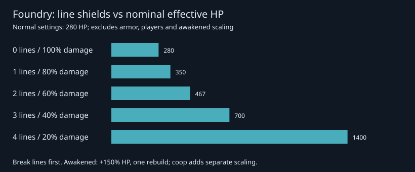
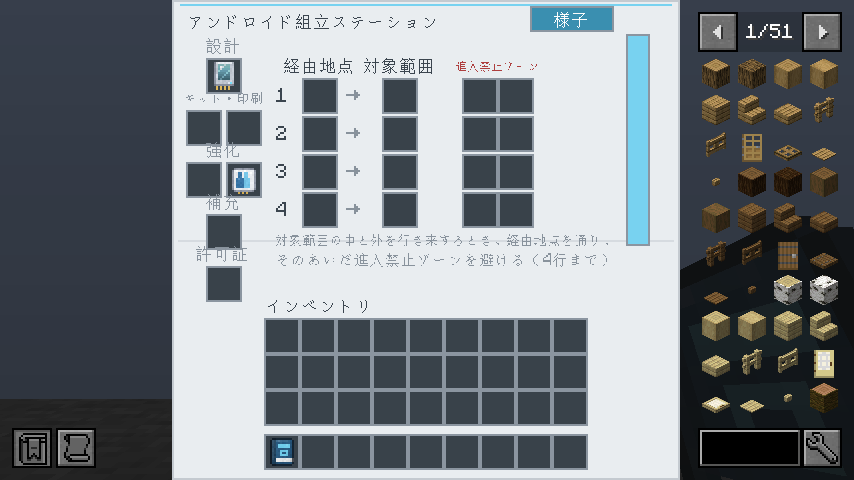
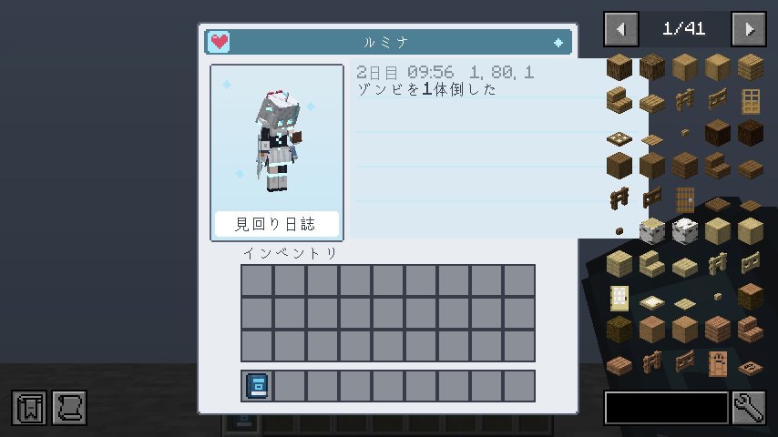

# 0.8.0 → main 統合レビュー

PR: [#27](https://github.com/GenichiMaruo/Singulo/pull/27)。基準mainは `8563d4b`、初回headは `7bcaff7`。PR #26の第6段階だけでなく、第1〜6段階の全体を対象とする。マージ・タグ作成・公開・1.20.1移植は今回行わない。

## 修正した問題

新規の `ReleaseReadinessGameTests` で、修正前の実サーバーに対して4件とも失敗を確認し、修正後の通常20TPSで全11件（既存7＋追加4）が成功した。

1. **P1 作業予約の取り残し**: 完了した注文の余りを持ったまま次の注文を探す際、素材取得のない作業まで借りて捨てていた。着手しない貸出を `DEFERRED` で解放し、工程の `inProgress` も戻す。
2. **P1 片付け中のアイテム消失**: 収納前の運搬品はインベントリ外にあり、死亡で失われた。破棄・死亡時にだけ一度ドロップする。読み込み解除時はNBTへ保存する既存動作を維持する。
3. **P2 着座時の埋まり**: 階段などの種類だけで座れると判定していた。実際に座る位置へ体の当たり判定を移して空間を確認し、選択後に塞がれた場合も着座直前に拒否する。椅子でない全ブロックへ衝突検査を増やさない。
4. **P2 巡回報告の二重計上**: 同種の討伐をまとめても未報告件数を増やし、過去の別行まで集計していた。未報告件数を行単位に統一し、報告後の討伐は新しい行にする。

バージョン番号は作者の確認を受けて0.7.0→0.8.0へ変更。READMEのJava説明を現行設定へ合わせた。問題一覧は [issue.md](../../issue.md) に追記し、既存の移植時の未解明事項は維持した。

## ゲームバランスと導線

mainの既存243レシピは変更なし、追加は6件。装置の基本速度・電力倍率・既存ティアの素材は維持されている。実績の親子関係は案内であり、レシピ解禁の追加条件ではない。新研究所の攻略を既存工業の必須条件に変更するものではない。

以下は20TPS・標準倍率・加速や省電力アップグレードなしの計算。`energy` はFE/tなので総電力は `time × energy`。

| 追加 | ティア | 時間 | 電力 | 工程単体の総電力 | 位置づけ |
| --- | --- | --- | --- | --- | --- |
| 範囲カード4枚 | 作業台 | 手作業 | 0 | 0 | レッドストーン2＋セラミック基板1＋基礎回路1。経路設定のやり直しを重くしない |
| 測量メガネ | 作業台 | 手作業 | 0 | 0 | 鉄3＋板ガラス2＋基礎回路1。表示補助で技術解禁を迂回しない |
| ガスタンク強化 | 2 | 6秒 | 100 FE/t | 12,000 FE | Mekanismの基礎ケミカルタンク＋オスミウム2＋鋼板2＋基礎回路1 |
| 液体・ガスタンク強化 | 2 | 8秒 | 200 FE/t | 32,000 FE | 液体用・ガス用を各1消費。両方運べる代わりに各タンク容量は半分 |
| 工場式印刷ユニット | 4 | 8秒 | 100 FE/t | 16,000 FE | アクチュエーター3＋キット2＋基礎回路2＋超伝導コイル2。探索素材と工業を両方使う |
| 覚醒の製造核 | 5 | 40秒 | 100,000 FE/t | 80,000,000 FE | ホーキング凝縮物1＋アクチュエーター2＋エキゾチック物質2。攻略後の再戦 |

ガスタンクは2基×32,000 mB、複合型は液体2基・化学物質2基それぞれ16,000 mB。兼用型に容量上の交換条件があり、完全上位互換ではない。Mekanism非導入時は該当2レシピを条件で除外し、実績コンプリートにも要求しない。

工場式印刷ユニットは印刷40,000→20,000 FE、印刷60→30tick、再印刷待ち100→50tick、待機修理2倍。初回だけでなく損耗後の回復を楽にする報酬で、部品・キットの支出とボス攻略が先に必要。16,000 FEという組立工程だけの電力は1回の印刷差額以下だが、素材加工の総電力・探索時間を含む回収期間ではない。

ファウンドリは通常設定でHP280（高難度設定は380）、装甲8。ライン4本時の被ダメージ倍率は0.2で、ラインを放置した防御前換算HPは1,400。破壊すると0.4→0.6→0.8→1.0へ戻る。

アームは予告2秒・最後0.8秒は狙いを固定、プレスは1.3秒予告、レーザーは1.5秒予告後3秒で旋回し跳躍で回避可能。通常設定の基礎ダメージは7／9／6。レーザーは同一照射中の重複命中を防ぎ、プレスと同時発動しない。量産機は同時4体まで、工場製個体は通常ドロップを持たない。覚醒版は標準でHP2.5倍、与ダメージ1.5倍、ライン再建は一度だけ。協力人数による補正は別に加わる。

通常討伐の部品3〜4個とキット1〜2個は、印刷ユニットの部品3・キット2に近い。キットだけ不足する場合は既存の製作で補える。試作機のメモリはプレイヤーごとの既受領型を保存し、未受領型を優先するため、報酬対象として2回倒せば両型がそろう（死亡で履歴を失わない）。

ノクスは光線2回＋斬撃1回の通常周期で公称3.75ダメージ/秒、半減後約4.77。斬撃は別枠で加算しない。射程12・予告あり・壁で停止するので、射程18の光線に対して利点と制約がある。前回資料の「25.71 FE/秒」「32.73 FE/秒」は**内部充電単位/秒**の誤記だった。増設なしの満充電2,800に10,000 FEを要するので、それぞれ約91.84／116.88 FE/秒相当（端数・充電経路・空振り等を除く）。資料を訂正し、実装の消費は変えていない。

「探索と工場づくりを両立する中程度」の方向に対して、今回の差分に既存の進行を飛ばすレシピや電力増殖は確認していない。ボスのライン破壊を無視した場合の硬さと、研究所の探索時間は通しプレイで調整余地がある。今回は他modとの実測速度比較や通しプレイを行ったとは扱わない。

## 検証記録

- 修正前: 新規4件の失敗を実サーバーで確認。修正後: 通常20TPSの関連11件成功。
- 実Mekanism 10.7.19.85: 非導入時と導入時を分離。導入時の専用1テストで実タンクの在庫・面別の出し入れ、SIMULATEの非破壊性、運搬タンク容量、NBT再読込、資材口への返却で量を保存することを検証。
- 実クライアント＋JEI: 20画面の撮影、巡回ボタンのサーバー反映、経路ページ切り替え、記録ページの日英表示と854×480での収まりを検証。インベントリの実PNGで35点×3画面を検査。CIでも同じ検査を行う。
- 翻訳、モデル0問題、73実績の整合、空の支援者名簿を検査。
- 通常ビルドと全348件の必須GameTestが成功（200TPS、テスト38.68秒、ビルド込み約1分2秒）。製品JAR `Singulo-0.8.0-1.21.1N.jar` に開発ハーネスが含まれないことを確認。CIに任意Mekanism構成の独立ジョブを追加し、最終headの結果はPRの最終レビューコメントへ記録する。

第6段階のビット演出・実績表示の実クライアント記録は [前回検証](0.8.0-stage6.md) を参照。今回のGUI smokeだけで戦闘全演出を再確認したとは扱わない。研究所の多数シードの接続検証、機構・ボスの技・再戦・保管庫解放は既存GameTestを含めて再実行する。全ティア通しプレイ、大規模稼働の負荷試験、他modの全装置構成は未網羅。

## 取り込み中に追加されたコミットの再レビュー

初回レビュー中に `a9b45c2`（ビットが12tickで背中へ戻る表示）が追加されたため、内容を保ってマージした。攻撃の威力・消費・判定は変更されていない。
追加表示では展開数が0になると画面外判定が本体だけへ戻り、本体が画面外・帰還中のビットが画面内という場面で表示が消える。帰還中の数も描画範囲へ含める修正を追加する。
専用の実クライアント検証に、帰還の開始・終了と、本体だけを除外する視錐台条件で帰還ビットを描くことの判定を加えた。修正前後の結果はPRへ記録する。

GUIの抜粋（854×480、日本語）:

| 経路 | 巡回記録 |
| --- | --- |
|  |  |
