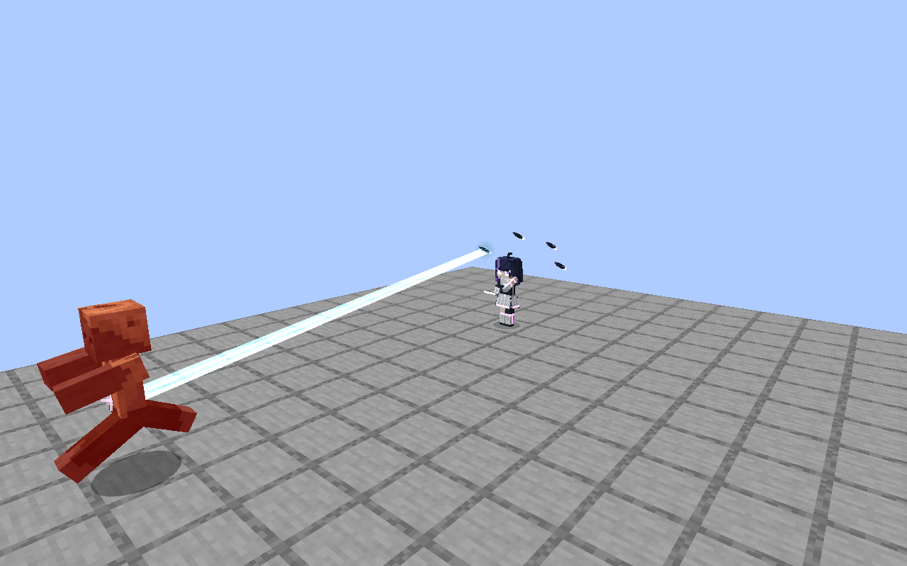
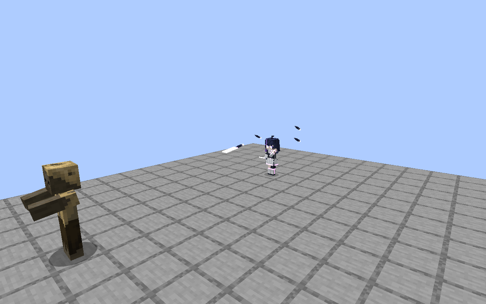
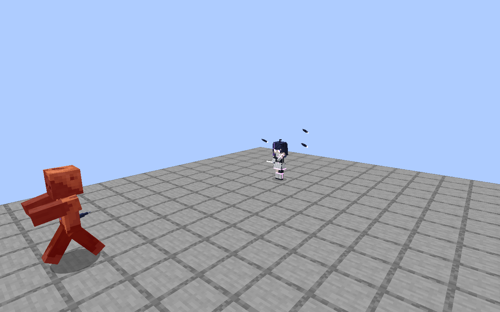

# 0.8.0 第6段階とビット改善の検証

対象: `feature/0.8.0` の第5段階 `55c58d1` からの変更。main `8563d4b` の知見共有はマージで取り込んだ。バージョン番号・レシピ・消費電力設定・製品のティアは変更していない。

## 変更

- ノクスのビットをワールド座標で追従させ、本体の歩行・旋回へ少し遅れて追いつくようにした。別エンティティ・独立した当たり判定は作らない。
- 光線の3回に1回を、先端の光刃を伴う突進斬撃へ置き換える。4tick予告・8tick往路・12tick帰還。狙いは開始時に固定され、横へ動いて避けられる。
- 壁、途中で置いた壁、味方、格納、充電切れ、一度の攻撃での重複命中を処理する。帰還中はダメージを与えない。本体が画面外でも、見えるビットは描画する。
- 射撃・斬撃の同期座標は整数の基準点と短いfloat差分に分け、遠方で小数精度を失わないようにした。
- 実績を54→73件へ拡張し、工業・探索・アンドロイドの導線として親子関係を見直した。旧IDと`done`を維持し、達成済み履歴を引き継ぐ。親の達成は発火の前提にしない。
- 通常ボスの討伐は報酬対象と同じ範囲の生存中の挑戦者へ付与。印刷・注文完了は持ち主／注文者だけへ付与し、ログアウト中なら次回ログインへ通知を保存する。
- 日英・簡体字・繁体字・韓国語とハンドブックを同じ定義に合わせた。Mekanismを実績コンプリートの必須条件に加えていない。

全体の木: [実績ツリーSVG](0.8.0-stage6/progression.svg)。開発段階6はゲームのティア6を追加する意味ではなく、ゲームのティアは1〜5のまま。

## ビットの戦闘バランス

| 条件 | 従来の光線のみ | 光線2回＋突進1回 |
| --- | --- | --- |
| 通常・公称ダメージ/秒 | 3.75 | 3.75 |
| 体力半減後・公称ダメージ/秒 | 約5.45 | 約4.77 |
| 通常・消費FE/秒 | 22.5 | 約25.71 |
| 体力半減後・消費FE/秒 | 約32.73 | 約32.73 |

計算は20TPS、通常の3発を48tick→56tick、半減後を33tick→44tickとして、光線3・突進4.5の防御前ダメージと、光線18・突進36の消費を合計した上限の目安。展開・短剣・移動・空振り・防御は含めない。

突進は射程12（光線18）で、予告と固定した狙いがある。狭い経路上の複数の敵へ当たる利点と、消費・命中までの時間・回避可能性を交換する。射撃へ別枠で追加する攻撃ではない。斬撃後は通常24tick／半減後22tick空け、相手の無敵時間で次の光線を失わないようにした。

## 検証

- 最終ソースの全344件の必須テストが成功（200TPS、通常ビルド込み1分11秒）。通常20TPSでも関連16件が成功し、その後追加した座標精度試験は全344件の実行に含む。PR上のCIと提出後のレビューは別途記録する。
- 通常20TPS: 光線、突進、途中の壁、味方、帰還、格納、戦闘AIの射撃間隔、実績のAND/OR条件・イベント・印刷／注文完了・オフライン復元を検査。
- `tools/check_advancements.py`: 73件の循環・孤立・段階逆転・アイコン・条件名・ハンドブック・5言語を確認。
- `tools/localization.py --check`、`tools/check_models.py`、`tools/check_supporters.py`。
- JEIありの実クライアント: 戦闘55フレームと実績3画面を撮影し、刃・突進・命中・追従と日本語表示を確認。画像はダメージ間隔・座標精度の自動テストとは別の表示確認。
- 通常ビルドのJARへ開発用の`GuiReviewHarness`・`Stage6ReviewHarness`が入らないことを検査。

表示の抜粋:

| 光線 | 突進中の先端の刃 |
| --- | --- |
|  |  |
| 命中後の帰還 | 本体の移動・旋回への追従 |
|  |  |

[実績の初期表示](0.8.0-stage6/advancements-start-ja.png)・[中間](0.8.0-stage6/advancements-middle-ja.png)・[終盤](0.8.0-stage6/advancements-end-ja.png)。全ノードはSVGで見渡せる。ゲーム内の通常の進捗画面はドラッグして見る。

## 検出・修正した問題

- 研究所のモデル検査7件: 発光面がブロック外へ0.01出ていた4件と、カプセルの不要なガラスの蓋が内部と重なる3件を、生成コードで修正。検査条件は緩めていない。
- 協力討伐の試験: `makeMockServerPlayerInLevel()`は`isCreative()`が常にtrueのため、サバイバルの条件を確かめる試験には使えなかった。接続済みの通常の`ServerPlayer`へ変更し、クリエイティブを除外する条件は維持。
- 既存の転送試験: 印刷済み個体がない時点で`get(0)`を呼んで失敗した。転送に無関係な歩行・落下を止め、印刷済みの個体を待ってから倒す。2キット、持ち物5個、再印刷・ドロップなしの判定と400tickの上限は維持。
- 斬撃と次の光線の無敵時間の干渉・遠方座標のfloat丸め: 上記の実装と回帰試験で対処。

これは全ティアの通しプレイや他Mod全構成の検証完了を意味しない。1.20.1で記録した毛刈り・応戦後のAI試験差異は別件で、今回解決したとは扱わない。

## 再現手順

```sh
python3 tools/check_advancements.py
python3 tools/localization.py --check
python3 tools/check_models.py
bash ./gradlew build runGameTestServer
# 戦闘と実績だけを通常速度で検証する場合
bash ./gradlew runGameTestServer -PtestNamespace=singulo_prototype,singulo_progression -PtestTickRate=20
# 毎回使い捨てワールドで表示を確認
python3 tools/review/prepare_stage6.py
xvfb-run -a bash ./gradlew --no-configuration-cache -I tools/review/stage6.gradle runClient
# GUIハーネス付き起動の後は、配布物を通常ビルドし直す
bash ./gradlew build
```

既定のGameTestは従来の`singulo`に`singulo_prototype`・`singulo_progression`を含む。Mekanismの専用群は従来どおり任意。PR検証を`feature/0.8.0`宛てにも有効にし、新規ワールドで200TPSの全体検証と既存のGUI検証を実行する。
