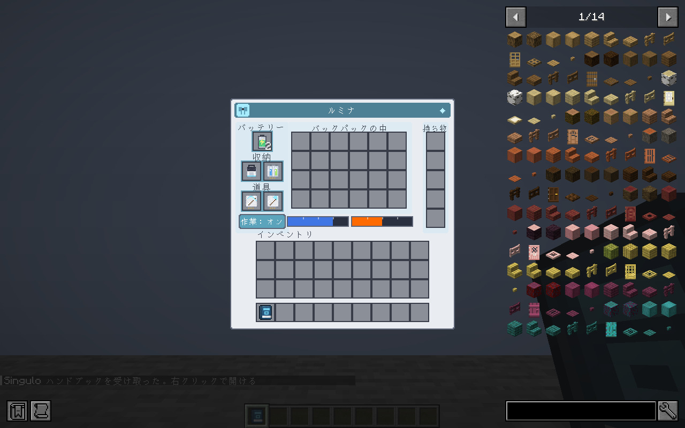
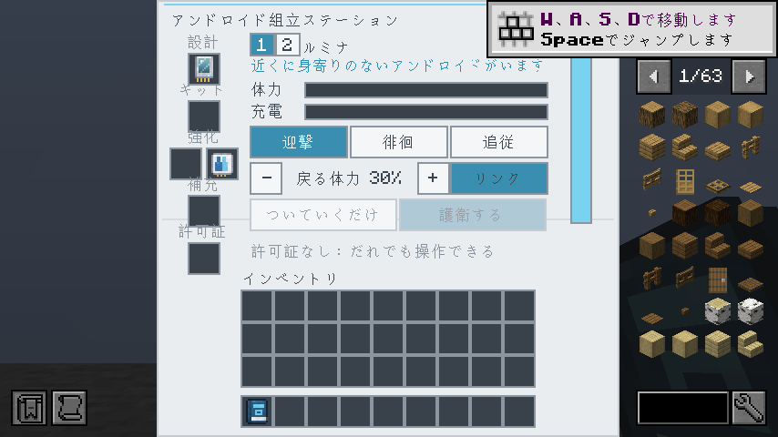
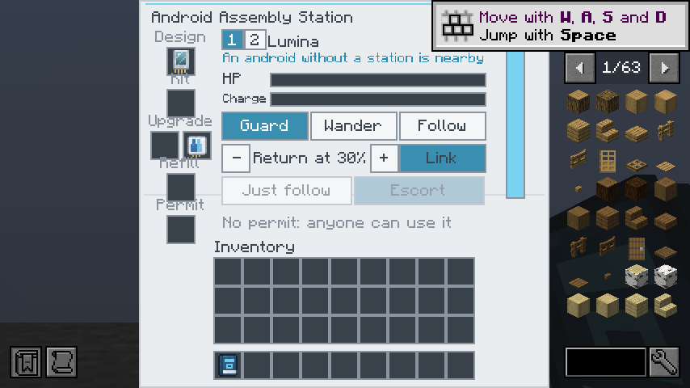
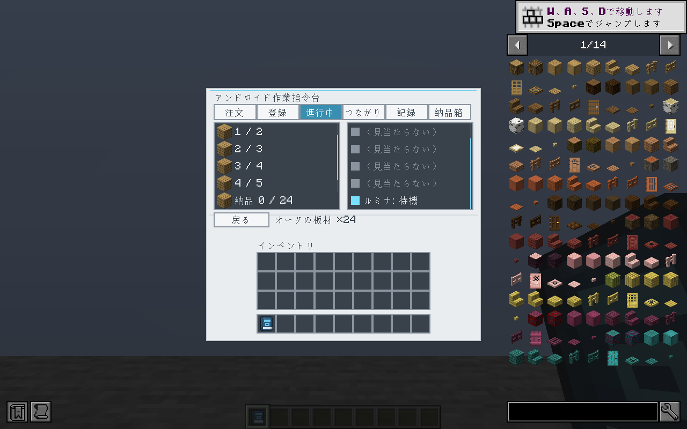
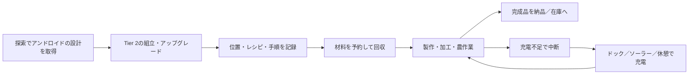

# PR #18 最終レビュー・修正報告

対象: [GenichiMaruo/Singulo PR #18](https://github.com/GenichiMaruo/Singulo/pull/18)  
初回: `05cb393f29838f95e9b8859d6d3933fc4b382e4a`  
実行確認済み: `cf03a36c3492b1544fcde76313c253aa215d64ca`  
環境: Minecraft 1.21.1 / NeoForge、Java 21、既定の基本値  
評価方針: 探索と工場づくりを両立する中程度の難易度

## 判定

**見つかった不具合を同じPRで修正し、再レビューした。現時点で確認済みの未修正ブロッカーはない。マージ操作は行っていない。**

[検証ログ・成果物](https://github.com/GenichiMaruo/Singulo/actions/runs/38625417378)で、ビルド、**302/302件の必須GameTest**、実クライアントによる**15画面のGUI検査**が成功した。修正後の小画面の日本語・英語表示も目視確認した。最後の整理コミットには、不要な副産物の排出を防ぐゼロ件チェック、テストのドロップ位置の隔離、報告書と画像の保存を含む。最新HEADの実行結果と最終判断は[PRのチェック](https://github.com/GenichiMaruo/Singulo/pull/18/checks)およびレビューコメントで確認できる。

通しのサバイバルプレイを完了した評価ではない。全操作・全環境で不具合がないという保証とは区別する。

## 修正した問題

| 問題 | 変更 |
| --- | --- |
| 充電不足でも加工バッチ全体を投入する | 未払いの1回分の充電を確認し、充電切れで停止 |
| 製作後の充電不足で最後の1回の進みを確定しない | 製作前に充電を確認し、製作済みの回数を必ず確定 |
| 採掘・伐採・収穫・牧場作業の最後の1回を充電不足でも実行する | 消費のある行動に開始前の充電確認を追加 |
| 分割納品の再試行が元の納品数を上限に使う | 作業ごとの未納品数を保持し、取消時も残数だけを解放 |
| 繁殖で後続手順用の餌まで消費する | 手順に記録した餌の数×実行回数を上限にする |
| USEの繰返し回数が常に1回 | 製作回数分だけ操作する |
| 伐採の根元以外が保護イベントを通らない | 対象ブロックごとに破壊可否を確認 |
| レバー・ボタン・牧場操作が保護判定を迂回する | 注文者のFakePlayerで右クリック／動物操作／攻撃イベントと自MODのシールド判定を確認 |
| 流体の製作数が見本アイテムの個数になる | outputKey / outputCountでmBを計算 |
| 再読込で消費・製作済みの進みを失う | 作業、割当て、製作・投入・回収・手順・受取途中を保存 |
| 転送・再印刷で作業用の荷物まで持ち主の私物になる／流体を失う | 私物のスロット区分・作業途中・タンクを引継ぎ |
| 未読込の個体から作業を取り上げ、消費済み工程を再実行する | 未読込中は再割当てせず、取消または復帰を待つ |
| 複数材料の個別SIMULATEを全量投入の保証と扱う | 実際の投入数と残りを保存し、再試行や再読込で再投入しない |
| 古い対象・数量の計画で開始できる | 現在の対象と数量に一致する計画だけを使う |
| 詳細画面が持ち物クリックを妨げる／長い詳細が切れる | 持ち物操作を通し、工程と作業員に独立したスクロールを追加 |
| 数量欄が変換できない数字文字を受け付ける | ASCII数字に制限 |
| 許可取消後もリンク先の棚・納品口が使える | 画面を開く時、操作時、開き続ける条件で指令台の権限を再確認。無権限の付替えも拒否 |
| 破壊済み指令台へのリンクが棚・納品口をロックする | 読込済み位置に指令台が存在しなければ古いリンクを解除。未読込時は権限確認を安全側で止める |
| 装備・装飾タブでプレイヤー持ち物の背景が消える | ページ分岐より先に共通のスロット背景を描画・確定 |
| 溶岩タンクが白く描かれる | 画面と装着タンクの溶岩をオレンジで描画 |
| 高さ254のステーションが854×480・GUIスケール2で切れる | メニューと表示・クリック座標を高さ240に収め、タイトルからホットバーまで表示 |
| 副産物で荷物が埋まると目的の品を落として取得済みに数える | 私物・工程材料・完成品を保護して目的の品を優先し、保持できた数だけ進捗に加算。装置からは持てる分だけ取り出す |
| WindowsのローカルJDK絶対パスが他環境のビルドを阻害 | Gradleの固定パスを削除し、Java 21のtoolchain / JAVA_HOMEを使う |
| 応戦テストが個体の初回tick前に攻撃して不安定 | 個体のtick開始を待って攻撃し、応戦と納品再開を同じ必須テストで確認 |

未読込の個体の注文は、復帰または指令台からの取消を待つ。転送できない死亡では、読込済みの指令台の注文を取り消し、消費済み工程の二重実行を防ぐ。

荷物満杯では、目的の品のために不要な副産物を足元へ落とすことがある。私物や必要材料は退避の対象にしない。これは無制限の搬送を可能にする変更ではなく、実際に運べていない品の完了計上を防ぐ変更。

## 検証結果

| 検査 | 結果 |
| --- | --- |
| Java 21のbuildとGameTestServer | 成功。完了ログで302件・全required成功を確認 |
| 翻訳検査 | zh_cn / zh_tw / ko_kr 各2,302項目で成功 |
| モデル検査 | 問題0件 |
| 配布JAR | 生成成功。開発用GuiReviewHarnessが混入していないことも検査 |
| 実クライアント | JEIあり、Xvfb、実際のMinecraftクライアントで15枚を撮影 |
| プレイヤー持ち物背景 | 状態・装備・装飾の3ページで、出力PNGの空き35枠の中心画素を独立検査して成功 |
| 詳細のスクロール | 6工程・6作業員行のUI用データで左右の独立スクロールを検査 |
| 小さい画面・言語切替 | 854×480・GUIスケール2、日本語・英語。読込オーバーレイ消失後に撮影し、画面の寸法も検査 |

15画面: 状態、装備、装飾、組立ステーション、注文、記録の製作・加工・手順、注文確認、レシピ棚、納品口、長い詳細とスクロール後、小画面の日本語・英語ステーション。

詳細の6作業員行は表示検査用の合成データで、6体を同時に稼働させた実プレイ結果ではない。画面の起動・ページ切替・スクロール等を自動操作したが、ドラッグ、Shift移動、全ツールチップや全ての権限変更を手動操作で網羅したわけではない。

## 回帰テスト

元の294件に、次の8件を追加して302件とした。既存の応戦テストも、検査を任意化せずに実行順の前提を修正した。

1. `partialDeliveryKeepsSurplus`: 部分納品と指令台再読込で余剰を届けない。
2. `fluidPlanUsesMillibuckets`: 1,500 mBの注文に対する2,000 mB製作・500 mB余剰。
3. `processingStopsWhenChargeRunsOut`: 充電10で原鉄3個のうち1個だけ投入。
4. `androidResumesCraftAfterReload`: 製作途中で個体・指令台を保存／読込し、追加素材なしで棒8本を納品。
5. `transferredWorkKeepsPersonalSlotsAndFluids`: 私物区分・作業の荷物・流体を転送時に保持。
6. `processingRemembersPartialInputs`: 複数材料の一部投入後に保存／読込しても二重投入・二重課金しない。
7. `workLinksEnforcePermissionChanges`: 許可取消、無権限の付替え、破壊済み指令台のリンク解放。
8. `workOutputSurvivesFullCargo`: 副産物で満杯でも目的品を保持し、私物と必要材料を守る。持てない装置出力は残し、落とした品を進捗に数えない。

保存／読込テストにはNBTの書出しと再読込を使うものがあり、OSプロセスの強制終了や全てのチャンク読込順を再現したものではない。

## バランスの計算

20 TPS、移動・充電場所への往復・装置側の待ち時間を除いた理論値。充電1回は基本電池2,800、ドックでは100 tickで充電し10,000 FE消費。充電量1あたり約3.571 FEとなる。電力以外の充電手段を使う場合は、このFE換算は適用しない。

| 指標 | 基本値 |
| --- | ---: |
| 作業台での製作 | 40 tick/回、充電10/回 |
| アンドロイド作業台での製作 | 10 tick/回、充電10/回 |
| 基本電池での製作 | 280回 |
| バッテリー2個での製作 | 560回 |
| 製作1回のドック充電換算 | 約35.7 FE |
| 通常作業台で連続製作→充電 | 560秒製作＋5秒充電、約0.496回/秒 |
| 専用作業台で連続製作→充電 | 140秒製作＋5秒充電、約1.931回/秒 |
| 採掘 | 充電6/ブロック、約21.4 FE/ブロックの単純換算 |
| 伐採 | 充電24/木、約85.7 FE/木の単純換算 |
| 運搬枠 | 5 → バックパック付き29、5.8倍 |
| 64個スタックの理論運搬量 | 320 → 1,856個 |
| タンク | 32,000 mB×2種類 |

バッテリーは容量を増やし、充電速度そのものは増やさない。2個装備時はドックで満充電まで約10秒・20,000 FE。無電力のソーラー／休憩充電も存在するため、工場全体の電力負荷の主役は加工装置側になる。アンドロイドの作業回数と、完成品の個数は別で、板材4枚のレシピなら1回の製作で4枚できる。

### 導入コスト

以下は速度・電力補正やアップグレードを掛ける前のレシピ定義の値。実際の装置ではサーバー設定の速度・電力倍率等が適用される。

| 追加物 | 段階 | 時間 | FE/t | time×energy |
| --- | ---: | ---: | ---: | ---: |
| 作業指令台 | 2 | 200 tick | 100 | 20,000 FE |
| 生産・採掘・伐採アップグレード | 2 | 160 tick | 100 | 16,000 FE |
| バッテリー・バックパック・タンク | 2 | 120 tick | 100 | 12,000 FE |

採掘・伐採にはダイヤの道具、鋼板、超電導コイル、回路が必要。作業指令台にもコイル等が必要で、Tier 2の基盤づくりを飛ばす導入にはなっていない。製作は実際の作業台レシピで照合し、加工は実在する装置へ材料を渡すため、レシピカードだけで上位加工を生成する仕組みではない。

### 評価と改善候補

探索で設計を得て工場の作業を任せる方向性に合う。基本電池でも専用作業台で2分20秒連続製作でき、電力が厳しい自動化というより、移動経路と在庫・工程の設計を楽しむ寄りの設定。今回の充電切れ後の無制限投入は、この前提を壊す明確な不具合なので修正した。

伐採は最大256原木まで探索する一方、木1本の消費が充電24で固定されている。小木と巨木の収益差が大きい。中程度の難易度なら「基本料金＋実際に切った原木数に比例する料金」を設定可能にする案が有用。バランス方針に関わるため、今回この数値は変更していない。

バックパックは5.8倍の運搬容量を1段階で得る。小規模な工場には便利で、移動する個体の数を抑えられる利点もある。伸び方を段階的にしたければ12枠→24枠の2段階化が候補。ただし、現在の値が即座にゲームを破綻させるという根拠はない。

他MODと数値を直接比較するには、対象バージョン・設定・チャンク読込・道具消耗・搬送距離の条件をそろえる必要がある。今回はそれらを検証していないため、他MODと同程度と断定していない。

## 残る確認範囲

- 長時間の通しプレイ、複数プレイヤー、大規模な経路・注文・チャンク境界の負荷。
- 個体と指令台が別々にチャンク読込されるケース、保存して終了してからの再起動、未読込状態での死亡等の組合せ。
- 他の保護MODとの組合せ。NeoForgeイベントと自MODのシールド判定は修正したが、他MODの実環境までは検証していない。
- GUIスケール3/自動、JEIなし、各種描画MOD・実機GPUの組合せ。

これらは検証範囲の限界であり、現在再現している未修正不具合として数えない。任意のバランス改善案も含めて[issue.md](../../issue.md)に集約した。
