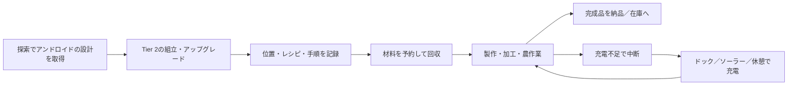

# PR #18 レビュー・修正報告

対象: [GenichiMaruo/Singulo PR #18](https://github.com/GenichiMaruo/Singulo/pull/18)  
初回確認: `05cb393f29838f95e9b8859d6d3933fc4b382e4a`  
対象環境: Minecraft 1.21.1 / NeoForge、既定の基本値  
評価方針: 探索と工場づくりを両立する中程度の難易度

## 判定

**実装上の指摘を修正して再レビューしたが、マージ承認は保留。**

このセッションにはシェル・Java・Minecraftを実行するツールがなく、ビルド、GameTest、実画面の確認を実施できていない。GitHub経由でソース・差分・コミットを確認し修正した。元PR本文の「ビルド成功」は作者による修正前の結果であり、今回の追加コミットの成功を保証しない。元の全294件のGameTestも完走未確認で、追加した回帰テスト6件も未実行。

## 修正

| 問題 | 変更 |
| --- | --- |
| 充電不足でも加工バッチ全体を投入する | 未払いの1回分の充電を確認し、充電切れで停止 |
| 製作後の充電不足で最後の1回の進みを確定しない | 製作前に充電を確認し、製作済みの回数を必ず確定 |
| 採掘・伐採・収穫・牧場作業の最後の1回を充電不足でも実行する | 消費のある行動に開始前の充電確認を追加 |
| 分割納品の再試行が元の納品数を上限に使う | 作業ごとの未納品数を保持し、取消時も残数だけを解放 |
| 繁殖で後続手順用の餌まで消費する | 手順に記録した餌の数×実行回数を上限にする |
| USEの繰返し回数が常に1回 | 製作回数分だけ操作する |
| 伐採の根元以外が保護イベントを通らない | 対象ブロックごとに破壊可否を確認 |
| レバー・ボタン・牧場操作が保護判定を迂回する | 注文者のFakePlayerで右クリック／動物操作／攻撃イベントと自MODのシールド判定を確認 |
| 流体の製作数が見本アイテムの個数になる | outputKey / outputCountでmBを計算 |
| 再読込で消費・製作済みの進みを失う | 作業、割当て、製作・投入・回収・手順・受取途中を保存 |
| 転送・再印刷で作業用の荷物まで持ち主の私物になる／流体を失う | 私物のスロット区分・作業途中・タンクを引継ぎ |
| 未読込の個体の作業を取り上げて消費済み材料を再要求する | 未読込中は再割当てを止め、取消操作または復帰を待つ |
| 複数材料の個別SIMULATEを全量投入の保証と扱う | 実際に入った数と未投入の残りを保持し、途中の再読込でも再投入しない |

未読込の個体の作業は指令台の取消操作で解放できる。転送できない死亡では、読込済みの指令台の注文を取り消して消費済みの工程を別個体に再実行させない。保護MODごとのイベント処理の違いまでは実環境で未検証。

## GUIのコード確認と修正

- 作業指令台: 256×236、組立ステーション: 254×254、アンドロイド: 210×216。
- 数量入力・計画の対象と個数・詳細画面のクリック伝播・スロット種別・ページ切替・描画ループを確認。
- 計画の対象と個数が現在の入力と一致してから開始を許可し、古い応答で有効化しない。
- 数量入力はASCII数字だけにする。
- 注文の詳細を開いている間も、下のプレイヤー持ち物をクリックできる。
- 詳細の工程は最初の4件、作業員は最初の5人までしか表示されなかったため、左右別々のスクロールとスクロール位置の表示を追加。
- 装飾・タンク・採掘道具のレンダラーと画面登録をソースで確認。

**スクリーンショットを使った目視検査、実際のマウス操作、最小解像度、多言語の文字幅、半透明の重なり、JEIとの配置は未検証。** コードの座標確認をGUI動作確認の代わりにはしていない。高さ254の画面は320×240のGUI座標では収まらないため、GUIスケールも実機で確認する。

## バランスの計算

20 TPS、移動・充電場所への往復・装置側の待ち時間を除いた理論値。充電1回は基本電池2,800、ドックでは100 tickで充電し10,000 FE消費。充電量1あたり約3.571 FEとなる。電力以外の充電手段を使う場合は、このFE換算は適用しない。

| 指標 | 基本値 |
| --- | ---: |
| 作業台での製作 | 40 tick/回、充電10/回 |
| アンドロイド作業台での製作 | 10 tick/回、充電10/回 |
| 基本電池での製作 | 280回 |
| バッテリー2個での製作 | 560回 |
| 製作1回のドック充電換算 | 約35.7 FE |
| 通常作業台で連続製作→充電 | 560秒製作＋5秒充電、約0.496回/秒 |
| 専用作業台で連続製作→充電 | 140秒製作＋5秒充電、約1.931回/秒 |
| 採掘 | 充電6/ブロック、約21.4 FE/ブロックの単純換算 |
| 伐採 | 充電24/木、約85.7 FE/木の単純換算 |
| 運搬枠 | 5 → バックパック付き29、5.8倍 |
| 64個スタックの理論運搬量 | 320 → 1,856個 |
| タンク | 32,000 mB×2種類 |

バッテリーは容量を増やし、充電速度そのものは増やさない。2個装備時はドックで満充電まで約10秒・20,000 FE。無電力のソーラー／休憩充電も存在するため、工場全体の電力負荷の主役は加工装置側になる。アンドロイドの作業回数と、完成品の個数は別で、板材4枚のレシピなら1回の製作で4枚できる。

### 導入コスト

以下は速度・電力補正やアップグレードを掛ける前のレシピ定義の値。実際の装置ではサーバー設定の速度・電力倍率等が適用される。

| 追加物 | 段階 | 時間 | FE/t | time×energy |
| --- | ---: | ---: | ---: | ---: |
| 作業指令台 | 2 | 200 tick | 100 | 20,000 FE |
| 生産・採掘・伐採アップグレード | 2 | 160 tick | 100 | 16,000 FE |
| バッテリー・バックパック・タンク | 2 | 120 tick | 100 | 12,000 FE |

採掘・伐採にはダイヤの道具、鋼板、超電導コイル、回路が必要。作業指令台にもコイル等が必要で、Tier 2の基盤づくりを飛ばす導入にはなっていない。製作は実際の作業台レシピで照合し、加工は実在する装置へ材料を渡すため、レシピカードだけで上位加工を生成する仕組みではない。

### 評価と改善候補

探索で設計を得て工場の作業を任せる方向性に合う。基本電池でも専用作業台で2分20秒連続製作でき、電力が厳しい自動化というより、移動経路と在庫・工程の設計を楽しむ寄りの設定。今回の充電切れ後の無制限投入は、この前提を壊す明確な不具合なので修正した。

伐採は最大256原木まで探索する一方、木1本の消費が充電24で固定されている。小木と巨木の収益差が大きい。中程度の難易度なら「基本料金＋実際に切った原木数に比例する料金」を設定可能にする案が有用。バランス方針に関わるため、今回この数値は変更していない。

バックパックは5.8倍の運搬容量を1段階で得る。小規模な工場には便利で、移動する個体の数を抑えられる利点もある。伸び方を段階的にしたければ12枠→24枠の2段階化が候補。ただし、現在の値が即座にゲームを破綻させるという根拠はない。

他MODと数値を直接比較するには、対象バージョン・設定・チャンク読込・道具消耗・搬送距離の条件をそろえる必要がある。今回はそれらを検証していないため、他MODと同程度と断定していない。

## 追加した回帰テスト

1. `partialDeliveryKeepsSurplus`: 箱の空きが1個ずつの場合と指令台の再読込で、余剰を納品しない。
2. `fluidPlanUsesMillibuckets`: 1,500 mBを注文し、2,000 mB製作・500 mB余剰と表示する。
3. `processingStopsWhenChargeRunsOut`: 充電10で原鉄3個のうち1個だけ投入する。
4. `androidResumesCraftAfterReload`: 原木1本から棒8本を作る途中で個体・指令台を保存／読込し、素材の追加なしで完了する。
5. `transferredWorkKeepsPersonalSlotsAndFluids`: 転送で私物を除外し、作業の荷物と流体を保持する。
6. `processingRemembersPartialInputs`: 1枠へ2種類を順に投入し、途中の保存／読込でも投入済み材料を再要求・二重課金しない。

これらは追加したコードの説明であり、成功の記録ではない。

## マージ前に必要な確認

[issue.md](../../issue.md) に未完了の実行確認と、今回の指摘の状態を集約した。
