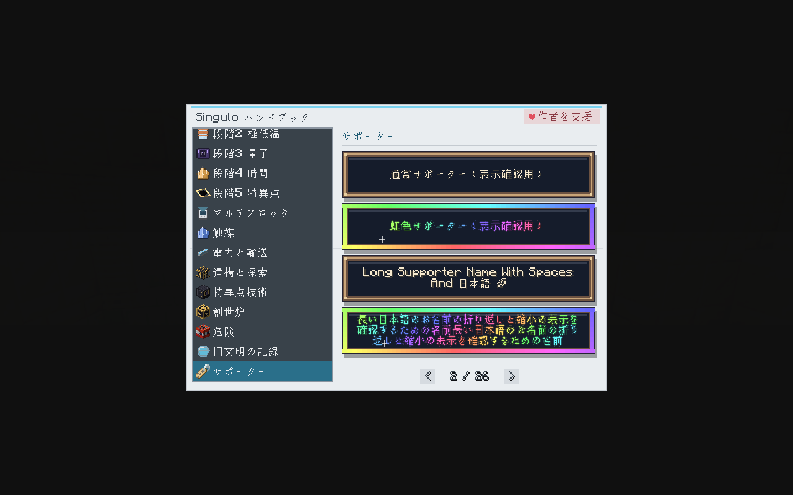
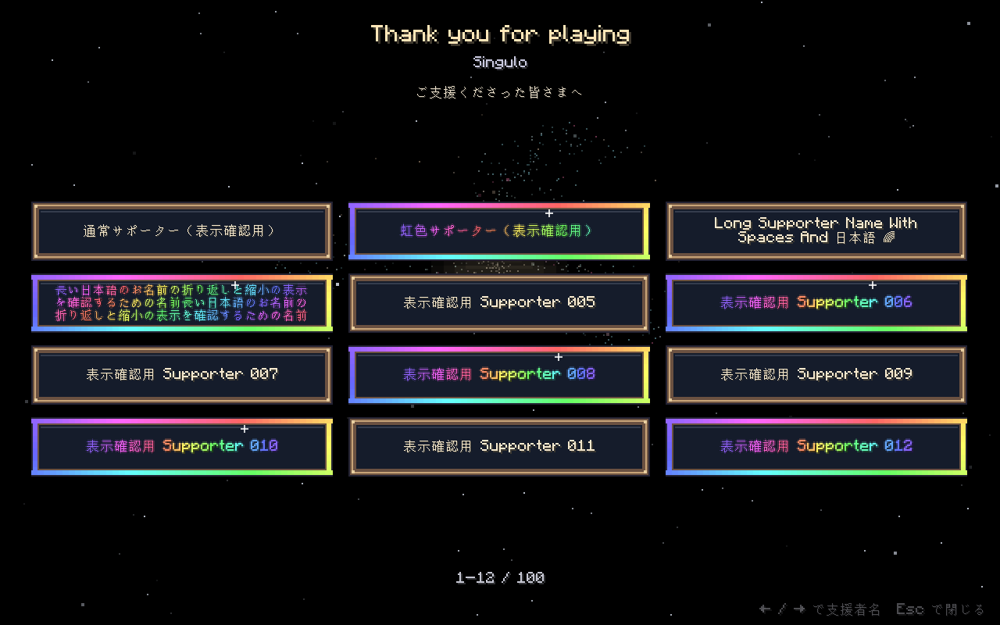

# Ko-fi サポーター名簿の管理

攻略本の「サポーター」章と、創世後のエンディングは同じ名簿を使用します。
現時点では掲載名が未定のため、名簿は空です。バージョン番号は変更していません。

## 名前を追加する

`src/main/resources/assets/singulo/supporters.json` の `supporters` 配列に追加します。
以下は記入例です。実在の支援者として登録されている名前ではありません。

```json
{
  "supporters": [
    {"id": "supporter-001", "name": "掲載を希望する名前", "tier": "standard"},
    {"id": "supporter-002", "name": "掲載を希望する名前2", "tier": "rainbow"}
  ]
}
```

- `standard`: 通常の額と名前。
- `rainbow`: 動く虹色の額縁と、虹色にきらめく名前。
- 2種類を合わせて最大100名。配列の順番が掲載順です。先着順の確認は運営側で行います。
- `id` は重複しない公開用の管理番号です。英小文字・数字・`_`・`-` の1〜64文字を使ってください。
- `name` は本人が掲載に同意した表示名です。前後の空白を除いて1〜64文字。日本語や絵文字も使えます。制御文字と `§` による書式コードは使用できません。
- 同じ表示名の別人は、異なる `id` で登録できます。同じ人のプラン変更は既存の `tier` を変更し、枠を重複させないでください。
- メールアドレス、決済番号、Ko-fi の非公開情報は記入しないでください。このJSONは配布JARに含まれます。

追加後はリポジトリのルートで次を実行します。

```sh
python3 tools/check_supporters.py
python3 tools/localization.py --check
./gradlew build runGameTestServer
```

名簿は Ko-fi と自動連携せず、Mod の更新に含めて配布します。購入時の説明には掲載名の確認方法と、掲載される更新の予定を記載してください。

## ゲーム内の表示

攻略本には紹介ページと、4名ずつの額のページができます。名前が長い場合は折り返し・縮小し、マウスを重ねると名前全体と支援区分を確認できます。

名簿が空の間は攻略本に追加予定の案内を表示し、エンディングは従来のままです。
名前を登録すると、物語と「Thank you for playing」の後に支援者ページが始まります。
画面のサイズに応じて1〜12名ずつ9秒間表示し、最後のページは12秒間表示します。
← / → またはマウスホイールでページを切り替え、Esc で終了できます。ウィンドウサイズが変わっても、その時点で先頭の支援者を保持します。

どちらの画面も `assets/singulo/supporters.json` をリソースとして読みます。試験用リソースパックで差し替える場合、F3+T で再読み込みして画面を開き直してください。
壊れた名簿はログにエラーを記録し、空の名簿として扱うのでゲームを停止させません。

特典は表示上のクレジットのみです。アイテム、レシピ、電力、進行条件への変更はありません。

## 表示確認

以下は100名の**表示確認用名簿**で撮影した実際のクライアント画面です。配布用の名簿は空のままです。





Java 21 / NeoForge 21.1.256 でビルドと265件の必須GameTestを確認しました。
クライアントでは100人目までの移動、9秒後の自動ページ送り、画面サイズ変更後の残りの名前の表示も確認しています。
特殊な文字や絵文字の見た目は、Minecraft の使用フォントによって異なります。
